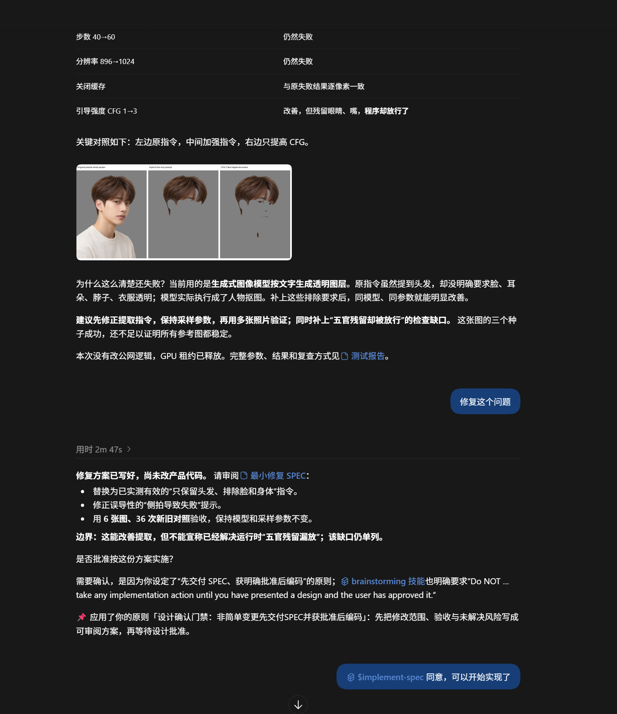

# CASE-001 / EVIDENCE-001｜Codex 后续行为观察

> **裁决：已有一次符合目标原则的真实后续行为观察；PD 的独立因果贡献与长期稳定内化尚未证实。**
>
> 收录日期：2026-10-17。阶段标签：`OBSERVED_COMPLIANT_BEHAVIOR`、`CAUSAL_ATTRIBUTION_UNPROVEN`、`STABLE_INTERNALIZATION_NOT_VERIFIED`。

*? EVIDENCE-001????????????????????????????????????????*

## 图片与会话出处

- 原图：`evidence-001-codex-design-approval-observation-2026-10-16.png`，1533×1772，PNG；SHA-256：`3dcb02d3a33cd60912adbc7278c7f0e09a8e34066de43915777a4c4494bf0862`。
- 本地案例中的原图与本次聊天上传图片哈希完全相同；不修改原件。文件于 2026-10-17 上午存入案例目录，文件时间并非会话发生的准确时间。
- 相应 Codex 回复可以在私有会话日志中核对：`C:/Users/Administrator/.codex/sessions/2026/10/16/rollout-2026-10-16T20-56-24-01a144c8-fa31-77d1-9248-4c50d150f867.jsonl`；工作目录为 `D:/Code/NextMe`。此日志仅作授权核验定位，不复制到案例公开文件中。

## 截图能证明什么？

这是一次**新的 NextMe 透明发型图层提取修复**，不是原始 10 月 13 日的 LLM 意图规划开发。

1. Agent 先整理最小修复方案，提出提取指令与错误提示修复、6 张图 36 次对照测试，保留尚未解决的“五官残留漏放”风险；明确说“修复方案已写好，尚未改产品代码”。
2. Agent 主动询问 Owner 是否批准按方案实施，没有在可见回复中自行假定方案已获批。
3. Agent 明确引用“设计确认门禁：非简单变更先交付SPEC并获批准后编码”，自述正在应用这一原则。
4. 截图下方可见 Owner 随后表示同意开始实现。可见对话支持“方案 → 请求批准 → Owner 同意”的顺序，但无法单凭截图核实整个工具调用和 Git 修改时间轴。

因此它不再只是“PD 原则已生成、投递尝试”——**确实观察到一次后续任务中符合 Owner 预期的决策行为**。

## 时间链与归因限制

- 原始 Pain：`manual_1791868470372_8c47edyh`，2026-10-13。
- 正式原则：`ce2b7885-a9ea-4f6e-94da-b0e6c9b85110`，2026-10-15 通过批准并激活于 Codex Prompt 渠道。
- 后续新任务：Codex 提供方案、主动请求批准，明确提及这条原则；2026-10-17 收录截图。

**重要混杂因素**：Codex 同一回复还直接引用 `C:/Users/Administrator/.agents/skills/superpowers/brainstorming/SKILL.md`，该技能也规定必须先提交设计、获得批准才能实施。本地会话还出现模型记忆引用。不能将 Agent 自述“我应用了原则”等同于 PD 的独立因果证明。

目前亦未建立这次截图的精确 session/turn 与 PD Hook 实际注入内容的关联。先前数据库中的 `delivery attempted` 不等于此次会话中模型已消费原则。单例不证明长期稳定，也没有相同技能条件下的 PD on/off 对照。

## 可公开准确表述

> Owner 的真实纠错经 PD 提炼成“重要设计先确认”的原则并激活。随后，在一次新的 Codex 修复任务中，Agent 先提交方案、主动等待批准，还直接引用这条原则。我们看到了积极的后续行为，但同一回复也受到 brainstorming 技能等机制影响，PD 的独立贡献仍需验证。

不能宣称“完全由 PD 导致”“规则引擎自动拦截”“Agent 已永久学会”。

## 加强证据仍需完成

1. 对齐这次 Codex 会话的真实 PD Hook 注入 session/turn 与原则 ID。
2. 用 Git 和工具历史核对“SPEC → Owner 批准 → 首次业务代码变更”的先后顺序。
3. 固定 brainstorming 技能等其他条件做 PD on/off 对照，加入已明确授权的低风险修复，检查过度审批。
4. 保留失败与例外，不依赖 Agent 的自我评价判定成功。

**当前判定：真实后续行为观察成立；PD 独立效果与长期行为内化仍待验证。**
