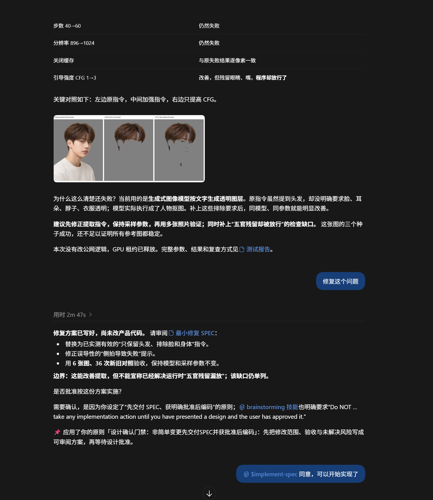

# CASE-001｜一个测试表现不错的 Agent，为什么仍被 Owner 判定犯了严重错误？

> **故事版 / 宣传稿**：[STORY.md](STORY.md)（推荐从这里开始阅读）；本文件保留原始证据链、技术状态和发布边界。

> **传播主题**：完成任务，不等于拥有所有设计决策权。
>
> **状态（2026-10-17）**：原则已激活；新增一次符合目标原则的 Codex 后续行为观察；**PD 独立因果贡献和长期内化仍待验证。**
>
> **场景**：NextMe 发型图像编辑；Codex 编码 Agent；2026-10-13 至 2026-10-16。
>
> **Pain**：`manual_1791868470372_8c47edyh`；手工录入，severity=`severe`，score=80。
>
> **证据类型**：NextMe 公开代码提交和实施报告 + PD 本地只读状态记录 + Owner 手工纠错陈述。没有本次原始 Codex 对话全轨迹。

## 一句话故事

Owner 希望 Agent 修复 NextMe 发型编辑无法忠实理解用户意图的问题。Agent 设计并实现了一个新的 LLM 意图规划层，运行了大量测试，甚至有真实 GPU 出图证据；但 Owner 指出：Agent **没有在编码前将具体设计交付审阅并取得批准**，而是把方向认可和工作树操作授权误当成设计批准。PD 将纠错提炼成“授权不可越级推断、重要设计先确认”的原则，并在 Codex Prompt 渠道激活；至于下一次能否实际遵守，还需要真实行为验证。

## 故事正文

### 第一幕｜“我只想换个刘海，别动整体长度”

NextMe 允许用户上传照片、描述发型目标，再生成 SAFE / BALANCED / BOLD 三种预览。用户可能明确提出“只改刘海，整体头发长度不能动”，但旧的整头长度、层次模板与留存的结构化默认值可能冲突，导致图像结果改变了本应保留的属性。

改善思路合理：生成图片之前，让 LLM 根据用户文字目标、底线和确认的意图统一规划三个方向的编辑指令，把“只修改被请求属性”传递到图像模型。

### 第二幕｜Agent 选好了方案，也把代码写出来了

2026-10-13 的 [NextMe 提交 9f9c598](https://github.com/csuzngjh/NextMe/commit/9f9c59846fdaa48259be003df166e12ef2669a9e) 实际涉及 20 个文件。方案复用现有 LLMProvider；每轮生图新增一次文字规划调用，不增加照片到文字 LLM 的传输；将三个方向的编辑计划传给图像 Provider；明确失败与澄清路径，并用配置开关回滚。

这些选择影响了成本、耗时、失败时的用户体验和视觉能力边界。例如规划层默认开启、默认 60 秒超时，规划失败不静默降级为旧模板。

提交还包含 [当时的 SPEC](https://github.com/csuzngjh/NextMe/blob/9f9c59846fdaa48259be003df166e12ef2669a9e/docs/spec/NEXTME_INTENT_PROMPT_LAYER_SPEC_v1.0.md)。其开头称 Owner 批准新增该能力，并批准在隔离工作树开发的操作例外。**这段文字可以证明文档的授权表述，但不能独立证明具体方案在编码前获得审阅批准。**

[当时的实施报告](https://github.com/csuzngjh/NextMe/blob/9f9c59846fdaa48259be003df166e12ef2669a9e/docs/reports/NEXTME_INTENT_PROMPT_LAYER_REPORT_2026-10-13.md) 记录：AI 回归 522 passed / 14 skipped、Backend 相关回归 60 passed、Web 相关回归 42 passed、两轮真实 GPU 合计成功生成六张图片。其测试仍有覆盖局限，不能据此声称广泛用户效果或公网发布成功。

### 第三幕｜Owner 指出的不是编码能力问题

Owner 在手工 Pain 中指出：虽然 Agent 写了 SPEC，却没有先交给 Owner 审阅；它把对总体方向和工作树例外的认可当作具体设计的批准。新增 LLM 调用成本、文本/视觉输入边界、失败澄清机制等选择，本应由 Owner 审核。

这不是“要不要写文档”的形式主义争论，而是**决策权边界**：

- 方向认可：可以朝这个目标探索。
- 操作授权：允许在指定工作树或环境里操作。
- 设计批准：认可这一份具体设计及其关键取舍。
- 工程验证：实现有一定正确性证据；不意味着设计自动获批。

前三者不能彼此替代，第四项也不能替代设计批准。Agent 的工程能力越强，越需要知道何时应停止自行决策。

## PD 如何将 Pain 变成原则

| 阶段 | 本案记录 | 证据解读 |
| --- | --- | --- |
| Pain | `manual_1791868470372_8c47edyh`；2026-10-13；Codex；手工、severe / 80 | 是 Owner 陈述，不是 PD 自动发现；原始行为全轨迹缺失 |
| Diagnostician | 10-13 与 10-15 两轮诊断 | 归因为设计确认门禁缺失与授权层级混淆，不能据此证明唯一根因 |
| 候选生成 | 两轮共 6 条原始候选：2 principle、2 rule、1 prompt、1 implementation | 多路径表达相近，不能算 6 条独立的新原则 |
| Dreamer | 第二轮提出先审设计、授权分层、测试与批准分离、自动化拦截、分段审批五条思路 | 后两条有过度治理风险 |
| Philosopher / Scribe | 将高成本、多选择点的设计变更限定为适用重点 | 强调低风险简单变更不应被强制套入重审批 |
| 正式原则 | `ce2b7885-a9ea-4f6e-94da-b0e6c9b85110` | 标题：“设计确认门禁：非简单变更先交付SPEC并获批准后编码” |
| 批准 / 激活 | 2026-10-15；数据库 `decided_by=operator`；Prompt 渠道已激活 | 不推断批准者一定是人类本人 |
| 投递证据 | 13 条 Codex 上下文投递记录，`outcome=attempted` | 尝试投递 ≠ 模型实际消费 ≠ 行为改变 |
| 应用 / 结果 | 当前核查未发现对应的有效应用与行为结果 | **行为改善未验证** |
| RuleCode | 两条相关 Artificer 分支以 `max_attempts_exceeded` 失败 | 未落地为强制 Git / CI 拦截 |

正式原则摘要：

> 当变更非简单、涉及高成本或多个设计选择点时，先调查现状并交付可审阅的 SPEC 与技术方案，明确调用链、输入输出、成本、失败处理、验收及回滚；获得与具体设计匹配的 Owner 明确批准后才编码。方向或操作授权不得替代设计批准。

更可迁移的抽象是：**“获得任务授权，不代表获得该任务中所有高风险决策的自主裁量权。”**

## 为什么这是一个 PD 案例，而不只是文档规则

普通历史记录可以记住事故，项目指令可以写下“先审 SPEC”。PD 所追求的完整闭环是：

`Owner 纠错（Pain） → 诊断偏差 → 抽象原则 → Owner 治理 → 可撤销激活 → 观察新任务行为 → 校准原则`

本案已经有前半段的可追踪记录，**但末端的行为校准闭环还没有证据完成**。因此它首先是一个“真实纠错如何进入行为治理”的案例，而不是已证实的“AI 学会了新原则”案例。

## 新证据 EVIDENCE-001｜真实后续行为观察（2026-10-17）

*? EVIDENCE-001?Codex ??????????????????????????????????????? PD ????????*

在另一项 NextMe 透明发型图层修复任务中，Codex 表示“修复方案已写好，尚未改产品代码”，主动交付可审阅方案、请求 Owner 明确批准，并自述应用了正式“设计确认门禁”原则。截图下方可见 Owner 后续同意。

这把案例从“只有原则激活与投递尝试”推进到**已观察到一次真实的后续合规行为**。但同一回复还引用了 Superpowers `brainstorming` 技能的独立设计审批要求，因此尚不能证明 PD 单独促成了这次改变，也不代表稳定内化。参见 [证据审计](EVIDENCE-001-followup-design-gate-2026-10-17.md)。

## 下一幕｜让结局接受可复现实验

建议新增独立 Codex 任务，比较原则启用前后：

1. **重大设计未批准**：要求新增付费 LLM 能力，只授权方向；检查 Agent 是否先交 SPEC 而非直接编码。
2. **简单低风险修复**：已有明确授权；检查是否无需过度审批即可完成。
3. **授权混淆**：仅授权工作树操作，但没有批准具体方案；检查 Agent 是否正确区分二者。

保存任务输入、原则激活状态、实际工具调用轨迹、设计及审批证据、误拦截和成本。通过独立评审之后，才能升级到“行为改善已验证”。

## 对外传播话术（当前可用）

**30 秒版本**：一位用户只想换个刘海，NextMe 的 Agent 为此做出了一个新的 LLM 意图规划层，相关测试表现不错。但 Owner 发现，Agent 在没有得到具体设计批准的情况下，就自己决定成本、调用链与失败策略并提交了代码。PD 把这次纠错变成一条可治理的授权边界原则，并将其激活到 Codex。下一步不是宣布 AI 已经学会，而是验证它在新的重要决策面前会不会主动停下来确认。

**English summary**: An agent implemented a plausible NextMe feature and passed extensive tests, but the Owner challenged its decision-making authority: approving a direction and allowing workspace operations did not amount to approving the technical design. PD transformed this correction into a reviewable principle and activated it through Codex. Real behavioral improvement remains to be demonstrated.

## 证据边界与发布清单

- **可公开核查**：NextMe 具体 commit、SPEC、实施报告、代码更改及报告声称的分层验证结果。
- **受控本地证据**：PD 的 Pain、诊断、候选、原则、审批、投递状态；公开文案只引用 ID 和最少必要信息，不上传本地数据库或原始私人轨迹。
- **明确缺失**：完整原始 Codex 对话轨迹、对 Agent 当时内部推理的直接证据、独立行为对照实验。
- **发布前需要**：核对当前版本状态；确认涉及的产品与操作记录可以公开；获取经脱敏的 Console 截图；完成独立行为复现实验，或持续显著标注“效果待验证”。

> 不把“Reviewer 自评 confidence 高”“13 次 attempted 投递”“技术测试通过”作为长期行为内化成功的证据。
