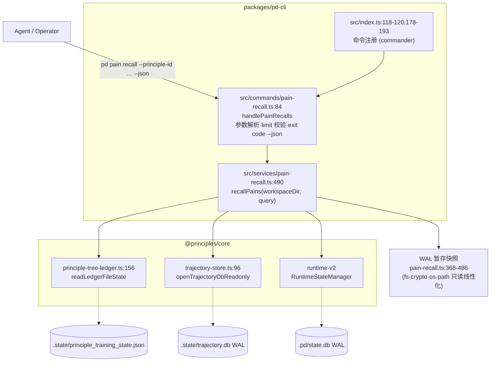
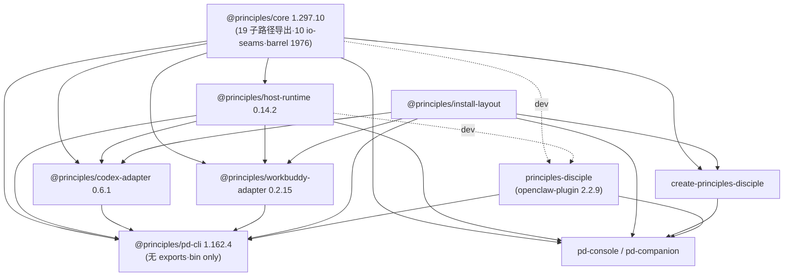
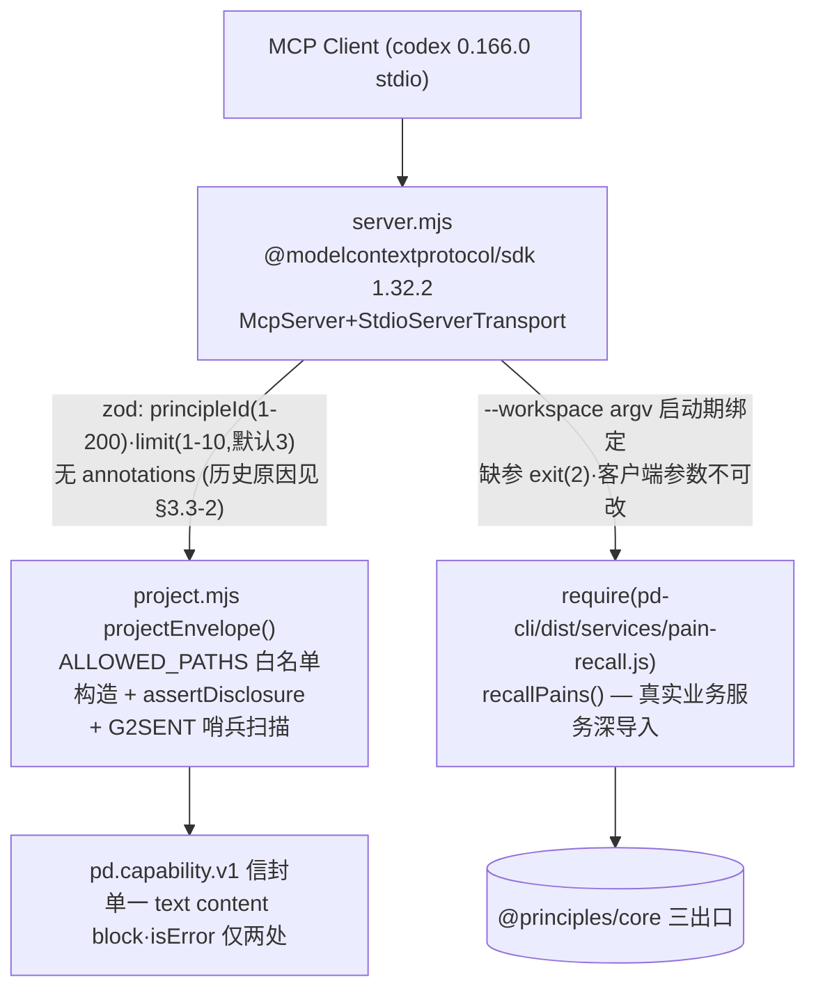
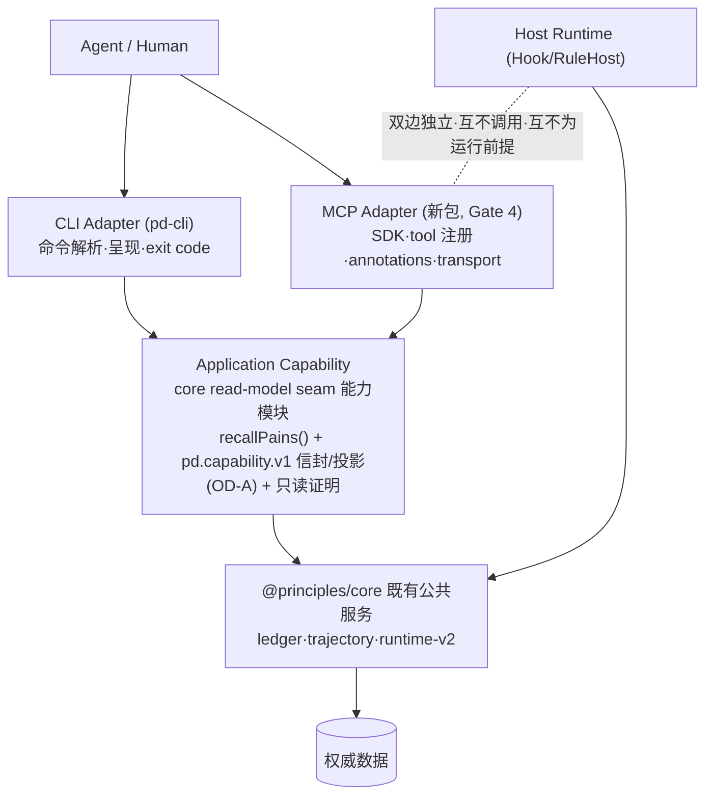

# PD-MCP-GATE3-PROPOSAL-001
# PD Application Capability 共享架构提案

| 字段 | 内容 |
|---|---|
| 阶段 | Gate 3 — Architecture Proposal（设计交付，非实施） |
| 核心上游 SPEC | `docs/specs/SPEC-PD-AGENT-CAPABILITY-API-001.md`（v0.4-draft，基线 `3a2de95c8`） |
| 前置审计 | PD-MCP-ARCHITECTURE-DELTA-AUDIT-20261031（基线 `9f0888a16`） |
| 前置实验 | PD-MCP-GATE2-001（72 运行，`GO_TO_GATE_3_PROPOSAL`） |
| 前置验证 | PD-MCP-HOOK-INTEGRATION-VERIFICATION-001（`READY_FOR_GATE_3_PROPOSAL`） |
| 本报告源码基线 | origin/main `796000a101fd93e5b74c9301e2cd41dfbb150313`（2026-10-31 fetch） |
| 审计 worktree | `D:\Code\_worktrees\principles\adhoc-20261031-mcp-gate3-audit-97407e`（@ `796000a10`，writer=zcode 租约已认领） |
| 实施授权 | **NOT GRANTED** —— 本报告只输出设计；任何代码抽取/新包/SDK/Hook/CLI/Core/Schema 改动均须 Owner 另行授权 |
| 最终裁定 | **READY_FOR_OWNER_DECISION**（见 §22；≠ 已批准实施） |

**证据约定**：`路径:行号（符号）` 相对基线 worktree 根；前置工件引用给出绝对位置。关键结论标注 VERIFIED（本轮源码/代码直证）/ REPORT（前置报告结论，工件在档）/ INFERRED（由事实推导）/ NOT_VERIFIED。凡引用均为本轮在 `796000a10` 复核，未沿用旧报告行号。

---

## 1. Owner Review Card

**1. Problem（被验证的真实问题）**
Gate 2 已证明 MCP 对首个业务能力有净增量（Arm B 100% vs Arm A 77.8% 成功率、中位工具调用 −92.9%、输入 token 约 7 倍差距、0 泄露 0 副作用），但生产主干上该业务能力（`recallPains()`）物理上住在 `packages/pd-cli` 内、无公共导出面；Gate 2 原型靠**未声明的深导入**（`dist/services/pain-recall.js`）调用它。生产 MCP 若沿用此路径，依赖的是一个无 semver 承诺、可被任意重构破坏的暗面。缺的是：一套让 CLI 与 MCP 复用同一业务实现的正式架构，以及 OD-A 披露策略的唯一权威落点。

**2. Before（此前系统实际行为）**
- 业务服务 `recallPains()` 在 pd-cli 包内（896 行，`packages/pd-cli/src/services/pain-recall.ts:490`），唯一消费者是 CLI 命令外壳与两份测试；pd-cli 无 `exports` 字段（`packages/pd-cli/package.json` 仅 `bin`+`files`），外部进程只能深导入暗面。
- MCP Server 在生产主干为零实现（全仓 `mcp` 源码命中仅 3 处注释，VERIFIED）；唯一存在过的 MCP 调用路径是 %TEMP% 隔离原型。
- PreToolUse 治理 matcher `Bash|apply_patch` 不覆盖 MCP 工具名（`plugins/principles-disciple/hooks/hooks.json:5`）；PostToolUse matcher `.*` 已覆盖——MCP 调用会被记为 `tool_calls` 证据行但不入 pain 准入（代码 `hooks.json:18` + `production-pain-evidence.ts:621` 与 Hook 验证报告运行时观察双证）。
- OD-A 字段白名单只存在于实验冻结材料与原型投影模块（`.tmp/pd-mcp-gate2/proto/project.mjs`），不在任何生产包内。

**3. After（本提案设计的系统）**
CLI 与 MCP 成为同一业务能力的两个并列 Adapter：业务编排、状态/错误契约、OD-A 披露投影、只读保证收敛为 core 内**一个注册过的能力模块**（read-model seam）；CLI 零行为变化地改为从 core 导入；未来 MCP Adapter 包只含协议壳（SDK、tool 注册、annotations、transport），不含任何业务语义。Hook 与能力层双边独立（C+A），可选的 MCP 治理分支留作设计。

**4. Existing mechanism reused（复用的既有权威）**
不新建任何治理或存储机制。复用：`@principles/core` read-model seam（`io-seam-registry.json:40-50`，自述 "pure read paths exposed for CLI and console reuse"）、core 三个公共子路径出口（principle-tree-ledger / trajectory-store / runtime-v2）、既有 25 用例只读矩阵测试、SPEC §7 信封契约、Gate 2 已验证的投影模块、宿主 hook 既有 tool-semantics 数据驱动机制。

**5. Complexity Delta**
新 truth source：**YES（1）**——OD-A 投影 profile 从实验材料升格为 core 内版本化代码契约。新持久 schema/state：NO。新子系统/后台进程：NO（MCP server 是按需 stdio 子进程，Gate 4 范围）。新公共抽象：**YES（1）**——core 一个能力子路径导出。新 feature flag：NO。新跨包依赖：Gate 3 阶段 NO；Gate 4 阶段 YES（MCP Adapter→core + `@modelcontextprotocol/sdk` 仅入 Adapter）。新宿主特有行为：NO。新外部/网络能力：NO（运行期零网络）。

**6. Design reason（为何这是最小连贯解）**
移动一个文件 + 注册一行 + 一个子路径导出，即可同时消除：未声明导入暗面、CLI/MCP 潜在双实现、OD-A 策略无权威落点三个问题。core read-model seam 是为该职责已存在的注册缝（六个同类读模型先例），不引入新层、新包、新治理机制。被明确拒绝的更重方案见 §12。

**7. Verification（证据）**
本报告全部架构断言基于 `796000a10` 源码直证（四路独立只读调查 + 关键引用抽查 8/8 通过）；实验结论引自在档冻结工件（预注册 sha256 锚定 + 原型源码复得并直读）。实施阶段的验收证据设计见 §16。

**8. Risk（仍可能出什么问题）**
core 发布协调成本（插件捆绑 core 字节 ⇒ create-principles-disciple/principles-disciple 联动发版，PRI-1065 先例）；barrel/registry 守卫的评审摩擦；MCP Adapter 阶段的进程安全（server 不受宿主 sandbox 约束，信任级=启动用户）；宿主版本演进（codex 0.166 fail-open、exit-2 语义待新版）。

**9. Rollback / recovery**
能力抽取 = 一次 git revert（文件移回 + import 还原）；MCP Adapter 独立包，停止/卸载不影响 CLI/Hook/RuleHost（SPEC §12.2 沿用）；无 schema 迁移、无数据回填。

**10. Follow-ups（刻意不纳入）**
Pain Trace 构造路径 bootstrap 副作用（独立既有缺口）；Arm A CLI 读命令的 WAL sidecar 现象（Gate 2 记录的既有 CLI 行为，见 §3.2 注）；MCP 写类工具治理启用（设计已备，默认不做）；WorkBuddy 实机验证（Gate 4 前置清单项）；SPEC v0.5 文本编辑本身（本提案给出条目，编辑随实施批准执行）。

---

## 2. 最新源码基线（Reality Check）

**基线保护记录**：主 checkout `D:\Code\principles`（分支 main，HEAD `0246e1dc1`）的既有用户修改（6 删除跟踪文件 + 18+ 未跟踪路径）本轮**零触碰**；两个前置 worktree（`adhoc-20261031-mcp-gate2-f505ca`、`adhoc-20261031-mcp-hook-verify-4f6804`）只读未动；代码调查全部在独立审计 worktree 进行；主 checkout 唯一新增物是本报告（未跟踪文件）。

| 项 | 值 |
|---|---|
| origin/main（fetch 后） | `796000a101fd93e5b74c9301e2cd41dfbb150313`（= 审计 worktree HEAD） |
| 前置审计基线 | `9f0888a16`（2026-10-31 早间） |
| 增量区间 | `9f0888a16..796000a10` = 16 提交：#2246（PRI-1065 prompt-budget/barrel）、#2247（PRI-1061 CLI 宿主无关懒加载）、#2248（runtime pins 维护）+ 3 次 version-packages |
| 包版本 @ HEAD | core 1.297.10 · host-runtime 0.14.2 · codex-adapter 0.6.1 · workbuddy-adapter 0.2.15 · pd-cli 1.162.4 · openclaw-plugin 2.2.9 |

**影响本次架构判断的增量变化（逐项复核，VERIFIED）：**

1. **PRI-1061（c31665b72 + e82a65323）**：CLI 启动图移除 codex-adapter 静态导入（`pain-explicit.ts:78`、`health-codex.ts:314` 改为 handler 入口 `await import()`，失败结构化降级 `codex_adapter_unavailable`）；新增 `tests/cli-startup-host-agnostic.test.ts`（91 行，影子适配器实测）。**含义**：pd-cli 对"作为库被导入"仍无正式承诺（无 `exports` 字段），但启动图更干净；`dist/index.js` 仍不可作库导入（模块加载即注册 103 个命令并 `program.parse()`，`src/index.ts:1329-1331`）。
2. **PRI-1065（399600759 + 5ac3a8863 + 4ac6831f2）**：core barrel 表面 1975→1977→**1976**（先加后收，`4ac6831f2` 为避免扩大冻结 barrel 而主动撤回一个导出）。**含义**：core 公共导出增加有真实评审成本与先例约束（fixture `runtime-v2-barrel-surface.json` 钉住 count+names，新增须在 PR 附 PRI 理由）——这直接支持本提案选择**专用子路径导出**而非 barrel 扩张（§13）。同批确认：core 变更若随插件捆绑发布，须与 create-principles-disciple / principles-disciple 联动发版（`5ac3a8863` changeset 声明）。
3. **hooks/matcher/semantics 零变化**：`plugins/principles-disciple/hooks/hooks.json`、codex/workbuddy `pd-hook.ts`、`tool-semantics.ts`、`host-runtime/src`+`tests` 在增量区间**零提交**——Hook 验证报告的全部结论在 HEAD 仍然成立（VERIFIED）。
4. **pain-recall.ts 零变化**：自 SPEC 基线 `3a2de95c8` 以来 `packages/pd-cli/src/services/pain-recall.ts` 无任何提交（VERIFIED，git log 空）——审计对其的全部事实描述原样有效。

**与 v0.4 SPEC 的不一致处**：无契约级不一致。v0.4 的所有事实行、依赖规则、Gate 结构在 HEAD 复核无一被推翻（与增量审计结论一致）。仅有的时效性差异是包版本号与 Gate 状态描述（v0.4 写 Gate 2 NOT_RUN，现为已完成并 `GO_TO_GATE_3_PROPOSAL`）——属状态推进，非架构漂移。

---

## 3. 前置事实回顾（三份在档工件）

### 3.1 Gate 0 增量审计（PD-MCP-ARCHITECTURE-DELTA-AUDIT-20261031）

主 checkout `docs/implementation-reports/`（未跟踪在档）。要点：v0.4 十项核心决策经 `9f0888a16` 复核零推翻；#2218 是治理生命周期能力非业务能力；#2227 影子关联未生产接线、trustedContextReceipt≠授权；`recallPains()` 是唯一完全合格的 Application Use Case（依赖已纯：仅 core 三出口 + node 内建）；抽取落点预研给出 core read-model seam（默认候选）/pd-cli 窄出口（备选）/独立包（按 D-06 冻结）三选项。本提案在更新基线上完成该决策（§13）。

### 3.2 Gate 2 实验（PD-MCP-GATE2-001）

工件：`D:\Code\_worktrees\principles\adhoc-20261031-mcp-gate2-f505ca\docs\implementation-reports\PD-MCP-GATE2-{PREREGISTRATION,EXPERIMENT-REPORT}-20261031.{md,json}`（预注册 sha256 锚定）+ `.tmp/pd-mcp-gate2/`（夹具/预言机/投影模块/运行记录）+ %TEMP% 原型（见 §5.4）。

| 指标 | Arm A（Skill+CLI） | Arm B（MCP） |
|---|---|---|
| 任务成功率 | 77.8%（28/36） | **100%（36/36）**（+22.2pp） |
| 字段准确率 | 74% | 100% |
| 中位工具调用 | 14 | **1**（−92.9%） |
| 中位端到端 | ~109s | ~14s（p95 比值 0.19×） |
| 输入/输出 token | 10,978,368 / 96,926 | 1,567,463 / 8,353（输入约 7× 差距） |
| 工作区副作用 | 18/36（既有 CLI 行为，v3 规则计为度量非违规） | **0/36** |
| 敏感泄露 / false-success | N/A | **0 / 0** |

效用门两支路同时通过（+22.2pp ≥ 10pp 且 −92.9% ≥ 25%）；CLI 基线规则未触发（77.8% < 95%）。裁定 `GO_TO_GATE_3_PROPOSAL`。REPORT（全部数字与 `.tmp/pd-mcp-gate2/analysis.json` 交叉核对一致）。

> 注：实验报告 §B 称被 DENY 的"原 OWNER_DECISION_REQUIRED"为"五项"但列出七个字段名（canonicalId/painId/occurredAt/source/host/score/severity）——预注册 JSON 与投影模块的 DENY 清单一致且更宽，以代码清单为准（文档笔误，见 §9.1 注）。

### 3.3 Hook 集成验证（PD-MCP-HOOK-INTEGRATION-VERIFICATION-001）

工件：`D:\Code\_worktrees\principles\adhoc-20261031-mcp-hook-verify-4f6804\docs\implementation-reports\`（+ %TEMP%\pd-hook-verify-001 15 个实验目录）。本轮设计直接吸收的结论（REPORT，全部运行时实证）：

1. codex 0.166.0 上**唯一可靠阻断 = deny JSON（exit 0）**；exit 1 / exit 2 / 非法 JSON / 未知决策 / 超时全部 fail-open。
2. `default_tools_approval_mode="writes"`（或默认 Auto）+ 工具诚实声明 `readOnlyHint:true` ⇒ headless 免审批执行；无 hint/写类工具被策略拒绝。
3. **lying_tool 实证**：宿主不验证 annotation 真实性——谎报 `readOnlyHint` 的工具在两种模式下都真实写了工作区内外的文件。Annotation 是审批提示，不是安全边界。
4. **MCP server 子进程不受宿主 agent sandbox 约束**——信任级 = 启动用户进程。有效数据安全边界 = PD 能力层投影 + core 只读服务。
5. 生产 matcher `Bash|apply_patch`（Exact 语义）永不命中 `mcp__*` 名——治理零覆盖（覆盖缺口，非破坏）；四层链：Codex 发 PreToolUse(MCP)=是 → 生产 matcher 命中=否 → PD handler 运行=否 → Codex 执行 PD deny=是。
6. WorkBuddy：DOC_VERIFIED_RUNTIME_NOT_VERIFIED（源码级已核：matcher `*` 全覆盖、exit-2 在 WB 是有效阻断通道；实机合成验证缺）。
7. 架构推荐 **C+A**：能力层持有授权/披露/只读安全（宿主无关），Hook 侧仅可选增加 MCP matcher 分支与语义表扩展（服务未来写类工具）；只读查询不强制过 rulehost（零增益）；否决深度耦合重构。

---

## 4. 当前架构 Reality Map（@ `796000a10`，全部 VERIFIED）

### 4.1 五层现状

| 层 | 定义 | 当前实例 |
|---|---|---|
| Domain Capability（core 纯域/读模型） | 权威数据与底层读 | `PainChainReadModel`（`core/runtime-v2/pain-chain-read-model.ts:135-274`）等 6 个 read-model seam 成员 |
| Application Use Case（宿主无关业务服务） | 类型化、版本化、可复用 | **`recallPains()`（唯一完全合格者）**——物理上在 pd-cli 包内 |
| Host Lifecycle Capability | 以真实 Hook 事件为前提 | `HostLivenessContract`（`host-runtime/host-liveness-contract.ts:8/51/81`）、production gate/pain handler |
| CLI Command | 解析/呈现/退出码 | `pd pain recall`（`pd-cli/src/commands/pain-recall.ts:84-174`，103 命令之一） |
| MCP Tool | 协议注册+Schema+生命周期 | **不存在（生产包内零实现；隔离原型存于 %TEMP%，未入库）** |

### 4.2 关键结构事实

- **依赖 DAG（严格无环）**：core 与 install-layout 是仅有的两个根；host-runtime→{core,install-layout}；三宿主适配器→{core,host-runtime,install-layout}；pd-cli→{core,codex-adapter,workbuddy-adapter,host-runtime,install-layout,principles-disciple}；**core 零工作区反向依赖**（rg 全源码零命中）。
- **能力文件与包的耦合仅是位置**：`pain-recall.ts` imports 仅 `fs/crypto/os/path` + `@principles/core` 三子路径（`:59-65`），零 pd-cli 本地导入；`workspaceDir` 是参数（`:490`）；唯一消费者 = 自身命令外壳 + 两份测试；故障注入钩子 `painRecallSnapshotTestHooks`（`:269-283`）为测试导出。
- **core 已拥有该服务消费的全部原语**：ledger 可用性读取 `readLedgerFileState`（`principle-tree-ledger.ts:156-177`，ok/empty/unreadable 三态）、只读 trajectory 打开 `openTrajectoryDbReadonly`（`trajectory-store.ts:96-109`，缺库抛 `TrajectoryDbUnavailableError`）、`RuntimeStateManager`（readonly/no-bootstrap 构造用法见 `pain-recall.ts:548`）。
- **read-model seam 即为该职责注册的缝**：`io-seam-registry.json:40-50`，6 文件，多数直接 import fs+path+better-sqlite3；守卫（`eslint.config.js:11-21,164-205` + `core/runtime-v2/__tests__/architecture-regression.test.ts:3765-3938`）全部从 registry 派生，注册即绿。`crypto`/`os` 不在受限组。
- **hook 链与 pd-cli 零导入耦合**：四个宿主集成包无一 import `@principles/pd-cli`（唯一文件系统级耦合是 `host-runtime/cli-recovery-probe.ts:41-47` 按**路径** spawn CLI，仅用于 readiness/console，不在 hook 路径）。
- **治理语义链**：PreToolUse → `createProductionRuleHostGate`（`host-runtime/production-rulehost-gate.ts:151-163`，`toolSemantics.resolve()`→canonicalKind，未知→`other`→无路径则免评估放行）→ deny JSON；PostToolUse → `createProductionPainEvidenceHandler`（`production-pain-evidence.ts:523`，记 `tool_calls` 证据行；pain 准入再过 `WRITE_TOOLS` 精确名集合 `:16,621`）。tool-semantics：core 数据驱动构建器+校验器（`tool-semantic-registry.ts:82-181`，`Object.hasOwn` 精确名查找 `:169-175`，无通配符），宿主层为冻结 TS 数组（codex 仅 `Bash→execute`、`apply_patch→write`，`codex-adapter/src/tool-semantics.ts:24-27`，PRI-657 证据约束），工作区投影 `.pd/host-tool-semantics/<hostKind>.json` 由各宿主 worker 持久化。
- **pain-recall 与 PainChainReadModel 是独立非分层关系**：遍历方向相反（principle→backward vs pain→forward）、构造契约相反（readonly/no-bootstrap vs 默认 bootstrap `pain-chain-read-model.ts:123-133` + `runtime-state-manager.ts:67-82`）；两者都内嵌"derivedFromPainIds 实存 candidateId"这一血缘知识（已知重复，见 §18 风险 R-7）。

---

## 5. 依赖关系图（节点对应真实文件与符号）

### 5.1 当前 Pain Recall 调用链



### 5.2 当前包依赖 DAG（@ 796000a10）



### 5.3 当前宿主 Hook 链（以 Codex 为例；MCP 工具的现状位置已标注）

```mermaid
flowchart LR
  H["Codex CLI 0.166.0"] -->|"PreToolUse matcher=Bash&#124;apply_patch<br/>(hooks.json:5 — MCP 名永不命中)"| PH
  H -->|"PostToolUse matcher=.* (hooks.json:18)<br/>MCP 调用会到达"| PH2
  PH["plugins/principles-disciple/hooks/pd-hook.cjs"] --> CA["codex-adapter/dist/pd-hook.js<br/>processHookInvocation :209"]
  PH2 --> CA
  CA -->|"dispatch :400-413"| PRT["host-runtime production-rulehost-gate.ts<br/>toolSemantics.resolve→kind→gate"]
  CA --> PPE["production-pain-evidence.ts:523<br/>tool_calls 证据 + WRITE_TOOLS 准入 :621"]
  PRT -->|"deny JSON (唯一可靠阻断)"| H
```



### 5.4 Gate 2 原型调用链（%TEMP% 已毁弃原型的实测路径，代码直证）



### 5.5 目标架构（本提案，详见 §12）



Skill（`pd-cli-operator` ×4 处：`plugins/principles-disciple/skills/`、`openclaw-plugin/templates/langs/{en,zh}/skills/`、`workbuddy-adapter/plugin/skills/`）位于 CLI 使用说明/能力发现层，不承担业务实现；`tests/cli-skill-contract.test.ts:76-138` 钉住 Skill↔CLI 合同。

---

## 6. Application Capability 职责定义

### 6.1 逐项裁决（任务 §4.1 清单）

| 职责 | 归属 | 依据 |
|---|---|---|
| 输入规范化（原始输入→类型化 Query） | **Adapter**（各自语法域）→ 能力层（类型契约） | CLI flag 解析在 `commands/pain-recall.ts`；MCP zod schema 在 Adapter；`PainRecallQuery`（`pain-recall.ts:150-156`）是共同类型 |
| 参数校验（业务约束） | **能力层定义，Adapter 执行语法层** | limit 1–10 默认 3 是业务常量（`:69-71`），已同时冻结于 SPEC §6.1 与原型 zod |
| 业务权限检查（该调用可否执行该能力） | **能力层**（首期 = 工具白名单本身；单工具无分级） | OD-A §2.1：服务端强制校验 |
| 身份上下文 | **Adapter 注入，能力层消费** | `workspaceDir` 参数即全部所需；服务内部零会话字段（`:150-156`） |
| 工作区绑定 | **Adapter**（CLI：`resolveWorkspaceDir()`/`--workspace`；MCP：可信启动配置） | 能力层只接受已解析目录，自身不发现工作区 |
| 数据读取编排 | **能力层** | `recallPains` 步骤 1-12（`:490-877`） |
| 数据可信度检查 | **能力层** | 三源 availability（ledger/trajectoryDb/stateDb）+ 单条三态 |
| 字段披露 | **能力层投影模块（唯一权威）** | 见 §9.2 |
| 结果结构化 | **能力层**（`pd.pain-recall.v1` 结果 + `pd.capability.v1` 信封构造器） | 信封是业务契约，不依赖 SDK 类型（SPEC §7） |
| 错误映射 | 业务状态**能力层**；exit code / isError **各 Adapter** | OUTER_STATUS 表（§8.3）一处定义 |
| 审计上下文 | 首期：Adapter 结构化日志（原型 evidence log 模式）；能力层无审计面 | 只读能力无状态可审计；避免为未来扩客服 |
| 业务幂等性 | **能力层固有**（纯只读 + WAL 快照时点语义） | 重复调用零副作用 |

**明确不属于 Application Capability**：协议适配（MCP wire/SDK）、命令行呈现、宿主生命周期事件、Hook 匹配、RuleHost 评估、pain 准入、注入回执——这些留在各既有权威（SPEC §2 两条集成面之分）。

**反"搬家式抽取"核验**：本提案不是把 CLI Service 挪个目录改旗号——`pain-recall.ts` 内部已无呈现、无 CLI 概念（无 commander/process/console 引用，VERIFIED），抽取对象本身就是合格的业务服务；新增的只有信封/投影模块（新代码，来源为已验证原型）。

### 6.2 分层职责（任务 §4.2 候选的落地形态）

- **Core**：权威数据、身份与关联、底层读取、一致性、只读保证 —— 既有职责不变，**新增承载**能力模块（业务编排+投影，见 §12 落点论证）。
- **Application Capability**（= core 内能力模块）：业务用例、输入契约、披露策略执行、结果投影、状态/错误契约。
- **CLI Adapter**（pd-cli，既有）：命令解析、参数适配、文本/JSON 输出、exit code、向后兼容。
- **MCP Adapter**（新包，Gate 4）：tool 注册、Schema（zod）、协议、annotations、Result Envelope 装配调用、MCP 错误映射、transport、进程生命周期。
- **Host Hook Adapter**（既有，不动）：宿主事件匹配、生命周期适配、治理事件、决策格式转换。**Hook 不是能力层的依赖，能力层不是 Hook 的依赖。**

### 6.3 安全责任矩阵（逐项检查无空白、无重复）

| 安全问题 | 责任层 | 现状/设计依据 |
|---|---|---|
| 工具是否可以执行 | Host Approval + Hook（deny） | 0.166 实测：审批策略 + PreToolUse deny 是宿主仅有的两个真实控制点 |
| 是否可访问某业务对象 | Application Capability | 工具白名单 + workspace 绑定 |
| 是否可披露某字段 | Application Capability（OD-A 投影） | 白名单构造 + 断言 + 哨兵 |
| 数据身份是否可信 | Core（ledger 精确键解析 `pain-recall.ts:508-519`）+ 能力层 | 无标题/相似度回退 |
| 数据是否一致 | Core + WAL 线性化点（`:368-486`） | 时点一致，非瞬时最新 |
| MCP server 可访问哪些文件 | OS/Runtime 隔离（§12；首期=启动用户+应用层路径派生） | lying_tool 实证宿主不管 |
| MCP server 可访问哪些网络 | OS/Runtime 策略（§12；运行期零网络） | 依赖图审计 + Gate 4 验证 |
| 是否产生 Pain | PD Pain Admission（`production-pain-evidence.ts:621` WRITE_TOOLS） | MCP 名天然不入准入门（除非未来显式映射，§11） |
| 是否产生 Injection | PD 治理逻辑（prompt-injection 路径） | 与 MCP 无关，不变 |

**特别禁止**（全部为已验证的负例）：Hook 当业务授权（fail-open 实证）；Annotation 当权限控制（lying_tool 实证）；Agent Sandbox 当 server sandbox（E5 实证）；字段投影等同文件系统隔离（投影管不了进程读文件，§12 分开处理）。

---

## 7. CLI 与 MCP 的接口关系：五方案比较

**关系定式**：CLI 与 MCP 是同一业务能力的两个并列 Adapter，无上下级。Skill 是使用说明层。

| # | 方案 | 裁决 | 论据（源码/实验证据） |
|---|---|---|---|
| A | MCP 调 CLI 子进程（spawn `pd pain recall --json` 解析 stdout） | **否决** | SPEC 核心决策 2/§5.1 规则 5 明令禁止；`dist/index.js` 模块加载即 `program.parse()`（`index.ts:1329-1331`）不可编程调用；exit code 两义（ok/no_matches/partial 同为 0，`commands/pain-recall.ts:169-173`）；stdout 契约是给人/脚本的（cli-1），不是库 API；环境耦合（PATH/workspace 解析差异）。Gate 2 已实证更优路径存在 |
| B | MCP 直接 import pd-cli 的 Service | **否决（生产）** | 即 Gate 2 原型的深导入 `dist/services/pain-recall.js`——实验隔离下合法（SPEC §2.2 允许），但生产依赖**未声明表面**：pd-cli 无 `exports` 字段，无 semver 承诺，任何重构（如 PRI-1061 类）可静默破坏；MCP→pd-cli 依赖方向正是 SPEC §2 要消除的（"避免 MCP 依赖 pd-cli"）；且按 §4.2，能力在 pd-cli 内是**唯一会与 hook 链构成未来依赖环的位置**（adapters→pd-cli→adapters），宿主侧一旦需要消费能力即成环 |
| C | CLI 与 MCP 分别实现业务逻辑 | **否决** | 违反 AGENTS P4（单一真相）与 SPEC 核心决策 1/§5.1 规则 4；Gate 2 Arm B 正是靠"真业务服务"取得 100% 字段准确率——复制实现必然漂移 |
| D | 业务能力抽取到现有 Core（read-model seam） | **推荐** | 见 §12 方案 C 详析 |
| E | 新建共享 pd-application 包，CLI/MCP 并列依赖 | **暂缓（有条件触发）** | 见 §12 方案 B：边界最清晰但当前仅一个能力，违反 P3/P7 与 SPEC D-06 精神；触发条件成文 |

**推荐 = D**：与增量审计的预研默认候选、Hook 验证报告 C+A 推荐中的"能力层宿主无关"要求、SPEC §5.2"若只需抽取一个窄用例，优先最小移动"三者在最新事实上收敛于同一答案。

---

## 8. Capability Interface Proposal

### 8.1 颗粒度

- **一个 Capability = 一个业务用例 = 首期一个 MCP Tool**；内部由多个 core 原语组成（ledger 解析 + 双权威边 + 三源读取 + WAL 快照），不把内部函数暴露为工具。
- **一个 Capability 同时服务 CLI 与 MCP**；CLI 命令 ≠ MCP 工具（CLI 有 `--pain-id`/`--context`/`--workspace`，MCP Schema 只有 principleId/limit——参数面按入口信任级与用途独立筛选，即 SPEC 核心决策 3 的实例）。
- 未来多工具共享同一能力模块的装配模式（信封构造器、投影框架、只读证明模板），但每个新工具独立过 Gate 1 字段裁决——首批**仅此一个**。

### 8.2 `pd_recall_principle_pains` 契约（全部来自实测源码与冻结材料）

| 项 | 契约 | 来源 |
|---|---|---|
| 能力 ID | 业务 `pd.pain-recall.v1`；交付工具名 `pd_recall_principle_pains` | `pain-recall.ts:67`；原型 tool 注册 |
| 输入 | `principleId: string 1..200 必填`；`limit: int 1..10 默认 3`。**不接受** workspaceDir/DB 路径/hostKind/sessionId/turnId/SQL/排序字段/自由文本 context/painId | SPEC §6.1 = 原型 zod（两处一致，VERIFIED） |
| 授权上下文 | workspace 由**可信启动配置**绑定（进程级，单工作区）；调用者身份 = 配置该 server 的 Owner 行为本身（stdio 无宿主凭据，审计 E.3）；无客户端自报身份通道 | 原型 `--workspace` argv + inputSchema 拒绝未知属性（注入 workspaceDir 的冒烟测试已证不可重绑定） |
| 字段披露 | OD-A profile（§9.1），代码内编译期常量，非调用参数 | §9 |
| 错误类型 | 业务状态 8 值 + 稳定 error.code（§8.3）；传输/协议错误由 MCP 层独立处理 | SPEC §7.1 + 原型 errorFor() |
| 幂等性 | 天然幂等（纯只读；WAL 快照时点语义；重复调用零副作用） | 25 用例只读矩阵 |
| 只读语义 | 严格只读已证明：文件不变性 + WAL/SHM/journal 零 sidecar + 缺库不建库（矩阵随服务迁移，§15） | `pain-recall-readonly.test.ts`（830 行） |

### 8.3 结果契约 `pd.capability.v1`（沿用 Gate 2 已验证语义，零改动）

**分层**：业务状态与信封字段由**能力层**定义/构造；MCP Adapter 只做协议映射（单一 text content block 携带 JSON 信封；`isError:true` 仅用于 `disclosure_guard_rejected` 与 `tool_execution_failed` 两类）；CLI 不用此信封（保持 `pd.pain-recall.v1` 直出，§14）。`structuredContent`：SPEC §7.2 建议宿主支持则优先——目标宿主未验证前维持原型已验证的**单 text block**，Gate 4 复核后决定（不改变业务语义，仅序列化形态）。

**状态映射（OUTER_STATUS，能力层一处定义）**：

| 内部状态（pd.pain-recall.v1） | 信封状态（pd.capability.v1） | error.code |
|---|---|---|
| ok / no_matches / partial | 同名透传 | null |
| principle_not_found | not_found | principle_not_found |
| pain_not_found | not_found | pain_not_found（经 statusDetail） |
| source_missing / source_unreadable | unavailable（保留原因码） | source_missing / source_unreadable |
| ambiguous_principle* | invalid_input | ambiguous_principle |
| 输入违反 Schema/约束 | invalid_input | invalid_input |
| 超时/执行失败（Adapter 层） | unavailable | tool_execution_failed |
| unconfirmed / denied | **本工具保留未用**（`denied` 为未来字段级运行时拒绝预留；本工具 DENY 是结构性缺省，不产生运行时 denied） | — |

\* 注：`ambiguous_principle` 在当前实现中**声明未生产**（identityStatus 仅产生 `resolved`/`not_found`，`pain-recall.ts:206,864`）——契约保留映射，测试以单测覆盖（诚实标注，非缺陷）。

**输出上限**（SPEC §7.2 建议值随 Gate 1 冻结动作一并确认）：≤10 条/次；结构化响应 ≤32 KiB；只读调用 10s 截止（原型 `CALL_TIMEOUT_MS=10s` 已实测）；截断必报 `truncated`（服务已实现 `:843-845`），不静默。

---

## 9. OD-A 字段披露架构

### 9.1 冻结白名单（逐字段，VERIFIED：预注册 JSON + 投影模块代码双源一致）

**权威可执行清单 = `ALLOWED_PATHS`**（`project.mjs:23-37`，数组下标归一为 `[]`）：

```
schemaVersion · capability · status
data.principle.requestedId · data.principle.identityStatus
data.query.limit · data.query.contextUsedForRanking · data.query.truncated
data.results[].association.type · data.results[].association.confidence
data.results[].availability.{painEvent, diagnoses, correctionEvidence}
data.summary.{returned, availableCandidates, truncated}
data.sources.{ledger, trajectoryDb, stateDb}
data.unresolvedAssociations[].reason
provenance.workspaceBinding · provenance.sources[].{name, status}
warnings[].{code, message} · error{,.code,.message} · nextAction{,.code,.message}
```

对照 `PainRecallResult` 完整字段树（§5.1 + 调查 A 的逐行清单）的**全量判定表**：

| 字段（PainRecallResult） | 权威来源 | MCP | 依据 |
|---|---|---|---|
| principle.requestedId / identityStatus | 调用输入 + ledger 精确键解析（`:508-519`） | **ALLOW** | Agent 需知解析结果 |
| principle.canonicalId | ledger | **DENY** | OD-A：原未决字段首期一律 DENY |
| principle.text | ledger 正文 | **DENY** | 正文类 |
| association.type / confidence | 两条权威边（`:612-678`） | **ALLOW** | 核心价值：关联真实性 |
| association.evidenceRefs.*（candidateId/taskId/decisionId/decidedAt） | 边引用 | **DENY** | 内部 ID（v0.4 明言不返回关联证据 ID） |
| results[].painId | trajectory.db | **DENY** | 同 OD-A 未决即拒 |
| pain.{occurredAt, source, host, score, severity} | pain 行 | **DENY** | 同上（时间/来源/评分全拒） |
| pain.{reason, text, rawStatement} | pain 行 | **DENY** | Owner 原话域（rawStatement 结构上恒 null，`:109-111`） |
| diagnoses[].*（含 diagnosisId/taskId/category/rootCause/supportingEvidence/confidence/isOriginalOwnerStatement） | 诊断存储 | **DENY** | 诊断正文与内部 ID |
| correctionEvidence.*（text/classification/channel/sessionId/occurredAt） | 纠错证据 | **DENY** | 最高敏感级 |
| lineage[]（血缘跳） | 服务计算 | **DENY** | 内部图结构 |
| availability 三态 ×3 | 服务计算 | **ALLOW** | 部分可用语义必需 |
| summary.{returned, availableCandidates, truncated} | 服务计算 | **ALLOW** | 计数与截断语义 |
| sources 三源枚举 | 服务计算 | **ALLOW** | 固定枚举 |
| unresolvedAssociations[].reason | 服务计算（5 个稳定原因码 `:638-701`） | **ALLOW** | 诚实降级必需 |
| unresolvedAssociations[].{painId, candidateId} | 服务计算 | **DENY** | 内部 ID |
| query.limit / contextUsedForRanking / truncated | 输入回显 | **ALLOW** | 非敏感回显（query.painId 不存在于 MCP 输入） |
| statusDetail | 服务计算 | **不进 data**；仅作 error.code 映射源（pain_not_found） | 原型行为 |
| trustedContextReceipt | router-context-v1 | **NOT_AVAILABLE** | 不存在于本能力响应；语义亦不匹配（审计 #3），不得挪用为授权凭据 |

**投影规则（实现语义，随白名单一并冻结）**：拒绝字段**结构性缺省**（信封按 ALLOW 逐字段构造，非先填后剥）；每次调用执行 `collectPaths()` 键路径断言（越界叶路径=违规）+ 敏感哨兵正则扫描；违规 fail-loud（`isError:true` + `disclosure_guard_rejected`，**永不返回携带违规的负载**）。哨兵机制从实验的 G2SENT 模式泛化为生产测试手段（§15 安全组）。

**扩权约束**：上表任何 DENY→ALLOW 变更 = 新的 Owner 裁决（OD-A §2.1 "未决字段一律 DENY" 持续有效）；实现者不得以"只读""实验需要"自行扩白名单；`ambiguous` 等未生产状态不构成扩权理由。

### 9.2 投影放哪一层（任务 §6.2 四选项）

| 选项 | 评估 |
|---|---|
| A. Core 投影 | 与 B 在推荐架构中合并（能力层就在 core，见 §12）：投影 = 能力模块的一个版本化导出 |
| B. Application Capability 投影 | **推荐**——单一权威位置；所有 Adapter 共享同一实现；与业务结果同包同版本演进；只读证明与披露证明同处测试 |
| C. MCP Adapter 投影 | 否决——每个交付 Adapter 各持一份白名单即"多层重复策略"入口；未来第二个交付面（如 WorkBuddy MCP/Console）必然复制漂移；且策略脱离业务包版本化 |
| D. 多层重复投影 | 否决——同上更甚 |

**CLI 与 MCP 披露差异的正当性与可信身份判定**：CLI 输出完整 `pd.pain-recall.v1`（含正文），MCP 只出 OD-A 投影——这不是策略分叉，而是**交付通道的编译期绑定**：CLI 二进制不调用投影（Owner/操作员本地面）；MCP server 二进制编译期绑定 `od-a-v1` profile 常量。**调用方身份不由任何运行时参数声明**（无 profile 参数、无 caller 参数；inputSchema 拒绝未知属性），由"哪个 Adapter 进程在调用"这一物理事实决定。服务端强制校验因此成立：投影与断言运行在 server 进程内的能力模块里，客户端无法绕过。

**绕过路径核查**：能力模块只此一条投影出口（单一导出）；MCP Adapter 被禁止直接 import `recallPains` 的完整结果类型（Gate 4 评审项+架构守卫可查：adapter 包依赖白名单）；CLI 侧无投影需求。策略升级审计 = profile 常量版本化（`od-a-v1`→`od-a-v2` 须 Owner 裁决 + 版本号变更 + 契约测试快照更新，天然留痕）。

### 9.3 身份与工作区绑定模型（任务 §6.3）

| 问题 | 设计 | 现状依据 |
|---|---|---|
| 谁决定工作区 | Adapter：CLI=既有 workspace 解析约定；MCP=**启动配置**（首版沿原型 argv/受信 env），规范化根路径，所有数据源路径由根派生（`.state/…`/`.pd/…` 的解析权威在 core：`trajectory-store.ts:68-70` 等） | 能力层接口只收 `workspaceDir: string` |
| 谁决定调用者身份 | 启动配置行为本身（stdio 子进程无宿主凭据，审计 E.3）——**授权边界 = 工作区绑定 + 工具白名单**，不做更细调用者身份 | 无自报通道 |
| 谁验证 Principle ID | 能力层：ledger 精确键成员检查，命中即 `canonicalId=requestedId`；miss = `principle_not_found`；**无标题/相似度回退** | `pain-recall.ts:508-519` |
| MCP server 如何获得可信上下文 | 只从启动配置；SPEC §8.1 全条沿用：越界符号链接拒绝、绑定失败=工具不可用（不回退 cwd/home） | 原型缺 `--workspace` 即 exit(2) |
| 客户端可否提交 workspace path | **否**（Schema 层拒绝 + 冒烟测试已证） | 原型实测 |
| 跨工作区读取 | 单工作区/实例；多工作区未来必须经可信配置层（SPEC §8.1） | — |

---

## 10. Hook 协作模型（吸收 Hook 验证报告 C+A）

### 10.1 目标关系

Hook Adapter 与 MCP Adapter 都是宿主侧机制，**互不调用、互不为运行前提**（目标图 §5.5）。MCP server 崩溃/卸载不改变任何门禁；hook 全 fail-open 也不削弱能力层安全（§6.3 矩阵各行独立成立）。

### 10.2 治理范围表（首期定式）

| 工具类 | PreToolUse 治理 | 依据 |
|---|---|---|
| Bash / apply_patch | 覆盖（现状） | `hooks.json:5` + 语义表既有条目 |
| **MCP 只读工具（首期唯一：pd_recall_principle_pains）** | **不纳入**——无增益：只读查询过 rulehost 零安全收益（Hook 报告否决纯 B 方案）；数据安全由投影+只读服务承担 | C+A 定式 |
| MCP 写类工具（未来，若 Owner 批准启用） | **可选纳入**：①`hooks.json` PreToolUse matcher 增 MCP 名分支（纯数据，但 `codex-plugin-bundle.test.ts:165-200` 锁形须同步）；②codex `tool-semantics.ts:24-27` 增精确名条目（registry 无通配符，`:169-175`）→write 类可获合成 `<tool:name>` 路径进 rule 评估；③WB/OpenClaw 仅需语义数组条目（WB matcher 本就 `*`；OpenClaw 另需 `constants/tools.ts` 集合） | 最小机制清单（§4.2） |
| 第三方 MCP 工具 | 不声明治理（PD 只能在宿主事件可见性内行事；不代宿主背书） | 边界诚实 |

**首期零 Hook 改动**：MCP 只读 recall 不需要任何 matcher/语义表/RuleHost 变更。PostToolUse(`.*`) 已把 MCP 调用记为 `tool_calls` 证据行（host_kind 归属机制 `workspace-behavior-evidence.ts`）——证据可见性与治理门禁分离，维持现状即可。

### 10.3 Tool Semantics 三选项（任务 §7.3）

| 选项 | 评估 |
|---|---|
| A. 各宿主语义数组加 MCP 精确名条目（现状数据模式延续） | **推荐**——零新机制；条目即数据；PRI-657 证据约束流程照用；何时加=Owner 决策① |
| B. 抽取通用工具身份描述（通配符/前缀语义进 registry） | 否决（当前）——registry 精确名查找是 rc 合同的一部分，通配符是语义扩张，为一个未来需求改核心匹配语义违反 P7 |
| C. 各宿主自由维护映射 | 否决——失去共享 baseline 与工作区投影 `.pd/host-tool-semantics/` 的统一性 |

**本轮零生产语义表改动**——以上仅为设计；启用条件与 Owner 决策见 D-05。

---

## 11. MCP Server 进程安全模型（独立于能力层设计）

**威胁基线（全部实证）**：server 进程信任级=启动用户（不受宿主 sandbox 约束，lying_tool 三重证据）；`readOnlyHint` 宿主不验证；审批模式是宿主策略非 server 属性；本机 codex 0.166.0 fail-open 面 = exit1/exit2/坏 JSON/未知决策/超时。

### 11.1 最低安全要求（Gate 4 准入清单，逐条可验收）

1. **最小进程权限**：普通用户权限运行，不提权（SPEC §8.4）；不申请任何高完整性资源。
2. **文件访问范围**：应用层——能力模块只从绑定根派生路径，server 代码只 import 能力模块（依赖白名单评审 + 架构守卫）；OS 层首期依赖工作区 ACL 与用户隔离，明示"server 可读=用户可读"。
3. **网络访问**：运行期零出站网络（stdio transport；能力零网络）；依赖图审计断言无网络依赖引入。
4. **环境变量**：不向 server 传递非必要 env（`codex mcp add --env` 白名单化）；凭据类 env 不进入 server 进程。
5. **启动配置可信绑定**：workspace 根只来自启动配置；客户端参数不可改（Schema 拒绝 + 冒烟测试）。
6. **SDK 与依赖固定**：`@modelcontextprotocol/sdk` 精确版本 + lockfile 提交（原型 1.32.2 为参考值，Gate 4 复核锁定）；仅入 Adapter 包；npm audit。
7. **客户端不可改工作区根**（同 5，独立验收项）。
8. **生命周期监控**：结构化 stderr 日志（SDK 约定）、退出码语义（缺绑定 exit 2 沿原型）、宿主侧重启/崩溃行为记录、uninstall 不留残留。
9. **Annotation 非安全控制**：`readOnlyHint:true` 必须**诚实声明**（只读证明矩阵背书；虚报=治理面伪装，Hook 报告 v0.5 建议 1）。
10. **Hook 非进程沙箱**：文档化 + 测试断言"hook 缺失/失效时业务安全仍成立"（§15 安全组）。

### 11.2 隔离选项比较（本轮只定要求与验证计划）

| 选项 | 安全增益 | Windows 现实性 | 维护/UX 成本 | 裁定 |
|---|---|---|---|---|
| 普通本地用户进程 + 应用层约束 | 基线（=CLI 同级信任） | 高 | 零新增 | **Gate 4 推荐** |
| 独立低权限进程身份 | 限制文件面 | 低（每用户 per-user service/账户编排复杂；AppContainer 工具链不成熟） | 高（配置/升级/排障全变复杂） | 暂缓；列为 Gate 5+ 可选验证 |
| OS 文件权限细化 | 缩小可读面 | 中 | 中（与宿主工作区布局耦合） | 暂缓（依赖 11.1-2 的应用层断言先行） |
| 容器/受控隔离环境 | 最强 | 低-中（Docker Desktop 依赖、stdio 路径映射、工作区挂载） | 高（本地工具引入容器运行时） | 暂缓；作为验证手段而非交付形态文档化 |

**理由**：首版单工具只读、单工作区、stdio 本地、零网络——应用层约束（§11.1）已覆盖全部已实证威胁；OS 级隔离的真实收益要在出现写类/多工作区/远程面时才兑现，提前引入是用重基建换零边际安全（P3/P7）。**验证计划**：Gate 4 进程边界测试直接复用 Hook 验证报告的 15 个实验模板（含 lying_tool 反例、越权路径、崩溃/退出）。

---

## 12. 架构方案比较与最终推荐（任务 §九 三方案 + 12 维）

**方案 A：最小抽取——pd-cli 增加窄公共出口**（文件不动，`package.json` 加 `"./pain-recall"` 子路径导出）
**方案 B：独立 `pd-application` 包**（CLI/MCP 并列依赖）
**方案 C：Core read-model seam 扩展**（能力模块移入 core，注册 seam，专用子路径导出）

| 维度 | A（pd-cli 窄出口） | B（独立包） | **C（core seam）——推荐** |
|---|---|---|---|
| 改动文件 | pd-cli package.json + 导出声明（~2 文件） | 新包全部接线（package/CI/发布/changeset 流水线）+ 移动 | 移动 1 文件（896 行）+ registry 1 行 + package.json exports 1 条 + pd-cli import 改 2 处 + 测试重指向（§12.1 清单） |
| 新增 package | 否 | **是** | 否 |
| 新增依赖 | 0 | 0（但新维护面） | 0 |
| 依赖方向 | MCP Adapter→pd-cli（拖入 CLI 包生命周期；SPEC §2 反向表述成立） | 干净（CLI/MCP→pd-application→core） | 干净（CLI/MCP→core；与 pd-console 消费 core 同型） |
| 循环依赖 | **未来风险**：宿主侧若需消费能力即 adapters→pd-cli→adapters（§7-B） | 无 | 无（core 零反向依赖已证） |
| CLI 兼容 | 零行为变化（文件未动） | 零（import 切换） | 零（import 切换 + 文件删除，单一 PR 内完成无双真相期） |
| MCP 接入 | import pd-cli 子路径 | import pd-application | **import core 子路径（Gate 2 原型调用形态的正式化）** |
| Hook 关系 | 独立（但见循环风险行） | 独立 | 独立（零 hook 改动） |
| 安全 | 投影仍无自然归属（留在 adapter→权威分散） | 能力层归属清晰 | **投影随能力入 core，单一权威**；与只读证明同处 |
| 测试 | 测试不动 | 测试迁移 + 新包 CI | 测试随迁（readonly 矩阵成 core 测试）；barrel 守卫零触碰（子路径导出不进 barrel） |
| 回滚 | 容易 | 较难（包摘除） | 容易（git revert 一次移动+接线） |
| 维护成本 | 低但 pd-cli 长期兼作库（语义负债） | 新包长期维护面（单能力撑不满） | 低——进入 core 既有发布节奏；一次性发版协调成本（PRI-1065 先例已跑通） |

**最终推荐**：**方案 C**。次优：**方案 A**（仅当 Owner 否决 core 发版协调时接受，须显式接受 pd-cli 兼作库的语义负债与循环风险）。**明确否决**：方案 B（当前）；D-06 的"第二消费者出现才建包"在本架构下被更精确表述为——**第二个交付 Adapter 或跨 core/host-runtime 的能力需求出现且 core 落点证明不适**时再评估升格（触发条件成文化，防止既成事实漂移）。

**复杂度增量（推荐方案，Gate 3 实施范围）**：移动 896 行 + 新增投影/信封模块（生产 ~150-200 行，源自已验证原型）+ 注册/导出/接线 ~10 行级改动 + 测试随迁；无新包、无新依赖、无 flag、无 schema 变更、无宿主行为变化。

### 12.1 方案 C 机械步骤清单（穷举，全部 VERIFIED 事实）

1. 移动 `packages/pd-cli/src/services/pain-recall.ts` → `packages/principles-core/src/runtime-v2/pain-recall-read-model.ts`；三条包名 import 改相对 import（`.js` 后缀，同 `pain-chain-read-model.ts:16-17` 模式）。
2. `io-seam-registry.json` read-model seam `files[]` 加该文件（fs/path 即过双守卫；crypto/os 不在受限组）；seam 描述按需补一句"WAL 暂存快照只写系统临时目录、零工作区写入"（守卫不强制措辞，评审诚实性要求）。
3. 导出面：package.json `exports` 增 `"./runtime-v2/pain-recall"`（专用子路径先例：`./runtime-v2/tool-semantic-registry` :89）——**不动 barrel、不动 barrel-surface fixture（1976 不变）**，规避 4ac6831f2 类评审摩擦。
4. 新增 `pain-recall-capability.ts`（信封构造 + OD-A 投影 + 断言，原型 project.mjs 的 TS 化）同 seam 注册。
5. `architecture-regression.test.ts` `REQUIRED_SOURCE_FILES`（:13-21）按房例补条目。
6. pd-cli：删旧文件；`commands/pain-recall.ts:15-21` import 改 core 子路径。
7. 测试分拆随迁：**服务边界测试**（`pain-recall-readonly.test.ts` 全部 25 用例 + `pain-recall.test.ts` 中直接驱动 `recallPains()` 的关联/可用性/排序用例）迁为 core 测试（仅需 node，无工作区夹具依赖）；**命令外壳测试**（参数解析/exit code/--json 输出/help）留在 pd-cli，import 重指向（`painRecallSnapshotTestHooks` 须继续从新位置导出，`:269-283`）。
8. 发布：core changeset（minor，新子路径）；pd-cli core 依赖 `^1.297.6` 提升到含新子路径的版本；按 `5ac3a8863` 先例与 create-principles-disciple/principles-disciple 联动发版。

---

## 13. CLI 向后兼容策略（硬验收）

**不变面（全部既有测试在档保护）**：

| 不变量 | 保护证据 |
|---|---|
| 命令名 `pd pain recall`（含父命令树位置） | `pain-recall.test.ts` cli-A 组 + `cli-skill-contract.test.ts:124-131` |
| 参数集 `--principle-id/--pain-id/--context/-l,--limit/-w,--workspace/--json`（含严格 limit 解析 `/^\d+$/`） | `commands/pain-recall.ts:51-54,98-110`；cli-A1-A5 |
| 默认值（limit=3） | cli-B 组端到端断言 schemaVersion+默认 3 |
| JSON Schema（`pd.pain-recall.v1` 全字段直出，**不套能力信封**） | cli-B1-B6 端到端 JSON |
| 退出码（ok/no_matches/partial→0；principle_not_found/pain_not_found/source_missing/source_unreadable/ambiguous_principle→1） | `:169-173` + 测试 |
| 错误语义（fail() 结构化 envelope + return 保证，cli-2） | `:33-42` + "guard: test stubs" 注释 |
| Skill 使用方式（4 处 `pd-cli-operator` 的调用指导不变；Skill 是 CLI 的说明层，不随 MCP 变化） | `cli-skill-contract.test.ts`（存在性+`--help` 实测） |
| 既有 CLI 测试全绿 | 771+830+139+91 行四份 + 仓库门禁 |

**新增验收**（不改变行为，只增加证明）：wire 黄金快照测试（同一合成工作区迁移前后 `--json` 输出逐字节等价）；CLI 启动宿主无关测试继续绿（PRI-1061 既有）。**披露**：CLI 输出完整结果（含正文）与 MCP OD-A 投影的通道差异是**既有事实的形式化**（今天 CLI 也这样输出），非本提案引入的行为变化。

---

## 14. 渐进迁移路线

| Phase | 内容 | 前置 | 改动范围 | 验收 | 风险/回滚 | Owner Gate |
|---|---|---|---|---|---|---|
| **P1 契约冻结** | SPEC v0.5：信封/状态映射/OD-A 落点/annotations 诚实要求/fail-open 事实/输出上限数值（§8.3 注） | 本提案获 Owner 采信 | 仅文档 | v0.5 评审通过 | 无 | **OG-1 批准提案与 P1** |
| **P2+P3 能力落地与 CLI 迁移**（建议单一 PR 集，无双真相期） | §12.1 清单 1-8 | OG-2 | core + pd-cli 两包 | §13 全表 + readonly 矩阵在 core 绿 + 无循环依赖（DAG 守卫）+ 发版协调完成 | 单 revert 恢复；旧文件在同一 PR 删除不残留副本 | **OG-2 批准 Gate 3 实施** |
| **P4 MCP Adapter 接入**（= SPEC Gate 4） | OG-3 + P2+P3 合并 | 新 Adapter 包：SDK/单工具/annotations(`readOnlyHint:true`)/`--workspace` 可信绑定/进程安全 §11.1/单 text block 信封 | §15 MCP 组+安全组+宿主组全绿；annotations 真实性=只读矩阵背书 | 停止/卸载 server 不影响 CLI/Hook（回归证明） | **OG-3 批准 Gate 4**（含 WorkBuddy 实机合成验证是否前置的裁决——Hook 报告待决②） |
| **P5 Hook MCP 事件适配（可选）** | Owner 决策①启用写类治理时 | `hooks.json` matcher 分支 + codex 语义条目 + bundle 测试同步（§10.2 清单） | matcher/语义/RuleHost 测试绿；fail-open 契约文档化 | 独立小 PR 可 revert | **OG-4 单独批准** |
| **P6 宿主分别验收**（= Gate 5） | P4 通过 | 每宿主：安装/发现/参数/错误/卸载/治理回归独立验证 | 各宿主独立证据包；WB 实机合成验证 | 每宿主单独 Gate | **OG-5** |

顺序依据：契约先于代码（SPEC 流程不变量）；能力先于 Adapter（否则 Adapter 只能深导入或双实现——两者都已否决）；CLI 迁移与能力落地同 PR 消除中间态；Hook 适配最后且可选（首期只读工具不需要）。Codex 0.166 的审批/Hook 故障语义按目标宿主版本在 P4 重新验收（Hook 报告待决③：exit-2 通道等宿主升级后再议，不入公共契约）。

---

## 15. 测试与验收矩阵

**A. Application Capability**（core 内）：输入校验（合法/缺失/空白/超长/未知字段；limit 边界）；身份授权（ledger 精确键命中/未命中/无标题回退反例）；工作区绑定（路径由根派生；越界符号链接拒绝）；字段披露（§9.1 全表逐字段的投影断言 + 键路径越界断言 + 哨兵扫描）；结果一致性（同夹具同结果，确定性排序）；错误映射（§8.3 OUTER_STATUS 全行 + error.code 稳定性）；**严格只读**（随迁 25 用例矩阵：ro-1..11 WAL 全模式 / race-1..4 / ABA / interleave——Recall 证据不得被其他能力继承引用，SPEC §11.2）。

**B. CLI Adapter**：命令树/帮助（skill-contract 实测 `--help`）；JSON Schema 快照；退出码表；参数严格解析；既有 771+830 行回归；**新增迁移等价黄金快照**。

**C. MCP Adapter**（Gate 4）：真实 stdio wire 级发现/调用（官方 client）；Tool Discovery/Schema/annotations（含 `readOnlyHint` 与只读矩阵的一致性断言——反 lying）；信封（单 text block、isError 两处语义）；非法输入（未知属性拒绝）；错误处理；未授权访问（跨工作区/注入 workspaceDir/自报身份全拒）；超时/崩溃/重启/卸载。

**D. Cross-Adapter Parity**：同一合成工作区、同一查询——CLI `--json` 与 MCP 信封的**业务事实一致**（状态/计数/关联/可用性逐字段对账；序列化形态允许不同，业务语义不允许分叉；预警：CLI 完整结果 vs MCP 投影的字段子集关系按 §9.2 通道绑定断言）。

**E. Security**：DENY 字段泄露（哨兵植入 pain.text/rootCause/correctionEvidence 等，断言响应/错误/日志零命中）；跨工作区访问；自声明身份绕过（无通道即断言拒绝面）；任意路径注入；server 进程越权（进程边界测试，复用 Hook 验证 15 实验模板）；**Hook 缺失时业务安全**（拔掉 hook 全套断言仍绿）；annotation 虚报只读（lying_tool 反例——PD 工具声明与实际行为一致性）；server 异常退出/stderr 泛滥/挂起。

**F. Host Integration**：Codex 0.166（+届时目标版本重验：deny 通道/审批模式/annotations 免审批/PostToolUse 证据记录）；WorkBuddy 实机合成验证（Gate 4 前置裁决项）；其他宿主未来按 Gate 5 单独成套。

---

## 16. 复杂度与价值评估

### 16.1 升级前后对照（实际核查值）

| 指标 | 当前架构 | 推荐架构（P2-P4 后） |
|---|---|---|
| 业务逻辑实现数量 | 1（`recallPains`，在 pd-cli） | 1（移入 core）+ 1 投影/信封模块（原型已验证代码的 TS 化） |
| CLI/MCP 复用 | 0%（生产 MCP 不存在；原型靠未声明深导入） | **100% 业务复用**；Adapter 仅协议壳（预计 ~300 行/Adapter） |
| 新增 package | 0 | 0（Gate 3）/ 1（Gate 4：MCP Adapter；**非** pd-application） |
| 新增依赖 | 0 | SDK 1 项（仅 Adapter，精确锁版） |
| Hook 耦合 | 0 | **0（不变）** |
| 测试复杂度 | 1740 行 recall 专属 | 随迁 + 投影断言 + parity/安全/MCP 三套新增（首工具一次性投入，框架可复用） |
| 多宿主接入成本 | N/A | 每宿主=客户端配置+验收证据（零业务代码） |
| 维护成本 | 能力住在 CLI 包内（位置负债+暗面风险） | 能力入 core 既有节奏；一次性发版协调 |

### 16.2 值不值（任务 §十二 的两个直问）

**只为一个工具值吗？** 值——但理由不是 MCP：是消除**未声明导入暗面**（生产依赖无 semver 承诺的路径）与给 OD-A 一个权威落点。即使 MCP 线明天停止，这两点仍成立；且成本是一次性的小移动（§12.1，预估 1-2 天工程量级）。
**5/10/20 个能力时成本曲线？** 每新增能力 = core 内业务模块（seam 注册）+ 投影/信封（复用框架）+ Adapter 注册 + 独立只读证明 + 独立 Gate 1 字段裁决。架构边际成本近零；**真实成本在每能力的只读证明与字段裁决**——这是产品安全要求，与落点选择无关（core/新包/CLI 出口都逃不掉）。反事实：不抽取时每能力都要么进 pd-cli（包继续膨胀、库语义负债累积）要么届时再付一次性抽取+迁移成本且顶着已上线的 Adapter 兼容压力。**结论：早抽比晚抽便宜，抽小比抽大便宜——本提案两者都占。**

### 16.3 Complexity Delta（AGENTS §13）

新 truth source：**YES** —— OD-A 投影 profile（`od-a-v1`）升格为 core 内版本化代码契约。①为何现有 owner 不行：现无处安放（实验材料非生产包；SPEC 文本非代码）；②隐藏的复杂度：白名单+断言+状态映射全套；③为何更小方案不足：无第二份实现（反 P4）；④验证：§15-A 投影断言+哨兵；⑤移除：随能力模块 revert。
新持久 schema/state：NO。新子系统/后台进程：NO（server=Gate 4 按需子进程）。新公共抽象：**YES** —— core 一个子路径导出（同⑤论证；子路径而非 barrel，表面增量最小化）。新 feature flag：NO。新跨包依赖：Gate 3 NO / Gate 4 YES（Adapter→core+SDK，方向向下、无环已证）。新宿主特有行为：NO。新外部/网络：NO。

---

## 17. 风险与未决事项

| # | 风险/未决 | 等级 | 缓解 | 状态 |
|---|---|---|---|---|
| R-1 | core 发版协调失误（插件捆绑 core 字节） | 中 | PRI-1065 联动发版先例；changeset 声明 | 流程性，已知解法 |
| R-2 | MCP server 进程越权（不受 sandbox） | 高（Gate 4 起） | §11.1 清单 + 进程边界测试；首版面=单只读工具 | 设计已备 |
| R-3 | 宿主版本演进（fail-open/exit-2/审批语义变化） | 中 | 契约只依赖 deny 语义；P4/每宿主重验收；版本钉 | 持续 |
| R-4 | 0.166 无 exit-2：Codex 侧阻断通道单一 | 低（只读工具不受影响） | 等 Host 升级重验（Hook 报告待决③），不入公共契约 | NOT_VERIFIED（新版） |
| R-5 | OD-A 投影与业务结果漂移（字段演化时漏更新白名单） | 中 | 键路径断言每次调用 + 投影契约快照测试 + 字段树变动即断言红 | 机制内建 |
| R-6 | barrel/registry 守卫评审摩擦 | 低 | 子路径导出绕开 barrel fixture；registry 单行 | 先例充足 |
| R-7 | "derivedFromPainIds 实存 candidateId"知识在 recall 与 PainChainReadModel 双处内嵌（既有） | 低 | 不在本提案范围扩大；抽取**不新增**第三份（移动不复制）；登记为后续统一候选 | 既有事实，如实披露 |
| R-8 | WorkBuddy 实机未验证 | 中 | 列 Gate 4 前置裁决（OG-3 附件） | 待 Owner |
| R-9 | `ambiguous_principle` 契约声明未生产（`:77,172`） | 低 | 契约保留+单测覆盖+诚实标注（§8.3 注） | 已披露 |
| R-10 | Arm A CLI 读命令 WAL sidecar 现象（Gate 2 记录 18/36） | 信息 | 既有 CLI 行为非本提案范围；为 CLI 侧后续观测项（与 R-7 同类登记） | 已披露不扩权 |

---

## 18. 回滚策略

- **P2+P3（能力落地+CLI 迁移）**：单 PR `git revert`（文件移回、import 还原、registry/exports 行删除）；无数据迁移、无配置残留；revert 后 pd-cli 自包含如初。
- **P4（MCP Adapter）**：独立包独立回滚——`codex mcp remove` + 卸载包即消失；CLI/Hook/RuleHost 零感知（SPEC §12.2；回归测试证明治理行为不变）。
- **P5（Hook 适配）**：独立小 PR revert；matcher/语义条目回退即恢复 `Bash|apply_patch` 现状。
- **任何阶段不要求**用户重建数据库/配置；禁止故障时自动切换宽权限工具（SPEC §12.2 沿用）。
- **OD-A 投影**：profile 版本化（od-a-v1）；任何变更是新版本而非静默修改，旧版本可显式保留。

---

## 19. Gate 3 Implementation 前置条件

1. Owner 采信本提案（§22 D-01..D-08 裁决完毕，特别是 D-02 落点）。
2. SPEC v0.5 编辑完成并入库（P1；条目已备：本提案 §8/§9/§10/§11 + Hook 报告 §七 六条）。
3. 无并发冲突：`pain-recall.ts` 自 `3a2de95c8` 零改动的稳定性在实施 PR 时重新确认（git log 复核）。
4. 实施在独立 worktree（git-1/git-11 认领流程），单一 PR 集，不与 Examiner/Console 等线混批。
5. 发版协调窗口确认（core minor + pd-cli 提升 + installer 联动）。
6. **Gate 3 Implementation ≠ 本提案批准**——OG-2 是独立动作。

---

## 20. Owner Decision Card

> OD-A（字段白名单）已批准（2026-10-31，预注册冻结），下列决策**不重新开放**其内容；D-04 只裁决实施位置。

**D-01｜Application Capability 最终职责边界**
问题：按 §6 裁决（能力=业务用例+输入契约+披露执行+投影+状态/错误契约；编排入 core 能力模块；权限=白名单+绑定；幂等/审计按表）？ 推荐：是。替代：能力兼持审计/多工作区路由（否决：为未来扩服）。复杂度差异：+0（推荐=最小）。风险：低。验收：§15-A。**需 Owner 决策：是。**

**D-02｜Capability 代码归属与 package 方案**
问题：三方案（A pd-cli 窄出口 / B 独立包 / **C core read-model seam**，§12）？ 推荐：C（§12.1 八步清单）。替代：A（须接受库语义负债+循环风险）。复杂度：C 移动 896 行+~10 行级接线；A 最小但负债；B 新包全接线。风险：C 的发版协调（R-1，有先例）。验收：§13 全表+DAG 守卫+只读矩阵在 core。回滚：单 revert。**需 Owner 决策：是（本提案核心决策）。**

**D-03｜CLI 与 MCP 公共接口契约**
问题：能力子路径导出形态 + `pd.capability.v1` 信封（§8.3 状态映射/上限数值）+ MCP 单 text block（structuredContent 待 Gate 4 复核）？ 推荐：如 §8（全部沿用已验证语义，零新发明）。替代：CLI 也改用信封（否决：破坏 CLI 兼容硬约束）。复杂度：+1 版本化契约。验收：§15-C/D。**需 Owner 决策：是（信封数值上限属 Gate 1 冻结残留项）。**

**D-04｜OD-A 披露策略实施位置**
问题：投影模块随能力入 core（唯一权威，编译期 profile 绑定，§9.2）？ 推荐：是（`od-a-v1` 版本化）。替代：留在 MCP Adapter（否决：权威分散）。复杂度：+1 模块（原型 TS 化 ~150-200 行）。风险：R-5（机制内建缓解）。验收：§15-A/E。**需 Owner 决策：是（位置；白名单内容不再议）。**

**D-05｜Hook Adapter 职责与接入范围**
问题：首期只读 MCP 工具**不纳入**治理（C+A 定式）；写类工具治理作为可选设计（§10.2 清单）待单独启用（= Hook 报告待决①）？ 推荐：首期零 hook 改动；启用留 OG-4。替代：立即启用 matcher 扩展（否决：零增益+测试面扩大）。复杂度差异：0 vs 小 PR。风险：无（覆盖缺口是现状）。验收：若启用走 §15-F。**需 Owner 决策：是（二段式：现在确认不纳入，未来启用另批）。**

**D-06｜MCP Server 进程安全最低要求**
问题：§11.1 十条 + 隔离分级（首版普通用户进程；OS/容器级列为后续可选验证）？ 推荐：如 §11。替代：首版即容器化（否决：UX/维护成本不当）。复杂度：0（Gate 4 准入清单）。风险：R-2 由清单覆盖。验收：Gate 4 进程边界测试（15 实验模板）。**需 Owner 决策：是（作为 Gate 4 准入合同）。**

**D-07｜CLI 向后兼容验收标准**
问题：§13 八不变量 + 既有四份测试 + 新增黄金快照 = 验收定义？ 推荐：是。替代：放宽某项（无建议——全部有既有证据）。风险：低。验收：自证。**需 Owner 决策：是（确认口径）。**

**D-08｜Gate 3 实施的范围、顺序和停止条件**
问题：P2+P3 单 PR 集（core+pd-cli）为 Gate 3 实施；P4=MCP Adapter=Gate 4 另批；P5 可选另批；WB 实机验证是否列 Gate 4 前置（= Hook 报告待决②）；停止条件=§13/§15 任一验收红即停？ 推荐：如 §14。替代：P2/P3 分两批（否决：双真相期）。风险：流程性。回滚：§18。**需 Owner 决策：是（OG-2/OG-3/OG-4 的授权点定义）。**

**汇总**：8 项全部需 Owner 裁决；Hook 报告的三项待决已映射（①→D-05，②→D-08，③→R-4 不入契约）。无隐藏决策项。

---

## 21. 证据索引（本轮 `796000a10` 直证为主）

| # | 结论 | 证据 |
|---|---|---|
| 1 | 能力文件职责纯净（零 CLI 耦合） | `packages/pd-cli/src/services/pain-recall.ts:59-65（imports）:67-71（常量）:150-180（契约类型）:269-283（测试钩子）:368-486（WAL 快照）:490-877（recallPains）`；消费者=命令外壳+2 测试（rg 全仓） |
| 2 | CLI 呈现层与 exit code | `packages/pd-cli/src/commands/pain-recall.ts:33-54,84-174`；注册 `src/index.ts:118-120,178-193` |
| 3 | pd-cli 无 exports、不可作库 | `packages/pd-cli/package.json`（bin+files only；v1.162.4）；`src/index.ts:1329-1331`（load 即 parse）；PRI-1061 `c31665b72/e82a65323` + `tests/cli-startup-host-agnostic.test.ts` |
| 4 | CLI 兼容保护网 | `packages/pd-cli/tests/commands/pain-recall.test.ts`（771 行）/`pain-recall-readonly.test.ts`（830 行）/`tests/cli-skill-contract.test.ts`（139 行，4 处 Skill 面） |
| 5 | core 导出面与 seam | `packages/principles-core/package.json:8-102`（19 子路径）；`io-seam-registry.json:40-50`（read-model seam 六文件）；守卫 `eslint.config.js:11-21,164-205` + `core/runtime-v2/__tests__/architecture-regression.test.ts:3765-3938` |
| 6 | barrel 冻结与评审先例 | `runtime-v2-barrel-surface.json`（count 1976）；`4ac6831f2`/`5ac3a8863`（PRI-1065）；子路径先例 `package.json:89` |
| 7 | DAG 无环、零反向依赖 | 11 包 package.json 实读（§5.2）；core 源码 rg `@principles/(pd-cli|host-runtime)` 零命中 |
| 8 | 移动成本清单 | §12.1（每步含文件行号） |
| 9 | matcher/治理链 | `plugins/principles-disciple/hooks/hooks.json:5,18`；`host-runtime/production-rulehost-gate.ts:151-163`；`production-pain-evidence.ts:16,523,621`；`core/runtime-v2/internalization/tool-semantic-registry.ts:82-181`（精确名 `:169-175`）；`codex-adapter/src/tool-semantics.ts:24-27`（PRI-657） |
| 10 | hook 链零 pd-cli 耦合 | 四宿主包 rg；唯一路径级 spawn `host-runtime/cli-recovery-probe.ts:41-47`（非 hook 路径） |
| 11 | PainChainReadModel 独立且 bootstrap 相反 | `core/runtime-v2/pain-chain-read-model.ts:123-133,135-274`；`runtime-v2/store/runtime-state-manager.ts:67-82`；对比 `pain-recall.ts:548` |
| 12 | OD-A 白名单（代码 SSoT） | `.tmp/pd-mcp-gate2/proto/project.mjs:12-16,23-37,39-43,67-141`（gate2 worktree）；预注册 `PD-MCP-GATE2-PREREGISTRATION-20261031.json:55` + `.sha256` |
| 13 | 原型架构与调用形态 | `%TEMP%\pd-mcp-gate2\gate2-20261031\server\{server.mjs,package.json}`（SDK 1.32.2；`require(pd-cli/dist/services/pain-recall.js)`；`--workspace` argv；isError 两处） |
| 14 | Gate 2 数字 | `PD-MCP-GATE2-EXPERIMENT-REPORT-20261031.md` × `.tmp/pd-mcp-gate2/analysis.json` 交叉一致（REPORT） |
| 15 | Hook 六故障语义/审批/lying/sandbox | `PD-MCP-HOOK-INTEGRATION-VERIFICATION-001.md`（hook-verify worktree；15 实验目录在 %TEMP%\pd-hook-verify-001） |
| 16 | 上游契约 | `docs/specs/SPEC-PD-AGENT-CAPABILITY-API-001.md`（v0.4-draft）；`docs/specs/SPEC-PD-PAIN-RECALL-CLI-001.md`（CLI 契约意图真值） |
| 17 | 语义缺口诚实标注 | `ambiguous_principle` 未生产（`pain-recall.ts:77,172` vs `:206,864`）；实验报告"五项/七字段"笔误（§3.2 注） |

---

## 22. 最终裁定

**`READY_FOR_OWNER_DECISION`**

- 最新主干已核实（`796000a10`，四路独立调查 + 引用抽查 8/8）；
- 关键依赖关系全部有源码证据（§4/§5/§21）；
- Application Capability 边界清晰（§6，含安全责任矩阵无空白）；
- CLI/MCP 关系明确（§7 五方案，推荐 D=core 落点 §12 方案 C）；
- Hook 与业务能力解耦（§10，C+A，首期零 hook 改动）；
- OD-A 约束完整保留且获得唯一权威落点（§9，白名单内容零变更；§9.3 身份与工作区绑定模型成文）；
- MCP Server 进程安全边界独立成章（§11，十条准入 + 分级隔离）；
- 复杂度增量与价值如实核算（§16，含"只为一个工具值不值"的直答）；
- Owner Decision Card D-01..D-08 就绪（§20）。

本裁定只代表架构提案完成。**不抽取任何生产代码、不创建包、不实现 Server、不动 Hook/CLI/Core、不建 PR、不自动进入 Gate 3 Implementation**——一切等 §20 裁决与 §19 前置条件。

---

*报告完。审计 worktree `adhoc-20261031-mcp-gate3-audit-97407e` 将于交付后释放租约并清理（零自产工件）；两个前置 worktree 与 %TEMP% 证据未做任何改动，留待 Owner 处置。*
