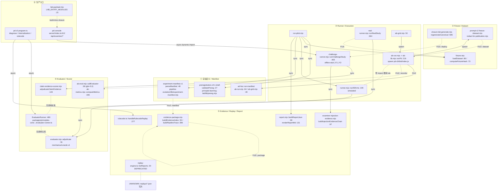

# PD Lab Capability Inventory — Read-only Architecture Audit

> PRI-1244 · 只读架构调查 · 调查日期 2026-11-16
>
> 本报告只描述**当前源码中实际存在并实际连通**的实验基础设施。所有结论均以本报告代码基线为准，
> 文档只作为线索。凡无法由源码证明的关系一律标 `UNKNOWN`，不以概念图或相似命名替代证据。
>
> **修订记录：** v2（2026-11-16，评审后修订）——撤回 Challenge Runner 作为 Prompt A/B 接入点的建议；
> 统一 §7.2 统计口径（5 / 3 / 1 / 3）；修正 Manifest 与 Preregistration 的关系定位；
> 修正"无共享实验身份"的绝对化表述；明确盲评 ≠ 独立评价；补充 §9.1 数据治理风险；
> 重写 §12 实施路径。**代码基线未变（`45a7fd7`），仅文档修订，无业务代码改动。**

---

## 1. Executive Summary

**核心结论：PD 目前尚未形成贯穿实验定义 → 输入冻结 → 执行 → 评价 → 证据 → 报告的完整实验生命周期。**
仓库里存在四套彼此独立的实验工具族、一套生产业务运行时中同名但业务专用的机制，以及一个只做声明的
`docs/experiments/` 资产目录。

需要精确区分两件事：

- **已经存在的**：部分共享的实验元数据机制。`experiment-manifest.v1` 同时被 pipeline-evolution 的
  `init-experiment.mjs`（`:26,121`）与 `collect-evidence.mjs`（`:39`，`resolveExperimentScope :342`）
  以及 principle-learning-lab 的 `run-pilot.mjs`（`:37,155-166`）消费；`preregistration.v0.1-draft`
  提供研究设计校验（`prereg.mjs:10,27`）。三者定位不同，各有自己的结构约束（见 §4.1）。
- **确实缺失的**：把这些局部契约串成一条链的**跨实验身份关联**。各工具族之间没有共享的 Evaluator、
  没有共享的 Evidence 协议；唯一的"生产 ↔ Lab"连接是 pd-console 的 Examiner 路由对
  `principle-learning-lab` 中 Challenge/Examiner 子集的动态 `import` 桥接。

因此准确的表述不是"PD 完全没有共享实验身份机制"，而是"**已存在部分共享的实验元数据机制，但尚未形成
统一的跨实验生命周期关联契约**"。现有 `experiment-manifest.v1` 可以作为元数据关联的基础，但它还不能
独立表达 #2653 所需的实验臂、样本、Prompt Variant、运行记录与评价结果之间的关系。

五项最重要的架构发现：

1. **三套实验定义契约并存但职责不同，不是互相替代关系。** `experiment-manifest.v1`（元数据 / 代码版本 /
   环境 / 数据关联）、`preregistration.v0.1-draft`（研究设计 / 假设 / 执行顺序 / 分析排除规则）、
   PR #2653 的 ad-hoc `run-manifest`（本次 A/B 的编排与执行记录）：前两者各有 schema 标识与校验器
   （`MANIFEST_SCHEMA`+`parseManifest` / `PREREG_SCHEMA`+`validatePrereg`），第三者是**无 schema 的 CLI 拼装**；
   但没有任何字段能把三者关联起来。实验 ID 无注册表。Manifest 是 **metadata authority**：
   实际运行事实仍由 state.db / trajectory.db / telemetry 拥有（`experiment-manifest.mjs:3-8`）。
2. **没有统一 Runner 与 Evaluator，而且不应强行统一。** G1 模拟 runner、G2 真实 runner、
   Challenge 三模式 runner、`ab-run` 调度器各自服务不同职责；Evaluator 至少五套
   （机械 oracle、claim-evidence scorer、内部化 LLM judge、#2653 盲评、#2653 指标统计），
   评价对象与输入输出契约互不相同，彼此**零代码复用**。把它们合成"一个通用 Evaluator"是错误抽象。
3. **生产桥只覆盖一小部分 Lab 能力。** `scripts/build/lab-payload.mjs:15-24` 的
   `LAB_ENTRY_MODULES` 只有 7 个 Examiner/Challenge 模块；G1/G2 核心模块
   （`prereg/fixture/runner/evaluator/real-runner/report/evidence-verifier`）均不在生产载荷闭包内。
   该文件是**构建期**的闭包定义，pd-console 在**运行期**消费已构建的载荷（§3.2）。
4. **"Replay" 是四种不同语义。** 确定性夹具重执行、Challenge 轨迹重放校验、
   RuleCode 沙箱确定性重执行、以及已退役的遗留报告只读查询——**没有真实宿主运行的 trace replay**。
5. **PR #2653 是一套自洽但高度一次性的 A/B 底盘。** 它把真实执行正确委托给生产 CLI 的 dist，
   但编排/评分/指标/盲化/报告全部自建且硬编码（4 个绝对 worktree 路径、v1 base commit、
   16 个 painId、19 个提示变体、rubric、模型、阶段集合），**零 import 既有 lab 库**。
   其盲评只做到 **blind 而非 independent**：生成侧与评价侧同为 `glm-5.3`（§4.4）。

**问题 A–E 的结论见本文末尾「最终结论」。**

**数据治理风险（须 Owner 决策，非本次可处理）：** PR #2653 的当前提交版本已脱敏并通过自动化泄漏扫描，
但早期未完整脱敏的数据**已经进入公开 Git 历史**（`PUBLIC_DATA_REDACTION_AUDIT.md:39-50`），
历史清理尚未执行。详见 §9.1。

---

## 2. Investigation Baseline（调查基线）

| 项目 | 值 |
|---|---|
| 调查日期 | 2026-11-16 (GMT+8) |
| 仓库 | `csuzngjh/principles`（`origin` = `https://github.com/csuzngjh/principles.git`） |
| 默认分支 / 基础分支 | `main` |
| **基础分支 HEAD SHA** | `45a7fd7062f9d9de65fa0460c05faab1e9def7ce`（`fix(runtime): persist pain reports before diagnosis readiness (#2671)`） |
| **PR #2653 合并 commit SHA** | `63e76a8bd6911db6d0a654897e0280e326a83e7e`（squash merge，单 parent `49d55e9374b0500be52ba087d89187b793e2b8e0`） |
| PR #2653 合并时间 | 2026-11-16T05:54:55Z |
| PR #2653 实际改动 | **141 个文件**：127 A + 14 M；其中 `experiment/prompt-v2/` 下 123 个，目录外 18 个 |
| 调查范围 | 以 `origin/main` 为准的整个 `packages/`、`scripts/`、`experiment/`、`docs/` 与 CI 配置 |
| 隔离方式 | 独立 worktree `D:/Code/_worktrees/principles/PRI-1244-lab-capability-inventory`，分支 `ai/PRI-1244-lab-capability-inventory` |

**基线核实细节（重要）：**

- 本地 `main` 在调查时 HEAD 为 `2927acefae`、落后 `origin/main` **31 个 commit**
  （`git rev-list --left-right --count main...origin/main` = `0 31`）。因此**未使用本地 main 作为基线**。
- 主工作树 `D:/Code/principles` 有 52 个未提交/未跟踪条目。按任务约束**未覆盖、未清理、未重置**；
  全部调查与报告写入均在独立 worktree 中完成。
- GitHub `gh pr view --json files` 只返回 **100** 个文件（API 上限）。以合并 commit 的
  `git diff-tree --no-commit-id --name-status -r 63e76a8bd...` 为准，实际为 **141** 个文件：
  123 个在 `experiment/prompt-v2/`（全部为新增），目录外 18 个
  （1 个 changeset + 6 个生产 prompt builder 修改 + 4 个测试/snapshot 修改 + 3 个新增测试 + 其余测试文件）。
  合并后 `git log --diff-filter=A 63e76a8bd..HEAD -- experiment/prompt-v2` 为空，
  即 `analysis/`、`snapshots/` 也属于 PR #2653 本身，而非后续提交。
- 文档只作为线索；`docs/experiments/README.md`、`docs/pipeline-evolution/README.md`、
  `scripts/dev/principle-learning-lab/README.md` 均已通读，其描述已逐项回到源码核对。
- 本报告中的所有行号均对应上述基线 SHA。

---

## 3. Existing Experiment Infrastructure（现有实验基础设施总览）

### 3.1 四套实验工具族 + 一个生产桥

| # | 工具族 | 根目录 | 入口 | 定位 |
|---|---|---|---|---|
| A | Principle Learning Lab — G1/G2 pilot 栈 | `scripts/dev/principle-learning-lab/` | `run-pilot.mjs`、`run-formal-study.mjs`（`package.json:60,61`） | 确定性、全合成研究原型；README 自述"未跑真实模型" |
| B | Principle Learning Lab — Challenge/Examiner 栈 | 同上 `lib/challenge-*.mjs`、`examiner-study.mjs` | `run-challenge-study.mjs`、pd-console `/api/examiner/*` | **唯一被生产 Console 动态加载的 lab 子集** |
| C | Pipeline Evolution + Closure Lab | `scripts/dev/pipeline-evolution/`、`scripts/dev/pipeline-closure-lab/` | `dev:evolution-init`、`dev:evolution-evidence`、`dev:closure-lab` | 只读取证 + 证据包派生 + 确定性夹具 |
| D | Adaptive Selector Lab | `scripts/dev/adaptive-selector-lab/` | `orchestrate.mjs`、`diagnostic.mjs`、`approved-run.mjs` | 审批门控的模型选择研究；协议已在生产 TS 中重写 |
| E | PR #2653 Prompt V2 A/B 底盘 | `experiment/prompt-v2/` | `ab-grid.mjs` → `ab-run.mjs` 等 CLI（无 npm script） | 真实 Pain A/B；自建全链；一次性代码为主 |

另有：

- `docs/experiments/`：`behavior-signature.json` 声明资产，`docs/experiments/README.md:3-4` 明写
  "本目录**不是**系统组件：没有数据库表、没有 runtime 对象、没有长期存储"。其形状校验只存在于
  `packages/principles-core/tests/behavior-signature-artifact.test.ts`，不是 `verify:merge` 门禁
  （`README.md:60-61` 自述）。**分类：PLANNED/声明资产。**
- `packages/*` 业务运行时：存在 Runner / Evaluator / Replay / Evidence / Report 同名实现，
  但全部绑定内部化、诊断、Examiner 业务流程（详见 §4、§6）。

### 3.2 关键边界：`LAB_ENTRY_MODULES`

`scripts/build/lab-payload.mjs:15-24` 定义生产安装载荷中 lab 的**唯一入口白名单**：

```
lib/examiner-study.mjs
lib/challenge-runner.mjs
lib/challenge-behavior-report.mjs
lib/challenge-actor.mjs
lib/examiner-injection-evidence.mjs
lib/examiner-v07-cases.mjs
lib/examiner-v2-cases.mjs
```

`collectLabModuleClosure(labRoot)`（`scripts/build/lab-payload.mjs:33-56`）以这些入口做相对 `import`
的传递闭包，越出 `lib/` 即 fail-loud。

**构建期 / 运行期边界（重要）：** `lab-payload.mjs` 是**构建期**的闭包定义与打包依据，不是运行期直接执行
lab 模块的入口。三个阶段的职责分别是：

| 阶段 | 承担者 | 职责 |
|---|---|---|
| 构建期 | `scripts/build/lab-payload.mjs:15-24,33`、`packages/create-principles-disciple/scripts/bundle-plugin.mjs:11,548-562`（`prepack/prepublishOnly`）、`scripts/dev/experiment-install-layout.mjs:35,135-158` | 定义"lab 子集"的唯一清单，计算闭包，把模块打进安装载荷 |
| 运行期 | `packages/pd-console/src/server/routes/examiner.ts:77`（`LAB_ENTRY`）、`:92-100`（`PD_EXAMINER_LAB_ROOT` 覆盖）、`:143-160`（动态加载）、`:240`（缺载荷 503 `examiner_lab_unavailable`） | 从**已构建**的载荷目录动态 `import`，不做闭包推导 |
| 校验 | `scripts/__tests__/experiment-install-layout.test.mjs`、`scripts/__tests__/lab-payload-closure.test.ts` | 验证载荷闭包完整性与"清单只有一份" |

**这意味着：只有 B 族是 PRODUCTION-GATED；A 族 G1/G2 核心模块、C/D/E 族均不在生产载荷内。**
`lab-payload.mjs` 的价值是"生产包边界控制"（避免研究/transport 模块进入用户机器），
不是一个可被 #2653 复用的执行基础设施。

---

## 4. 七类核心能力盘点（Manifest / Fixture / Runner / Evaluator / Replay / Evidence / Report Inventory）

### 4.1 Manifest / 实验定义

| 契约 | 源码位置与符号 | 字段 / 校验 | 调用方 | 实际使用 |
|---|---|---|---|---|
| `experiment-manifest.v1` | `scripts/dev/pipeline-evolution/lib/experiment-manifest.mjs:17` `MANIFEST_SCHEMA`；`:48` `parseManifest`；`:137` `loadManifest`；`:153` `newManifestTemplate` | 必填 `experimentId/scenarioId/host/startedAt/pdCommit`（`:19,53-60`）；模板含 model/featureFlags/fixtureHash/sessionIds/painIds/correlations/behaviorObservation（`:155-177`）。**无 hypothesis / arm / sample / stopping / baseline-treatment 字段**。肯定性结论须 ≥1 条 evidence（`:95-122`） | `init-experiment.mjs:26,121`；`collect-evidence.mjs:39,594`；`principle-learning-lab/run-pilot.mjs:37,155-166`（host=`simulated`） | LAB-ONLY。`packages/*` 零 import |
| `preregistration.v0.1-draft` | `scripts/dev/principle-learning-lab/lib/prereg.mjs:10` `PREREG_SCHEMA`；`:27` `validatePrereg` | `studyId`、claims（含 `contrastId`/`hypothesisDirection`/`primaryMetric`/`competingExplanations`/`analysisUnit`）、`contrastDesign`、`primaryMetricsByProbe`、`allocationAndAnalysis.executionOrder`（严格排列校验 `:55-77`）、`informationCutoff`、`budget`、`ownerDecisionsPending`。拒绝工具伪造审批（`:34-36`） | 仅 `run-pilot.mjs` + 测试 | LAB-ONLY。状态为 `DRAFT_NOT_OWNER_APPROVED`；无版本冻结逻辑，冻结在 `sidecar.mjs` |
| ad-hoc run manifest | `experiment/prompt-v2/scripts/ab/ab-run.mjs:64-76`；`ab-grid.mjs:40-47`；`ab-dreamer-paired.mjs:86-100` | `runId`/shard/heads/datasetFile/datasetSha256；arms.role=control/treatment。**无 schema、无注册表**，`runId` 是自由 CLI 参数 | 仅 #2653 自身脚本 | LAB-ONLY/一次性 |
| `behavior-signature.json` | `docs/experiments/<slug>/`；校验在 `packages/principles-core/tests/behavior-signature-artifact.test.ts` | intentContract 逐字复制 + eligibleOpportunity + previousBehavior + observationWindows | 测试 | PLANNED/声明资产 |

**三套契约的职责定位（不是互相替代）：**

| 契约 | 源码与校验器 | 表达什么 | 不表达什么 |
|---|---|---|---|
| `experiment-manifest.v1` | `pipeline-evolution/lib/experiment-manifest.mjs:17` `MANIFEST_SCHEMA`、`:48` `parseManifest`、`:137` `loadManifest`、`:153` `newManifestTemplate` | 实验**元数据**：experimentId / scenario / 代码版本（`pdCommit` + 三个包版本）/ host 与环境 / 数据范围绑定（painIds、sessionIds、correlations）/ behaviorObservation | 实验臂、假设、样本分配、停止条件、评价结果 |
| `preregistration.v0.1-draft` | `principle-learning-lab/lib/prereg.mjs:10` `PREREG_SCHEMA`、`:27` `validatePrereg` | **研究设计**：claims、`contrastId`、`hypothesisDirection`、`primaryMetric`、`competingExplanations`、`analysisUnit`、`contrastDesign`、`allocationAndAnalysis.executionOrder`（严格排列校验 `:55-77`）、`informationCutoff`、`budget`、`ownerDecisionsPending` | 代码版本、宿主环境、数据存储定位；也不含 prompt-variant 绑定 |
| ad-hoc run manifest（#2653） | `experiment/prompt-v2/scripts/ab/ab-run.mjs:64-76`、`ab-grid.mjs:40-47`、`ab-dreamer-paired.mjs:86-100` | 本次 A/B 的**编排与执行记录**：runId / shard / heads / datasetFile / datasetSha256，以及每臂的 role（control 或 treatment） | 无 schema、无校验器、无注册表；`runId` 是自由 CLI 参数 |

三者都有（或都没有）自己的结构约束，**不能宣称只有某一个存在校验器**；也不能认为把字段合并进一个
巨大 Manifest 就能替代其余两者。后续应研究如何通过最小关联键把它们连起来（§12 Step 1）。

**实验 ID：** 三套机制互不共享——`experiment-manifest` 由操作者 CLI 传入（`init-experiment.mjs:94,122`，无生成器）；
`principle-learning-lab` 由调用方硬编码/传入（`run-pilot.mjs:89` `PLE-PILOT-01`；
`run-formal-study.mjs:211,247`）；#2653 `runId` 自由传参。**不存在全局实验 ID 注册表**
（`experiment-manifest.mjs:11-13` 注释亦承认 "no registry until SPEC Phase 2"）。

**版本冻结：** `init-experiment.mjs:99-105` 用 `git rev-parse HEAD` 抓 `pdCommit`，`:107-113` 读三个
`package.json` 版本；`sidecar.mjs:48-62` `freezeCandidate()` 以 `sha256(policyText)` + byteLength 冻结候选；
#2653 以 `prompt-hashes*.json` + `check-frozen-files.mjs:16-33` 钉死 16 个运行时文件的 blob SHA。
三者各自有效，冻结对象不同（代码版本 / 单候选文本 / 运行时文件集），但**没有共同的"冻结描述"契约**。

### 4.2 Fixture / Dataset

| 能力 | 源码与符号 | 性质 | 实际使用 |
|---|---|---|---|
| G1 合成夹具 | `principle-learning-lab/lib/fixture.mjs`：`DATASET_SCHEMA='pd-principles-dataset.v0.1'`（`:15`）；`computeFixtureHash`（`:73`）；`loadDataset`（`:86`）；`healthCheck`（`:265`）；`assembleActorInput`（`:199`）；`scanGoldLeak`（`:238`） | **全合成**，强制 `synthetic===true`（`:272-283`）；14 文件固定顺序 + 排序拼接 sha256（`:47-79`）；canary 防泄漏；gold 不可见。`preregistration.json` 特意排除在 hash 外并单独算 hash（`:120-130`） | LAB-ONLY，`run-pilot.mjs`；无生产调用 |
| closure-lab 夹具 | `scripts/dev/pipeline-closure-lab/generate.mjs:585-654`（`regenerateCanonical`）、`:675-707`（`deployCopy`） | 公式种子、无随机；`DEPLOY_EXCLUDE` 剥离 ground truth（`:663-673`）；6 个场景 | LAB-ONLY，`dev:closure-lab`；不在 CI |
| #2653 真实 Pain 数据集 | `experiment/prompt-v2/dataset/pain-dataset.json`（4969 行）、`pain-inventory.json`（16822 行）；`freeze-dataset.mjs:25-42`（16 个 painId）、`:115-135`（每样本 inputDigest）；`redact-for-publication.mjs:112-152,224-249`（脱敏 + fail-closed 断言） | **真实生产 DB 快照**；提交副本字段级脱敏，全保真副本在 gitignored `.tmp`；`loadDataset`（`ab-lib.mjs:242-259`）与 `assertFullFidelityDataset`（`ab-blindpack.mjs:148-167`）遇脱敏值直接抛错 | 一次性；`redact-for-publication.mjs` 是**无依赖纯函数库，具通用性**（被 `scripts/__tests__/pdspec001-redaction.test.ts:16` import） |
| adaptive-selector 夹具 | `scripts/dev/adaptive-selector-lab/fixture-workspace.mjs:17` `seedFixtureWorkspace`（async，播种真实 SQLite） | 不是 stub reader，向真实 Reader 播种；无 digest，成本是 char 数 | LAB-ONLY，被 `scripts/dev/adaptive-activation/run-cases.mjs:28,318` 等复用 |
| 测试框架 fixture | `packages/*/tests/fixtures/**`、`docs/plans/**` | 测试专用 | 不构成实验数据管理 |

**没有**跨工具族的统一 Fixture 管理、统一样本 ID、跨实验样本复用协议。真实样本仅存在于 #2653；
G1/G2 全部为合成样本。

**三套 Digest 冻结的不是同一个对象（不要按"算法不一致"判缺陷）：**

| 机制 | 冻结对象 | 规范化方式 | 粒度 |
|---|---|---|---|
| `fixture.mjs::computeFixtureHash`（`:73`） | G1 的**整个数据集图**：`FILE_ORDER` 14 个文件（`:47-61`）+ 可选 `histories/G.json`（`:69-71`） | 每文件 `canonicalJson` 后按**固定文件顺序**拼接再 `sha256`（`:73-78`）；`preregistration.json` 特意排除并单独算 hash（`:120-130`） | 数据集级 |
| `dataset-manifest.json` `sampleDigests`（`:41-58`） | #2653 的 **16 条 Pain 样本**逐条内容 | 每条样本独立摘要（由 `freeze-dataset.mjs:115-135` 生成） | 样本级 |
| `check-frozen-files.mjs:16-33` | 16 个**运行时 prompt/配置文件的 blob** | git blob SHA | 文件级 |

三者的数据来源、冻结粒度与规范化路径都不同，**不能因为底层 hash 算法或计算顺序不同就要求强制统一**，
也不能互相校验。需要统一的是**上层描述契约**（唯一标识 / 算法标识 / canonicalization 规则 / digest 值 /
来源与版本 / 与实验臂的关联 / 冻结后不可变性验证），允许底层各自保留实现，由 Adapter 映射到共同的
"Frozen Input 描述"。任何统一尝试都不得破坏现有冻结机制（§7.2 #4、§12 Step 1）。

### 4.3 Runner / Execution

| Runner | 入口与符号 | 模式 | 配对/隔离/恢复 | 调用关系 |
|---|---|---|---|---|
| G1 模拟 | `principle-learning-lab/lib/runner.mjs:27` `runArm`、`:106` `runAllArms` | 仅 `simulated`，无开关 | history×strategy 配对；arm 局部内存；无进程隔离；无 retry（timeout 即结算） | 仅 `run-pilot.mjs:28` + 测试 |
| G2 真实 | `lib/real-runner.mjs:120` `runRealArm`、`:364` `runRealStudy` | transport 注入，真实/离线 Fake 由调用方决定 | `contentMode`（policy/summary/raw/none）四向对照；每 arm 新建 transport | 仅 `run-formal-study.mjs:38`（动态 import）+ 测试；README:98 "未跑真实模型" |
| Challenge（生产桥） | `lib/challenge-runner.mjs:263` `RUNNER_EXECUTION_MODES = ['offline-stub','F1-direct-model','F2-real-host']`、`:405` `runChallengeStudy` | 三模式 | 写锁 + append-only ledger（`:436,470`）；skip 已结算；`RESULT_UNKNOWN` 不自动重试（`:481-485`）；断路器；`runChallengeStudyResume`（`:875`） | CLI `run-challenge-study.mjs`；pd-console `examiner-executor.ts:600-605` 动态加载 |
| closure-lab | `scripts/dev/pipeline-closure-lab/generate.mjs:709-710` + 各场景 `verify.js` → `lib/report.cjs:26` `runConsumer`（async `execFile`） | 夹具部署 + 机械断言 | 公式种子；子进程隔离 | 手动 CLI + 场景本地 `npm test`，不入 CI |
| #2653 A/B | `ab-grid.mjs:50-65` spawn ×N → `ab-run.mjs` → `ab-lib.mjs:216-236` `runPd` | **真实模型**：`spawn(process.execPath, [<arm>/packages/pd-cli/dist/index.js, ...])`，调用 `pain record`/`diagnose run`/`runtime internalization run-once` | 4 个 arm worktree 硬编码（`ab-lib.mjs:27-37`）；CAS 租约回收（`ab-run.mjs:88-98`）；`runId` 自由传参 | 完全自建，**零 import 既有 lab runner**；执行委托给生产 CLI 的 dist（非源码） |

**Challenge Runner 的职责边界（必须明确）：** `challenge-runner.mjs` 是 **Examiner Challenge / 行为验证场景的
专用执行基础设施**，不是通用实验执行器。它的执行语义完全由 Challenge 领域模型决定：

- 输入是**冻结的 Challenge 套件**（`judge-only/<caseId>.json` 与 `actor-visible/<caseId>.json`，`:91-93`），
  每个 unit 前重算 suite/mapping/grader/per-case/principle/arms 的全部冻结 hash，漂移即中止（`:8-11,99-104`）。
- 有独立的 **Execution Mode** 语义：`execution.mode` 由 runner 单方面声明（`offline-stub` | `F1-direct-model` |
  `F2-real-host`），**永不采信 actor 自述**（`:17-22`）。
- 有 **Stage R 授权门**：从 study 的 `run-authorization.json` 读权威授权，`NOT_AUTHORIZED`/过期/撤销/
  mode 不匹配时**不构造 actor、不 reserve、不执行任何 step**（`:23-28`）。
- 有 **study 写锁 + append-only ledger**：每个模型请求 reserve 一个 ledger slot（`auth.requestCap`），
  `RESULT_UNKNOWN` 不自动重试，恢复需同一 owner 显式释放（`:13-16,30-32,41,436,470,481-485`）。
- 评分走 Claim/Evidence 语义（`adjudicateClaimEvidence`），证据走六级注入链。

而 #2653 的 `ab-run`/`ab-lib` 面对的是**六个 Agent 的真实生产管道 A/B**：arm、worktree、workspace、
输入冻结、模型配置、隔离与结果聚合。两者同属 Lab，但**执行语义不可统一**——因此本报告**不建议**给
Challenge Runner 增加 Prompt A/B mode，也不建议把 #2653 迁移到 Challenge Runner（§10、§12）。
Challenge Runner 在其自身 Examiner 场景中仍然是有效且必要的执行基础设施。

**关键判断：没有统一 Runner。** #2653 是唯一执行真实生产 CLI 的 A/B runner，但它执行的是**两个独立
worktree 中已编译的 dist**（v1 冻结在 base、v2 treatment），并通过各臂 dist 的 TypeBox schema 校验产物
（`ab-run.mjs:31-40`）。它没有重实现诊断/内部化业务逻辑，但重实现了编排、租约与完成判定。

### 4.4 Evaluator / Scorer / Metrics

| 评价器 | 源码与符号 | 性质 | 与谁连通 |
|---|---|---|---|
| G1 机械裁定 | `principle-learning-lab/lib/evaluator.mjs:31` `JUDGE_ID='mechanical-oracle-v1'`、`:78` `adjudicate`、`:143` `runCalibration` | 三层分离（objectiveTaskStatus / principleAlignment / ownerCost）；`blinded:true`；**无 LLM judge**（`report.mjs:124` `NOT_SUPPORTED`）；rubric `gold.v0.1` | `runner.mjs:13`、`real-runner.mjs:38`、`run-pilot.mjs:26` + 测试 |
| G1 门 + 报告 | `lib/report.mjs:27` `evaluateG1Gate`、`:90` `buildReportJson`、`:131` `renderReportMd` | baseline/treatment 比较在这里，**不在 evaluator**；MD 由 JSON 确定性派生 | 仅 `run-pilot.mjs:36` |
| Examiner scorer | `lib/claim-evidence-scorer.mjs:143` `adjudicateClaimEvidence`（`claim-evidence-adjudication.v3`） | production-bridged；`challenge-runner.mjs:39,425` 默认注入；与 `evaluator.mjs` **无代码复用**（仅注释声称 mirror discipline） | Challenge 栈 + pd-console Examiner |
| 内部化 LLM judge | `packages/principles-core/src/runtime/internalization/evaluator-runner.ts:480` `class EvaluatorRunner`（4104 行）；prompt builder `evaluator-prompt-builder.ts:681` `EVALUATOR_PROTOCOL_INSTRUCTION`/`:696` `buildPrompt`（合约 `evaluator-output-v1.prompt.v13`）；输出契约 `evaluator-output.ts:428` `isEvaluatorOutputV2`、`:445` `EvaluatorValidator` | **完全绑定内部化业务流**（Dreamer→…→Evaluator→Rule activation）；驱动 Artificer 修复（`:2383`）、治理效应（`:2314`）、rule artifact（`:3553`）；失败的 LLM `adversarialResult` 在落库前被剥离（`:951-953`） | `pd runtime internalization run-once --runner evaluator`；宿主 auto-consumer；非实验 evaluator |
| #2653 盲评 + 指标 | `ab-eval.mjs:27` `RUBRICS`（6 阶段维度权重）、`:36` `callEvaluator`（`node:https` 直连）、`:45` `model:'glm-5.3'`、`:90` `buildEvalPrompt`；`ab-diversity-eval.mjs:25-48` 8 指标；`ab-metrics.mjs:207` `layer1`、`:258` `buildFullChainPairing`、`:297` `buildPerAgentPairing`、`:346` `computeMetrics` | rubric/模型/prompt **全部硬编码在源码**，无版本号；盲包由 `ab-blindpack.mjs:334` `buildBlindPack` + `:106` `scrubLeakyFields` + `:124` `findBlindViolations` 生成，blindmap 单独文件 | 仅 #2653 自身脚本 |
| Quality scorecard | `packages/principles-core/src/quality-scorecard/report-generator.ts:31/121/222` | 业务质量评分卡（14 维 + 强模型裁定），非实验报告 | `pd quality scorecard`（hidden CLI） |

**五套"evaluator"的职责边界（不得交叉复用）：**

| 评价器 | 评价对象 | 输入 | 输出 | 谁在用 |
|---|---|---|---|---|
| `evaluator.mjs`（`JUDGE_ID='mechanical-oracle-v1'`） | G1 合成 episode 的 **objective task status** | G1 gold 结构 + episode | `adjudication`（三层分离） | 仅 G1 pilot |
| `claim-evidence-scorer.mjs::adjudicateClaimEvidence` | Challenge 中的 **claim 是否被 evidence 支持** | claim + evidence 环境 | `claim-evidence-adjudication.v3` | Challenge 栈 + pd-console Examiner |
| `EvaluatorRunner` | **生产内部化产物是否达标**（业务门） | 内部化运行产物 + `evaluator-output-v1` 契约 | 业务裁定，驱动 Artificer 修复 / rule activation | `pd runtime internalization run-once` |
| `ab-eval.mjs::callEvaluator` | #2653 的 **A/B 输出对（盲评）** | blindpack `packages.json`（Output-A/B + 完整证据） | 每维度 Score/Evidence/Rationale JSON | 仅 #2653 |
| `ab-metrics.mjs::computeMetrics` | #2653 的 **配额/完成度/配对统计** | `records/` + `evals/` | layer1 + 配对指标 JSON | 仅 #2653 |

**Blind ≠ Independent（#2653 的真实限制，须如实记录）：** `ab-eval.mjs` 文件头注释（`:3-6`）声称评价模型是
openrouter `baidu/ernie-5.5-flash-preview:free`——"a DIFFERENT provider+model"。但**实际实现与之不符**：
`:45` 硬编码 `model: 'glm-5.3'`，而生成侧在 `ab-lib.mjs:145-152` `deriveExperimentConfig` 中把六个学习链
Agent 统一重绑到 `pi-ai.glm`（zai / glm-5.3）。代码内的行内注释（`:38-43`）已自述这是"an INDEPENDENT session
— same model family as generation"，并按 SPEC §7.4 的同模型 fallback 条款披露。因此：

- 样本确实做了**盲化**（顺序随机化 + `scrubLeakyFields` + `findBlindViolations`），评价者看不到 arm 身份；
- 但评价模型与生成模型**同族同型号**，盲化不能消除同源偏好（self-preference），
  **不能宣称评价器具有完全独立性**；
- 若要提升独立性，需换用不同 provider/model，并如实记录该配置变更。

`ab-eval.mjs` 的头注释与实现不一致本身也是一个**文档漂移缺陷**，应作为待修项记录（本报告不修改代码）。

**Examiner 边界：必须区分。** Examiner 是**生产 Console 可达的研究管线**（研究问题 + prereg + arm config +
盲评/证据链），其评分走 `claim-evidence-scorer.mjs`；内部化 `EvaluatorRunner` 是**业务流水线门**；
G1 `evaluator.mjs` 是**确定性机械 oracle**；#2653 的 `ab-eval`/`ab-metrics` 是**一次性实验盲评与统计**。
五者只共享"evaluator"命名与部分纪律理念，**没有调用关系，也不应合并为一个统一评分器**。

### 4.5 Replay

| 形态 | 源码 | 语义 | 判定 |
|---|---|---|---|
| Deterministic re-execution | G1 `fixture.mjs:7-9` 注释、`report.mjs:140` "deterministic replay: yes"；`run-pilot.mjs:11-13` `startedAt` 不参与 replay-identity | 冻结夹具 + 无时钟无随机 → 重跑得到同一结果 | 可复现，但不是 trace replay |
| Fixture-based verification | `challenge-behavior-report.mjs` `replayChallengeExecution`（测试：`principle-learning-lab-productization-integration.test.ts:9,50-59`、`principle-learning-lab-frozen-package.test.ts:9,35`）；`run-exm-mvp-offline.mjs:13` `replayExmPackage` | 对照 `expected-replay.json` 校验 `reportHash`/`executionsHash`；可抛 `SCORE_REPLAY_MISMATCH`/`STATE_REPLAY_MISMATCH`/`IMPLEMENTATION_DRIFT`/`GOLD_OR_INPUT_DRIFT` | **重放校验**，不重放真实宿主 |
| RuleCode sandbox 重执行（生产） | `evaluator-runner.ts:2747` `executeDeterministicReplay`、`:3010` `evaluateRefinerRuleHostGate({code, goldenTrace})`；CLI `packages/pd-cli/src/commands/rulecode.ts:277` `handleRulecodeReplay`、`:363` 调用 gate | 冻结 golden trace 上重执行规则代码，决定是否可激活 | 生产确定性重执行，绑定内部化 |
| 遗留报告只读查询 | `packages/openclaw-plugin/src/core/replay-engine.ts:11` `ReplayEngine`、`:20` `listReports`、`:48` `hasPassingReport`；类型 `principles-core/src/runtime/types/replay-types.ts:7-42` | 只读 `<implAssetRoot>/replays/*.json`，**零重执行** | **DEPRECATED**：`openclaw-plugin/src/index.ts:1016` "replay 生成路径已在 PRI-230 退役"；写方 UNKNOWN |
| Re-execution（#2653） | `experiment/prompt-v2/reports/EXPERIMENT_REPRODUCIBILITY_REPORT.md:16-33` | 靠重跑脚本重建产物；grep `replay` 在脚本中仅命中 `dump-v1-prompts.mjs:10` 注释 | **不是 replay** |

**结论：不存在"恢复原始实验定义 + 输入 + Prompt + 模型 + 运行配置 + 执行轨迹"的统一 Replay 入口。**
真实宿主运行无法被 trace 回放；只能重新执行或离线仿真。

### 4.6 Evidence

| 机制 | 源码与符号 | 身份 / Digest | 性质 |
|---|---|---|---|
| Pipeline evidence package | `pipeline-evolution/lib/evidence-package.mjs:50` `buildEvidenceIndex`、`:331` `buildMetrics`、`:396` `buildPipelineTrace`、`:436` `renderOwnerReview`；写出在 `collect-evidence.mjs:469-484` `writePackage`、`:414-467` `exportArtifacts` | 每 artifact sha256（`:404-406,451`）；**无包级 digest**；trace 阶段表 `:388-394`，behavior 恒 UNKNOWN（`:422`） | 从只读 store 派生的证据索引；纯函数；LAB-ONLY |
| Lab 注入证据链 | `principle-learning-lab/lib/examiner-injection-evidence.mjs:31-33` 六级链、`:67` `buildInjectionEvidenceChain`、`:164` `verifyInjectionEvidenceChain`、`:251` `collectOfflineStubInjectionEvidence` | `studyId/unitId/caseId/armId/repetitionId/attemptId/principleHash/promptHash/receiptHash` + `chainHash`（`:153`） | **production-bridged**（在 `LAB_ENTRY_MODULES` 内）；真实 host 上限 `SUBMITTED`（`:41-46`） |
| 生产业务证据链 | `principles-core/src/runtime/types/evidence-chain-contract.ts:954` `assembleEvidenceChain`；`pd-console/src/server/models/EvidenceChainConsoleModel.ts:249-330`；`ExaminerEvidenceModel.ts:200-260` | pain/task/candidate/principle ID 链（`:65-131,1294-1313`）；**不产 digest**；内容 hash 仅内部去重 | 业务证据 read model，非实验证据包 |
| 内部化证据就绪门 | `evidence-readiness.ts:378` `computeBehaviorExamplePackDigest`（`sha256:`）、`:400` `assessEvidenceReadiness` | 行为样例 pack digest | 业务门，非实验 |
| #2653 散列钉子 | `dataset-manifest.json:41-58` sampleDigests、`ab-run.mjs` `artifactsSha256`、`ab-lib.mjs:55-56` `sha256/sha256File`、`blindpack/packages.json` + `blindmap.json` | 多处 sha256，但**无统一 Evidence Package / Index** | 一次性 |

**结论：不存在统一、可验证的实验证据协议。** Evidence 是不同模块分别生成的文件集合/业务链，
不是一套统一、可验证的实验证据协议。

`examiner-injection-evidence.mjs` 是目前唯一形成"带 `chainHash` 的六级可验证链"的模块，但它**不能直接
承载 #2653 的 Prompt A/B 证据**，因为它的身份模型是 Examiner 专用的：

- 每条链强制绑定 `studyId / unitId / caseId / armId / repetitionId / attemptId` 六元组
  （`buildInjectionEvidenceChain` 的参数列表，`:67-72`；schema 注释 `:56-63`）；
- 六级语义（`CONFIGURED → SELECTED → SUBMITTED → HOST_ACCEPTED → CONTEXT_PRESENT → RUNTIME_LOADED`）
  描述的是"原则是否真的注入进了宿主上下文"，与"prompt 变体是否改善了六 Agent 输出"不是同一个 claim；
- `producedBy` 只接受 `runner-offline-stub` / `trusted-host-probe`（`:44`），actor 自述被构造性拒绝；
- `HOST_MAX_PROVABLE_LEVEL`（`:46-51`）按宿主声明可证上限，与 A/B 实验无关。

因此本报告将其定位为 **设计参考**（chainHash 的内容完整性验证思路、fail-closed 的 producer 白名单），
**不是可直接复用的 Evidence 实现**。要提取通用能力，必须先明确 `unitId/caseId` 等业务绑定的隔离方式并
定义新的接口契约；不得直接把 Examiner 六级链改造成通用实验平台。Evidence Package 应作为**独立能力缺口**
继续调查与设计（§7.2 #10、§11、§12 Step 4）。

### 4.7 Report

| 报告生成器 | 源码 | 输入→输出 | 判定 |
|---|---|---|---|
| G1 comparison report | `principle-learning-lab/lib/report.mjs:90` `buildReportJson`、`:131` `renderReportMd` | `{dataset, study, adjudications, calibration, gate, studyHash, arms}` → `comparison-report.v0.1` JSON + MD（MD 确定性派生，禁止手工重抄） | LAB-ONLY；唯一"从结构化数据自动生成"的实验报告 |
| Evidence owner review | `evidence-package.mjs:436` `renderOwnerReview` | evidence package → `report.md` | LAB-ONLY |
| Examiner behavior report | `challenge-behavior-report.mjs` `buildBehaviorReportV2` | challenge 执行 → behavior-report-v2.json | production-bridged（载荷内） |
| Quality scorecard | `report-generator.ts:31/121/222` | `QualityScorecardReport` → MD/HTML/JSON 字符串，零 I/O | 业务报告，`pd quality scorecard` hidden CLI |
| #2653 报告 | `experiment/prompt-v2/reports/*.md` 共 **25 个** | 全部**手写 markdown**；唯一脚本生成的 md 是 `analysis/owner-spotcheck-list.mjs:71`（写入 gitignored `.tmp`） | 一次性人工报告 |

**Report 复用边界（明确）：** `report.mjs::buildReportJson({ dataset, study, adjudications, calibration, gate,
studyHash, arms })`（`:90`）的入参**全部是 G1 adjudication 的结构**——它按 opportunity × arm 生成矩阵，
字段是 `objectiveTaskStatus / principleAlignment / realOutcomes / ownerCost`（`:94-105`）。它**不具备**
#2653 A/B 报告生成能力：无法表达 prompt variant、arm 级阶段完成度、配对指标或盲评维度得分。

可以借鉴的**不是它的 schema，而是它的纪律**：

- JSON 作为权威结果，Markdown 由结构化 JSON **确定性派生**（禁止手工重抄，`renderReportMd :131`）；
- 报告携带 `studyHash` 等冻结标识，使结论可追溯到具体实验版本。

#2653 仍然需要自己的**对比结果 schema** 与映射 Adapter（§7.2 #12 保持 `CONTRACT GAP`）。

**区分：** 实验报告（G1）、Examiner 报告、业务诊断/质量报告、临时实验分析 Markdown 是**四种不同职责**，
不因都叫 Report 而具有同一协议。

---

## 5. Actual Call Graph（真实调用关系）

以下 Mermaid 图只画**源码可证**的调用/交接关系。实线箭头为进程内调用（标注 sync/async），
点线为**文件交接**，虚线为无法证明的关系（`UNKNOWN`）。节点标签使用真实源码符号与路径。



**对应关系核查（§5 的十个问题）：**

| 问题 | 答案 |
|---|---|
| 谁创建实验？ | 无统一创建者。`init-experiment.mjs`（manifest）、`run-pilot.mjs`（study）、#2653 各 CLI（runId）各自创建 |
| 谁准备输入？ | G1 `fixture.mjs::assembleActorInput`；closure-lab `generate.mjs`；#2653 `freeze-dataset.mjs` |
| 谁执行？ | 四个独立 Runner（见 §4.3） |
| 谁评价？ | 五套 Evaluator（见 §4.4） |
| 谁生成 Evidence？ | `collect-evidence.mjs`（LAB）、`examiner-injection-evidence.mjs`（production-bridged）、业务链（production） |
| 谁生成 Report？ | G1 `report.mjs`（自动生成）、25 份手写 MD（#2653）等 |
| ID 如何传递？ | **部分共享、未闭环**：`experiment-manifest.v1` 提供 `experimentId`，被 pipeline-evolution 与 G1 pilot 共同消费；但 studyId / runId / unitId / caseId / armId 分属不同协议，**没有贯穿定义→运行→评价→证据的关联键**（R8） |
| 直接耦合？ | `run-pilot → {fixture,runner,evaluator,report}`；`challenge-runner → {claim-evidence-scorer, injection-evidence}`；`console → lab payload` |
| 存在但未连接？ | G1/G2 核心模块不接生产；`evidence-package` 不接 #2653；`pipeline-evolution` 不接 `EvaluatorRunner`；`ReplayEngine` 不接任何生成方 |

---

## 6. Production vs Lab Maturity Matrix（成熟度矩阵）

分类标准：`PRODUCTION` / `PRODUCTION-GATED` / `LAB-ONLY` / `TEST/POC` / `PLANNED` / `DEPRECATED` / `UNKNOWN`。

| 模块 | 成熟度 | 生产入口 | Lab 入口 | 测试入口 | Flag / Gate | CI | 判定理由 |
|---|---|---|---|---|---|---|---|
| `experiment-manifest.mjs` | LAB-ONLY | 无 | `dev:evolution-init`、`dev:pl-pilot` | `pipeline-evolution-evidence.test.ts`、`principle-learning-lab.test.ts` | 无 | test:scripts | `packages/*` 零 import；manifest 只界定实验 |
| `evidence-package.mjs` + `collect-evidence.mjs` | LAB-ONLY | 无 | `dev:evolution-evidence` | `pipeline-evolution-evidence.test.ts` | 无 | test:scripts | 纯函数 + 只读 DB 派生；无生产写方/读方 |
| `pipeline-closure-lab` | LAB-ONLY | 无 | `dev:closure-lab` | 各场景本地 `npm test` | 无 | 未纳入 | 场景 `verify.js` + `report.cjs`；不入 CI |
| `adaptive-selector-lab` | LAB-ONLY | 无（生产 TS 仅注释引用协议） | `orchestrate.mjs`/`diagnostic.mjs` | 3 个 `node:test` .mjs | `--execute-approved-*` + 一次性 claim | 未纳入 | 真实请求有审批门控，但无生产 import |
| G1/G2 核心（`prereg/fixture/evaluator/runner/real-runner/report/evidence-verifier`） | LAB-ONLY | 无 | `run-pilot.mjs`、`run-formal-study.mjs` | `scripts/__tests__/principle-learning-lab*.test.ts` | `NOT_AUTHORIZED` 配置门 | test:scripts | 不在 `LAB_ENTRY_MODULES`；README:98 "未跑真实模型" |
| Challenge / Examiner 栈（`challenge-runner`、`claim-evidence-scorer`、`examiner-injection-evidence`、`examiner-study`、`challenge-behavior-report`） | **PRODUCTION-GATED** | `/api/examiner/*`（`server/index.ts:612-614` 无条件注册） | `run-challenge-study.mjs` | `scripts/__tests__/*` + console BDD/E2E | lab 载荷缺失→503；F2 需 APPROVED Stage R（`:956`）；`PD_EXAMINER_LAB_ROOT` | 部分 | 唯一生产 lab 桥；载荷由 `bundle-plugin.mjs` 打包 |
| `lab-payload.mjs` | PRODUCTION（构建期） | `bundle-plugin.mjs` prepack/prepublishOnly；运行期由 console 消费已构建载荷 | `experiment-install-layout.mjs` | `lab-payload-closure.test.ts`、`experiment-install-layout.test.mjs` | 无 | test:scripts | 构建期单一"lab 子集"定义 + fail-loud；不是运行期执行入口 |
| `docs/experiments/behavior-signature.json` | PLANNED | 无 | 无 | `behavior-signature-artifact.test.ts` | 无 | 未证实 | README 明写"不是系统组件" |
| `EvaluatorRunner` / `evaluator-prompt-builder` / `evaluator-output` / `evidence-readiness` | PRODUCTION | `pd runtime internalization run-once`；宿主 auto-consumer | 无 | 大量 `__tests__` | `evaluator_artificer_repair_loop` flag（默认 ON）；`internalization_auto_consumer` | 是 | 生产业务门，非实验 evaluator |
| `runner-phase/runner-result/base-peer-runner` | PRODUCTION | 同上 | 无 | 架构回归测试 | 同上 | 是 | 业务 runner 基座 |
| `rulecode replay` / evaluator 内 replay | PRODUCTION | `pd rulecode replay`（hidden） | 无 | 测试 | 无 | 是 | 规则沙箱确定性重执行 |
| `evidence-chain-contract` / `EvidenceChainConsoleModel` / `ExaminerEvidenceModel` / `evidence-guards` / `evidence-sanitizer` / `evidence-ref-binding` / `evidence-outcomes` | PRODUCTION | `/api/evidence-chain`、`/api/evidence/outcomes`、诊断链 | 无 | 测试 | 无 | 是 | 业务证据子系统，非实验证据 |
| `report-generator.ts`（quality-scorecard） | PRODUCTION | `pd quality scorecard`（hidden CLI） | 无 | 测试 | 无 | 是 | 业务质量报告 |
| `experiment-workspace-guard.ts` | PRODUCTION-GATED | 宿主 hooks（当 `PD_EXPERIMENT_ROOT` 存在） | 实验 workspace | 测试 | `PD_EXPERIMENT_ROOT` | 是 | 隔离守卫，不是执行能力 |
| `replay-engine.ts` / `replay-types.ts` | DEPRECATED | 插件 `/pd-promote-impl` 只读查询 | 无 | 测试 | 无 | — | 生成路径 PRI-230 退役；写方 UNKNOWN |
| `experiment/prompt-v2/scripts/*` | LAB-ONLY / TEST-POC | 无（无 npm script、无 CI） | 手动 CLI | `pdspec001-*.test.ts` | 无 | 未证实执行 | 一次性 A/B 底盘；无生产路径 |

**注意：** 上表 `PRODUCTION` 指的是"被生产入口调用"，**不意味着该模块是通用实验基础设施**。
绝大多数 PRODUCTION 行都是业务实现。

---

## 7. PR #2653 Capability Mapping（实验能力映射）

### 7.1 #2653 实际包含什么

合并 commit `63e76a8bd...` 实际改动 141 个文件（见 §2）。其中：

- `experiment/prompt-v2/` 下 123 个新增文件：
  - `baseline/`（V1 prompt 快照 + model-config + prompt-hashes）
  - `prompts/`（V2 canonical 6 个 + runtime 变体 19 个 + hashes）
  - `dataset/`（真实 pain 数据集、inventory、dataset-manifest）
  - `scripts/ab/`（12 个 A/B 脚本）、`scripts/analysis/`（3 个）、顶层工具 12 个、3 个测试
  - `reports/` 25 份手写 Markdown、`isolation/` 报告、`snapshots/`
- 目录外 18 个：changeset、6 个生产 prompt builder 修改、其测试/snapshot 与 3 个新增测试。

### 7.2 逐项映射表

判定取值：`DIRECT REUSE` / `ADAPTER REQUIRED` / `CONTRACT GAP` / `MISSING` / `UNKNOWN`。
"现有能力"指 §3–§4 中已盘点的模块；"接入"指 #2653 资产复用现有能力。

| # | #2653 实验资产 | 判定 | 证据与理由 |
|---|---|---|---|
| 1 | Prompt Variant | **CONTRACT GAP** | #2653 `dump-v2-prompts.mjs:40-74` 生成 19 变体 + `prompt-hashes-v2.json`；没有通用 variant 管理模块。现有 `sidecar.mjs::freezeCandidate` 只冻结单个候选文本（`:48-62`），不含 arm/variant 矩阵语义 |
| 2 | Experiment Definition | **CONTRACT GAP** | `experiment-manifest.v1` 无 arm/hypothesis/stopping；`preregistration.v0.1` 无 prompt-variant/pain-sample 绑定；#2653 用 ad-hoc `run-manifest.*.json`（`ab-run.mjs:64-76`）。三者字段不重叠 |
| 3 | Fixture / Samples | **ADAPTER REQUIRED** | #2653 真实 Pain 样本 + 脱敏器；`redact-for-publication.mjs` 是无依赖纯函数（可 **DIRECT REUSE**），但 16 个 painId 硬编码（`freeze-dataset.mjs:25-42`），需适配到统一样本 ID / digest 契约 |
| 4 | Frozen Input | **CONTRACT GAP** | #2653 用 `dataset-manifest.json:41-58` sampleDigests（样本级）+ `check-frozen-files.mjs:16-33` blob SHA（文件级）；`fixture.mjs::computeFixtureHash`（`:73`）冻结的是 14 文件数据集图（数据集级）。**三者冻结对象不同，各自有效，不构成"hash 算法不兼容"缺陷**；缺的是共同的 Frozen Input **描述契约**（唯一标识 / 算法标识 / canonicalization / 来源版本 / 与 arm 的关联） |
| 5 | Runner | **ADAPTER REQUIRED** | `ab-lib.mjs:216-236` `runPd` 已正确委托生产 CLI dist；但 4 个 worktree 绝对路径（`:27-37`）+ v1 base commit（`:40`）硬编码。可保留执行委托，把 worktree 解析抽成 adapter |
| 6 | Execution Records | **CONTRACT GAP** | `records/<sid>.<arm>.json` 内联拼装 `steps/status/verification/artifactsSha256`；无共享 schema，与 `experiment-manifest.v1` 或 `sidecar` 的 `adjudication.v0.1` 都不兼容 |
| 7 | Evaluator | **UNKNOWN → ADAPTER REQUIRED** | `ab-eval.mjs` 盲评（盲化成立，但评价模型 `glm-5.3` 与生成侧同族，**独立性受限**，§4.4）；现有既有评价器（`evaluator.mjs` 机械 oracle / `claim-evidence-scorer` / `EvaluatorRunner`）无一消费 prompt A/B 结果；`evaluator.mjs` 只接受 G1 gold 结构。需要一个把 `evals/*.json` 映射到既有裁定契约的 adapter，但**映射目标契约尚未确定**，故仍记 UNKNOWN |
| 8 | Scorer | **ADAPTER REQUIRED** | `ab-metrics.mjs:207,258,297,346` 的 layer-1 + 配对指标逻辑是纯计算，可复用；但 arm 名（v1/v2/v2c/v21）与阶段集合写死 |
| 9 | Trace | **MISSING** | 仅 `record.steps[]`（时间戳 + stdout 尾部，`ab-run.mjs:171`）；无 `buildPipelineTrace` 式结构化 trace；真实宿主执行轨迹不可回放 |
| 10 | Evidence | **MISSING** | 无 evidence package/index；只有散列钉子。`examiner-injection-evidence.mjs` 的六级链是 Examiner 专用（绑定 `unitId/caseId`），不能承载 prompt A/B |
| 11 | Replay | **MISSING** | 只有"重跑重建产物"的可复现性；无 trace replay；与 `replayChallengeExecution`/`rulecode replay` 无关联 |
| 12 | Report | **CONTRACT GAP** | 25 份手写 MD；`report.mjs::buildReportJson`（`:90`）只接受 G1 adjudication；无 prompt A/B 对比报告生成器 |

**7.2 汇总（本节是全文唯一统计口径，§9 / §10 / §11 / §12 与最终结论必须与之一致）：**

| 分类 | 数量 | 对应项 |
|---|---:|---|
| `CONTRACT GAP` | **5** | #1 Prompt Variant、#2 Experiment Definition、#4 Frozen Input、#6 Execution Records、#12 Report |
| `ADAPTER REQUIRED` | **3** | #3 Fixture / Samples、#5 Runner、#8 Scorer |
| `UNKNOWN → ADAPTER REQUIRED` | **1** | #7 Evaluator（现有既有评价器均不消费 prompt A/B 结果，映射目标契约尚未确定；**不计入已确认的 Adapter 数**） |
| `MISSING` | **3** | #9 Trace、#10 Evidence、#11 Replay |
| **合计** | **12** | 全部实验资产 |

> 统计纪律：`UNKNOWN → ADAPTER REQUIRED` 必须单独计数，不得并入 `ADAPTER REQUIRED`；
> 不得把 12 项拆成"5 项 Adapter + 4 项 Contract Gap"这类与表不符的口径。

**额外调查结论：#2653 是否已经实现自己的实验执行/评价/报告/数据管理？**

**是，且是完整自建的一套。** 证据：

- 执行：`ab-grid.mjs` → `ab-run.mjs` → `runPd` spawn 生产 CLI dist；自建编排、租约回收与完成判定。
- 评价/评分：`ab-eval.mjs`（盲评）、`ab-diversity-eval.mjs`、`ab-metrics.mjs`、`ab-blindpack*.mjs`、`ab-blind-summary.mjs`。
- 数据管理：`snapshot-and-discover.mjs` → `build-inventory.mjs` → `freeze-dataset.mjs` + `redact-for-publication.mjs`。
- 报告：25 份手写 Markdown + 脚本生成的 blind-summary/layer1-metrics JSON。
- **零复用**：全仓 grep 无任何 `import .../principle-learning-lab` 或 `.../pipeline-evolution`；
  唯一跨目录 import 是 `scripts/__tests__/pdspec001-redaction.test.ts:16` → `redact-for-publication.mjs`；
  `package.json` 无对应 npm script；`.github/` 与 `.cnb.yml` 无引用。

其中**真正具备通用能力潜质**的只有少数纯函数：`redact-for-publication.mjs`、
`ab-blindpack.mjs::{buildBlindPack, scrubLeakyFields, findBlindViolations}`、
`ab-metrics.mjs::{computeMetrics, layer1, build*Pairing}`、`ab-lib.mjs::{sha256, canonical, childEnv}`。
其余均为与 PD 六 Agent / 具体 arm / 具体 worktree 绑定的一次性代码。

---

## 8. Existing Architecture Boundaries（现有架构边界）

1. **产品边界（AGENTS.md §1）**：PD 拥有"与 Owner 相关的行为证据、重复行为模式诊断、可复审的
   原则提案、Owner 决策、可逆激活、行为变化观察"；不做通用任务执行、通用编排、通用记忆。
   实验基础设施应当服务于这条边界，而不是成为新的通用平台。
2. **单一真相源（AGENTS.md P4）**：`experiment-manifest.v1` 自我定位为 *metadata authority*，
   "what HAPPENED remains owned by the stores: state.db / trajectory.db / telemetry"（`:3-8`）。
   这是现有体系中最清晰的一条边界，应当保留。
3. **事实 vs 结论分层**：`evidence-package.mjs:8-15`、`docs/pipeline-evolution/README.md:68-71`
   明确 bucket（事实）与 status（结论）分离，未到达 = UNKNOWN，绝不判 FAIL。
4. **生产 ↔ Lab 边界**：`lab-payload.mjs:1-9` 只打包 console 实际可达的闭包，
   避免研究/transport 模块（读用户 home 的 API key）进入用户机器。这是**有意的安全边界**。
5. **安装器所有权（AGENTS.md §1.1）**：`~/.pd/runtime`、`<ws>/.pd/`、
   `~/.openclaw/extensions/principles-disciple` 归安装器，调查期间未触碰。
6. **业务门 vs 实验评价**：`EvaluatorRunner` 的产物直接驱动 Artificer 修复与 rule activation
   （`evaluator-runner.ts:2383,3553`），不能当作实验评分器复用。

---

## 9. Duplication and Architecture Risks（重复建设与架构风险）

> 本阶段只识别，不清理、不重构。

| # | 重复职责 | 涉及模块 / 源码位置 | 是否有真实调用 | 整合影响 | 建议复用的现有实现 |
|---|---|---|---|---|---|
| R1 | 三套实验定义契约并存 | `experiment-manifest.mjs:17,48,137`（元数据）；`prereg.mjs:10,27`（研究设计）；`ab-run.mjs:64-76`（执行记录，无 schema） | 各自在自己的 CLI 内被调用；`experiment-manifest.v1` 被 pipeline-evolution **与** G1 pilot 共同消费 | 三者职责不同、**不应合并**；真正缺的是把它们关联起来的最小身份键，#2653 因此无法被 evidence/trace 链定位 | 保留三者各自定位；`experiment-manifest.v1` 作为元数据关联基础（metadata authority），研究设计留在 prereg，执行记录留在 run manifest；通过**可选关联字段**连接（§12 Step 1） |
| R2 | 多套 Fixture / 数据集 | `fixture.mjs:15,73`；`closure-lab/generate.mjs:585`；`freeze-dataset.mjs:25-42` | 各自真实运行 | 冻结输入 digest 不兼容；真实 vs 合成样本无统一标记 | `fixture.mjs` 的 canonicalJson + sha256 纪律；#2653 的脱敏器 |
| R3 | 多套 Runner（职责不同，**不应统一**） | `runner.mjs:106`（G1 模拟）；`real-runner.mjs:364`（G2 真实）；`challenge-runner.mjs:405`（Examiner Challenge）；`ab-run.mjs`/`ab-lib.mjs:216`（#2653 A/B） | 全部真实调用 | 执行模式/授权/账本语义不同；强行统一会破坏 Stage R 门与 ledger 语义 | **保留各自执行器**；只统一"运行记录契约"与运行身份传递（§12 Step 1–2） |
| R4 | 多套 Evaluator / Scorer | `evaluator.mjs:78`；`claim-evidence-scorer.mjs:143`；`EvaluatorRunner:480`；`ab-eval.mjs:36`+`ab-metrics.mjs:346` | 全部真实调用 | 同名不同契约，最易被误判为"可复用" | 按职责分层：机械 oracle / 业务 judge / 实验盲评分别保留，禁止交叉误用 |
| R5 | 多种 Replay 语义 | `replayChallengeExecution`；`rulecode.ts:277`；`replay-engine.ts:20`；#2653 重跑 | 前三者有真实入口；`ReplayEngine` 半退役 | "已回放"表述极易误导 Owner | 明确术语：Deterministic Re-execution / Fixture-based Replay / Re-execution / Offline Simulation |
| R6 | 多套 Evidence 生成 | `evidence-package.mjs:50`；`examiner-injection-evidence.mjs:67`；`evidence-chain-contract.ts:954`；#2653 散列钉子 | 前三者有真实调用 | 无统一证据包，跨模块追溯断裂 | **仅借鉴** `examiner-injection-evidence.mjs` 的 chainHash 内容完整性思路与 producer 白名单纪律；其 `unitId/caseId` 业务绑定使其**不可直接复用**，通用 Evidence Package 需另行设计（§12 Step 4） |
| R7 | 多种 Report 格式 | `report.mjs:90`；`evidence-package.mjs:436`；`challenge-behavior-report.mjs`；`report-generator.ts:31`；25 份手写 MD | 全部真实 | 结论分类/版本/追溯不一致 | `report.mjs` 的"JSON 为权威、MD 确定性派生"纪律 |
| R8 | 实验身份**未成链**（非"完全无共享"） | `experimentId`（manifest，被两族共用）/ `studyId` / `runId` / `unitId` / `caseId` / `armId` 分属 6 个命名空间 | 各自真实 | 部分共享了 `experimentId`，但**没有贯穿定义→运行→评价→证据的关联键**，仍无法把 #2653 的样本结果关联到 manifest/evidence/report | 在现有 `experiment-manifest.v1` 上做**最小关联键扩展**（可选字段或 sidecar），不新建身份系统 |
| R9 | Lab 与生产能力重复 | `evaluator.mjs`（LAB）vs `EvaluatorRunner`（PROD）；`challenge-runner`（LAB→PROD 桥）vs 业务 runner | 有真实调用 | 名实不符是最大评审风险 | 保留业务实现；Lab 只复用纯函数与纪律 |
| R10 | 无 CI 保护的实验路径 | #2653 脚本、closure-lab、adaptive-selector-lab | 手动执行 | 无人能保证冻结协议长期有效 | `lab-payload-closure.test.ts` 的 fail-loud 闭环模式 |

### 9.1 Data Governance Risk（数据治理风险 · 独立风险项）

> 本节不是重复建设问题，而是**已经发生、需 Owner 决策**的数据治理风险。
> 依据：`experiment/prompt-v2/PUBLIC_DATA_REDACTION_AUDIT.md`（2026-11-15，55 行，随 PR #2653 合并）。

**当前状态（应当如实区分"现在"与"历史"）：**

1. 当前提交版本的 `dataset/pain-dataset.json` 与 `dataset/pain-inventory.json` **已经完成字段级脱敏**：
   自由文本 / 会话标识 / 本地绝对路径 / 失败原因原文均被占位符、`anon-<sha256:16>` 与失败类别替换
   （`PUBLIC_DATA_REDACTION_AUDIT.md:6-15`）；结构、lineage 引用、分类与时间戳保留（`:30`）。
2. 自动化泄漏扫描与"脱敏可重现"一致性检查**均已通过**：7/7 canary 测试 PASS；
   `scan-public-leaks.mjs` 对 81 个 PR 改动文件、1508 条敏感原文 + 31 个真实 session id 扫描 **0 失败**；
   提交文件与 `redactForPublication()` 重新生成结果**逐字节相等**，重跑冻结不会重新泄漏（`:38-48`）。
3. **早期未经完整脱敏的数据已经进入公开 Git 历史**：verbatim `pain-dataset.json` blob
   `074717ac4841…` 存在于已推送提交 `72c89a9b4` … `cfa838465`（PR 分支上的 13 个提交），
   verbatim `pain-inventory.json`（85 条 `textPreview` + evidence 文本）同样如此（`:37-45`）。
4. 审计报告明确记载：暴露内容为 **Owner 本人关于其 Agent 的 Pain 提交文本**（含对 Owner 其他项目的
   简短提及）、证据备注与管道产物（`:45-47`）。
5. 审计报告明确记载：**未发现凭证或 Token 被提交**；feedback ingest token 从未进入仓库，
   被剥离的配置段只存在于运行时派生的配置中（`:47-48`）。
6. **历史清理尚未执行**，审计报告将其列为需 Owner 决策的事项，给出三个选项
   （接受暴露 / 历史重写 + force-push / 迁移私有），并明确 agent 不得自行 force-push（`:37-55`）。

**风险评级：** P1（数据内容为 Owner 自述治理材料，非凭证；但已公开且不可撤回）。
**对后续 PD Native Dataset / Benchmark 的约束：** 任何新建数据集能力都必须把"提交前脱敏 + 可重现扫描 +
canary 正控"作为**门禁**而非事后审计；全保真副本只能留在 gitignored 本地目录。

**本次任务的严格禁令（本 PR 完全遵守，未执行任何一项）：** 不 force-push、不重写 PR #2653 历史、
不删除历史提交、不修改 Dataset 原始数据、不改变当前脱敏策略。历史处理不属于本报告范围。

---

## 10. Reusable Components（可复用组件）

按"可复用程度"分级，均**不需要新子系统**。分级严格对应 §7.2 的 5 / 3 / 1 / 3 统计口径。

**Tier 1 — 可直接复用（纯函数 / 已有正式契约）：**

- `scripts/dev/pipeline-evolution/lib/experiment-manifest.mjs:48,137,153`：`experiment-manifest.v1` 的
  `parseManifest` / `loadManifest` / `newManifestTemplate`。**注意它只承载元数据**，不含臂/样本/评价语义，
  因此"直接复用"指的是校验与模板机制，不是"用它表达整个实验"。
- `scripts/dev/principle-learning-lab/lib/prereg.mjs:10,27`：`PREREG_SCHEMA` + `validatePrereg` 的
  研究设计校验（含 executionOrder 排列校验、拒绝伪造 Owner 审批）。同样是"校验机制可复用"，
  不是"把 #2653 塞进同一个 prereg"。
- `scripts/dev/principle-learning-lab/lib/fixture.mjs:18,27,73`：`canonicalJson`、`sha256`、`computeFixtureHash`
  的**规范化纪律**（固定顺序 + 逐文件 canonicalJson）。
- `experiment/prompt-v2/scripts/redact-for-publication.mjs:112,224`：字段级脱敏 + fail-closed 断言（零依赖，
  已被 `scripts/__tests__/pdspec001-redaction.test.ts:16` import，是唯一已跨目录复用的 #2653 资产）。
- `scripts/build/lab-payload.mjs:33` `collectLabModuleClosure`：单一 lab 子集定义 + fail-loud 纪律
  （**构建期**模式，可借鉴其"清单只有一份"的做法，不是执行器）。

**Tier 2 — 需要薄 Adapter：**

- `ab-lib.mjs:216` `runPd`：执行委托给生产 CLI dist 的思路正确；把 4 个 worktree 绝对路径（`:27-37`）
  与 `V1_BASE_COMMIT`（`:40`）的解析抽成配置/adapter。**保留该执行器本身，不迁移到别的 runner。**
- `ab-metrics.mjs:207,258,297,346`：`layer1` + 配对指标是纯计算；参数化 arm 名（v1/v2/v2c/v21）与阶段集合。
- `ab-blindpack.mjs:334,106,124`：盲包 + 去标识 + 泄漏自检；适配到统一样本 ID。
- `report.mjs:90,131`：**不是复用它的 schema**，而是复用"JSON 权威 + MD 确定性派生 + 携带 studyHash"的纪律；
  #2653 需要自己的对比结果 schema（§4.7）。

**Tier 3 — 需要最小契约扩展（不是新协议）：**

- 在 `experiment-manifest.v1` 上增加**可选**身份关联段（或 sidecar）：`experimentId / runId / armId /
  sampleId / inputDigest / promptHash / modelId / executionStatus`；保持向后兼容。
- 统一 Frozen Input 的**描述契约**（唯一标识 / 算法标识 / canonicalization / 来源版本 / 与 arm 关联 /
  不可变性验证），底层 hash 实现各自保留（§4.2）。

**明确不应复用（职责不同）：**

- `EvaluatorRunner`（业务内部化门，产物驱动 Artificer 修复与 rule activation）；
- `evidence-chain-contract`（业务 Pain 证据链，不产 digest）；
- `report-generator.ts`（质量评分卡）；
- `ReplayEngine`（已退役的只读查询）；
- `challenge-runner.mjs`（Examiner Challenge 专用执行器：Stage R 授权 + ledger + 冻结套件语义，
  **不增加 Prompt A/B mode**）；
- `examiner-injection-evidence.mjs`（**设计参考而非实现复用**：需先隔离 `unitId/caseId` 业务绑定）。

**设计参考（可借鉴思路，不可直接复用代码）：**

- `examiner-injection-evidence.mjs:67,164`：chainHash 的内容完整性验证、`producedBy` 白名单、
  "actor 自述被构造性拒绝"的 fail-closed 姿态；
- `evidence-package.mjs:8-15`：bucket（事实）与 status（结论）分离，未到达 = UNKNOWN，绝不判 FAIL。

---

## 11. Actual Gaps（真实能力缺口）

> 缺口列表必须与 §7.2 的 5 / 3 / 1 / 3 口径一致：以下 #1–#4 对应 `CONTRACT GAP` / `MISSING` 项，
> #5 为工程保障缺口，不是新协议。

1. **跨实验身份关联链（`CONTRACT GAP`，#8 / #2 / #6）**：`experimentId` 已在两族间共享，但缺少把
   experimentId → inputDigest → runId → armId → evaluation → evidence → report 串起来的关联键。
   这是"部分共享"与"完整生命周期"之间的真实差距。
2. **统一的结果映射契约（`UNKNOWN → ADAPTER REQUIRED`，#7）**：不是"缺一个通用 evaluator"，
   而是缺一套把不同评价结果（机械裁定 / claim-evidence / 盲评维度分 / 配额指标）映射到**共同结果描述**的
   契约。五套评价器各自服务不同对象，**不应合并**（§4.4）。
3. **统一 Evidence Package（`MISSING`，#10）**：无包级 digest、无覆盖 #2653 实验结果的 claim→evidence 索引。
   Examiner 六级链只能作为设计参考，其业务绑定需先隔离。
4. **真实 Replay（`MISSING`，#11）**：无"恢复定义 + 输入 + Prompt + 模型 + 运行配置 + 轨迹"的重放；
   真实宿主只能重新执行或离线仿真（§4.5）。
5. **统一对比结果 Schema（`CONTRACT GAP`，#12）**：25 份手写 MD 说明缺从结构化结果自动生成对比报告的能力；
   `report.mjs` 的 G1 schema 不可直接套用（§4.7）。
6. **CI 保护（工程保障）**：#2653 / closure-lab / adaptive-selector-lab 的冻结协议无 CI 守护（R10）。
7. **Prompt Variant 冻结机制（`CONTRACT GAP`，#1）**：`sidecar.freezeCandidate` 只冻结单候选
   （`sidecar.mjs:48-62`），不含 arm/variant 矩阵语义。

---

## 12. Recommended Minimal Integration Path（最小实施路径建议）

> 仅给顺序与理由，**不在本 PR 实施任何一项**。
> 指导原则：**保留专用执行器、只统一边界契约**。不新建通用 Runner 平台，不新建第二套 Manifest，
> 不把任何不同职责的 Evaluator 合并。

### Step 1 — 建立实验身份关联（基于现有 `experiment-manifest.v1`）

以现有 metadata authority 为基座，通过**可选扩展字段或 sidecar** 增加最小关联键：

```
experimentId / runId / armId / sampleId / inputDigest / promptHash / modelId / executionStatus
```

要求：

- **向后兼容**：新字段全部可选，旧 manifest 仍可被 `parseManifest`（`:48`）接受；不改变既有必填集合
  （`REQUIRED`，`:19`）。
- **所有权明确**：manifest 仍是**元数据**（这个实验是什么）；实际运行事实仍由 state.db / trajectory.db /
  telemetry 拥有（`experiment-manifest.mjs:3-8`）。**Manifest 不得取代实际运行证据。**
- **只做关联，不做聚合**：把 prereg（研究设计）与 run manifest（执行记录）通过 `experimentId`/`runId`
  连起来，而不是把三者字段塞进一个巨大 Manifest（§4.1）。

理由：R8 是所有后续整合的前置条件；此步不改任何模块主体，符合最小变更面。

### Step 2 — 保留 #2653 的专用执行器

**保留 `ab-grid.mjs` → `ab-run.mjs` → `ab-lib.mjs::runPd` 及其对生产 CLI dist 的执行委托。**
只在必要边界增加 Adapter：

- worktree 解析（替换 `ab-lib.mjs:27-37` 的绝对路径与 `:40` 的 `V1_BASE_COMMIT` 硬编码）；
- 路径与环境隔离（复用 `childEnv()` `:128` 的清理纪律）；
- 统一运行身份传递（Step 1 的字段）；
- 结构化运行记录（把 `records/<sid>.<arm>.json` 的拼装收敛到可复用 writer）。

**明确不做：**

- ❌ 不接入 `challenge-runner.mjs`（Examiner Challenge 专用：Stage R 授权 + ledger + 冻结套件，§4.3）；
- ❌ 不为 Challenge Runner 增加 Prompt A/B mode；
- ❌ 不把 #2653 迁移到 Challenge Runner 或任何其他现有 runner；
- ❌ 不新建第五个通用 Runner。

理由：#2653 需要 arm / worktree / workspace / 输入冻结 / 模型配置 / 隔离 的自有编排语义，
与 Challenge 的行为验证语义正交；强行合并会同时破坏两边的门禁。

### Step 3 — 统一实验结果映射（保留 #2653 自己的评价链）

保留 `ab-eval.mjs`（盲评）、`ab-metrics.mjs`（配对统计）、`ab-blindpack*.mjs`（盲包）与
`ab-diversity-eval.mjs`。新增的是**结果描述契约**，不是新的评分器：

- 定义统一的实验结果描述（`runId / armId / sampleId / stage / scores / metrics / status`）；
- 定义"裁定映射"：把盲评维度分与配额指标映射到该描述，供报告与证据引用；
- 明确记录评价独立性限制（`ab-eval.mjs:45` 与生成侧同族，§4.4），并在结果描述中携带 `evaluatorModelId`
  与 `independenceNote` 字段，避免下游把 blind 误读为 independent。

**明确不做：** 不复用生产 `EvaluatorRunner` 作为实验评分器；不把 Challenge Scorer 直接当 Prompt A/B Scorer；
不把不同评价结果混成单一总分。

### Step 4 — 建立实验 Evidence Package（作为待设计能力）

Evidence 是本次盘点确认的**独立能力缺口**（§7.2 #10 = `MISSING`），需要单独设计，不能靠改造 Examiner 链获得。
最小内容要求：

- 实验输入（含 `inputDigest` 与算法标识）；
- Prompt 版本（variant → hash → 文件）；
- 运行配置（模型、宿主、feature flags、冻结 commit）；
- 执行记录（run/arm/attempt 状态）；
- 原始产物引用（不改写产物，只引用 + digest）；
- 评价结果（含 evaluator 身份与独立性说明）；
- 包级 digest 与完整性验证入口。

可以研究并借鉴 `examiner-injection-evidence.mjs` 的 chainHash 与 producer 白名单设计，
但**必须先隔离 `unitId/caseId` 业务绑定**并定义新契约；不得直接把六级链改造成通用实验平台。

### Step 5 — 建立结构化实验报告

保留 #2653 自身的评价结果与盲包产物作为数据源。借鉴 `report.mjs` 的纪律（JSON 权威、Markdown 由 JSON
确定性派生、报告携带实验冻结标识），通过**专用 Adapter** 生成实验对比报告：

- 报告的权威产物是 JSON，Markdown 由脚本生成，不手工重抄结论；
- 25 份手写 MD 中的叙述性审计可保留为 sidecar，但指标与对比结论应由 JSON 派生；
- 报告 schema 属于 #2653 的对比结果契约（Step 3），不是 G1 `comparison-report.v0.1` 的复用。

### Step 6 — 加入自动化保护

把本路径中确定下来的契约固化为测试，纳入 `test:scripts` 或适当 CI：

- 实验身份关联字段的存在性与向后兼容（旧 manifest 仍通过 `parseManifest`）；
- Frozen Input 描述的一致性（digest 与算法标识匹配，冻结后不可变）；
- 结果映射契约的 schema 校验；
- Evidence Package 的完整性验证（包级 digest + 逐 artifact digest）。

复用 `lab-payload-closure.test.ts` 的 fail-loud 闭环模式与 `experiment-install-layout.test.mjs` 的
"清单只有一份"检查思路。**本次不实施这些代码改造。**

### 落地顺序与依赖

```
Step 1（身份关联） ──┬─→ Step 2（执行器薄 Adapter）
                     ├─→ Step 3（结果映射）
                     └─→ Step 4（Evidence Package）──→ Step 5（结构化报告）──→ Step 6（CI 保护）
```

Step 1 是硬前置（其余各步都要引用关联键）；Step 2/3/4 可并行；Step 5 依赖 Step 3+4；Step 6 收口。
每一步都可独立回退，且都不触碰 `packages/` 业务代码。

**不推荐：** 新建统一 Lab 平台、统一 Runner 抽象、把 `EvaluatorRunner` 改造成通用 evaluator、
把 Challenge Runner 扩展成通用执行器、把 `ReplayEngine` 复活为实验 replay。

---

## 13. Explicit Non-Goals（明确非目标）

- 本 PR **不包含任何业务代码、测试代码、实验数据改动**，只新增本报告。
- 本阶段**不实施**任何清理、重构、协议扩展、adapter 或 CI 变更（§12 仅为建议）。
- 本阶段**不新建** SPEC、Dev Experiment Kit、第二套 Manifest/Fixture/Runner/Evaluator/Replay/Evidence/Report。
- 不把测试通过等同于生产使用；不把文档规划等同于已实现；不把命名相似等同于可复用。
- 不把盲化（blind）等同于评价独立（independent）；不把"部分共享元数据"描述成"完全没有共享机制"。
- **不 force-push、不重写 PR #2653 的 Git 历史、不删除历史提交、不修改 Dataset 原始数据、
  不改变当前脱敏策略**（历史暴露处理属 Owner 决策，见 §9.1）。
- 不修改 Owner 工作区、`.pd/`、安装目录或任何未提交改动。
- 不关闭 PRI-1244、不自动合并 PR、不部署。

---

## 14. Source Evidence Index（源码证据索引）

> 全部路径相对于报告所在基线 `45a7fd7062f9d9de65fa0460c05faab1e9def7ce`。

### 14.1 实验定义 / Manifest

| 符号 | 路径:行 |
|---|---|
| `MANIFEST_SCHEMA` / `parseManifest` / `loadManifest` / `newManifestTemplate` | `scripts/dev/pipeline-evolution/lib/experiment-manifest.mjs:17 / :48 / :137 / :153` |
| `REQUIRED` / behavior outcome gate | `scripts/dev/pipeline-evolution/lib/experiment-manifest.mjs:19 / :30 / :95-122` |
| `validatePrereg` | `scripts/dev/principle-learning-lab/lib/prereg.mjs:27` |
| prereg schema / executionOrder guard | `scripts/dev/principle-learning-lab/lib/prereg.mjs:10 / :55-77` |
| `freezeCandidate` | `scripts/dev/principle-learning-lab/lib/sidecar.mjs:48-62` |
| ad-hoc run manifest | `experiment/prompt-v2/scripts/ab/ab-run.mjs:64-76`、`ab-grid.mjs:40-47`、`ab-dreamer-paired.mjs:86-100` |

### 14.2 Fixture / Dataset

| 符号 | 路径:行 |
|---|---|
| `DATASET_SCHEMA` / `computeFixtureHash` / `loadDataset` / `healthCheck` / `assembleActorInput` / `scanGoldLeak` | `scripts/dev/principle-learning-lab/lib/fixture.mjs:15 / :73 / :86 / :265 / :199 / :238` |
| `regenerateCanonical` / `deployCopy` | `scripts/dev/pipeline-closure-lab/generate.mjs:585 / :675` |
| 真实 pain 样本固定 | `experiment/prompt-v2/scripts/freeze-dataset.mjs:25-42` |
| `redactForPublication` / `assertNoVerbatimLeak` | `experiment/prompt-v2/scripts/redact-for-publication.mjs:112 / :224` |
| `assertFullFidelityDataset` | `experiment/prompt-v2/scripts/ab/ab-blindpack.mjs:148-167` |

### 14.3 Runner

| 符号 | 路径:行 |
|---|---|
| `runArm` / `runAllArms` | `scripts/dev/principle-learning-lab/lib/runner.mjs:27 / :106` |
| `runRealArm` / `runRealStudy` | `scripts/dev/principle-learning-lab/lib/real-runner.mjs:120 / :364` |
| `RUNNER_EXECUTION_MODES` / `runChallengeStudy` / `runChallengeStudyResume` | `scripts/dev/principle-learning-lab/lib/challenge-runner.mjs:263 / :405 / :875` |
| `runConsumer` | `scripts/dev/pipeline-closure-lab/scenarios/f-cross-asset/lib/report.cjs:26` |
| `runPd` / `WORKTREES` / `V1_BASE_COMMIT` | `experiment/prompt-v2/scripts/ab/ab-lib.mjs:216 / :27-37 / :40` |

### 14.4 Evaluator / Report

| 符号 | 路径:行 |
|---|---|
| `JUDGE_ID` / `adjudicate` / `runCalibration` | `scripts/dev/principle-learning-lab/lib/evaluator.mjs:31 / :78 / :143` |
| `evaluateG1Gate` / `buildReportJson` / `renderReportMd` | `scripts/dev/principle-learning-lab/lib/report.mjs:27 / :90 / :131` |
| `adjudicateClaimEvidence` | `scripts/dev/principle-learning-lab/lib/claim-evidence-scorer.mjs:143` |
| `class EvaluatorRunner` / `evaluateRefinerRuleHostGate` | `packages/principles-core/src/runtime/internalization/evaluator-runner.ts:480 / :3010` |
| `buildPrompt` / prompt contract v13 | `packages/principles-core/src/runtime/internalization/evaluator-prompt-builder.ts:696 / :681` |
| `assessEvidenceReadiness` / `computeBehaviorExamplePackDigest` | `packages/principles-core/src/runtime/internalization/evidence-readiness.ts:400 / :378` |
| `callEvaluator` / `buildEvalPrompt` / `computeMetrics` | `experiment/prompt-v2/scripts/ab/ab-eval.mjs:36 / :90`、`ab-metrics.mjs:346` |
| 盲评模型硬编码（与生成同族） | `experiment/prompt-v2/scripts/ab/ab-eval.mjs:45`（`model:'glm-5.3'`）、`:38-43`（同族披露注释）、`:3-6`（与实现不一致的头注释） |
| 生成侧模型重绑 | `experiment/prompt-v2/scripts/ab/ab-lib.mjs:145-152`（`deriveExperimentConfig` 注释）、`:153`（函数体） |
| `generateMarkdownReport` / `generateHtmlReport` / `generateJsonReport` | `packages/principles-core/src/quality-scorecard/report-generator.ts:31 / :121 / :222` |

### 14.5 Evidence / Replay

| 符号 | 路径:行 |
|---|---|
| `buildEvidenceIndex` / `buildPipelineTrace` / `renderOwnerReview` | `scripts/dev/pipeline-evolution/lib/evidence-package.mjs:50 / :396 / :436` |
| `buildInjectionEvidenceChain` / `verifyInjectionEvidenceChain` / `HOST_MAX_PROVABLE_LEVEL` | `scripts/dev/principle-learning-lab/lib/examiner-injection-evidence.mjs:67 / :164 / :41-46` |
| `assembleEvidenceChain` | `packages/principles-core/src/runtime/types/evidence-chain-contract.ts:954` |
| `ReplayEngine` / `listReports` / `hasPassingReport` | `packages/openclaw-plugin/src/core/replay-engine.ts:11 / :20 / :48` |
| 退役声明 | `packages/openclaw-plugin/src/index.ts:1016` |
| `handleRulecodeReplay` | `packages/pd-cli/src/commands/rulecode.ts:277 / :363` |

### 14.6 生产桥 / 门控

| 符号 | 路径:行 |
|---|---|
| `LAB_ENTRY_MODULES` / `collectLabModuleClosure` | `scripts/build/lab-payload.mjs:15-24 / :33` |
| 安装器打包 | `packages/create-principles-disciple/scripts/bundle-plugin.mjs:11 / :548-562` |
| `LAB_ENTRY` / `resolveLabRoot` / 503 | `packages/pd-console/src/server/routes/examiner.ts:77 / :92-100 / :240` |
| examiner 路由注册 | `packages/pd-console/src/server/index.ts:612-614` |
| 动态加载 lab | `packages/pd-console/src/server/routes/examiner-executor.ts:600-605` |
| 载荷闭包测试 | `scripts/__tests__/lab-payload-closure.test.ts`、`scripts/__tests__/experiment-install-layout.test.mjs` |
| `PD_EXPERIMENT_ROOT` 守卫 | `packages/openclaw-plugin/src/core/experiment-workspace-guard.ts:47 / :78 / :153 / :175` |

### 14.7 数据治理 / 脱敏

| 符号 / 事实 | 路径:行 |
|---|---|
| 泄漏类别与修复状态 | `experiment/prompt-v2/PUBLIC_DATA_REDACTION_AUDIT.md:6-15` |
| 脱敏机制五层（key 规则 / 字符串化 JSON / 结构化兜底 / fail-closed 断言 / 仓库扫描） | `PUBLIC_DATA_REDACTION_AUDIT.md:17-23` |
| 验证证据（7/7 canary、81 文件 / 1508 原文 / 0 失败、逐字节等价） | `PUBLIC_DATA_REDACTION_AUDIT.md:25-31` |
| 已公开历史暴露（blob `074717ac4841…`，提交 `72c89a9b4`…`cfa838465`） | `PUBLIC_DATA_REDACTION_AUDIT.md:39-45` |
| 无凭证 / Token 被提交 | `PUBLIC_DATA_REDACTION_AUDIT.md:45` |
| 三个处置选项 + "agent 不得 force-push" | `PUBLIC_DATA_REDACTION_AUDIT.md:39-50` |
| `redactForPublication` / `assertNoVerbatimLeak` | `experiment/prompt-v2/scripts/redact-for-publication.mjs:112 / :224` |
| 仓库级泄漏扫描器 | `experiment/prompt-v2/scripts/scan-public-leaks.mjs` |
| 脱敏正控测试 | `scripts/__tests__/pdspec001-redaction.test.ts:16` |

### 14.8 文档线索（仅线索，结论已回到源码）

- `docs/experiments/README.md:3-4,60-61`
- `docs/pipeline-evolution/README.md:34-71,152-159`
- `scripts/dev/principle-learning-lab/README.md:98,109,163-169`
- `docs/specs/SPEC-PD-PL-001-principle-learning-dataset-v0.3.md`（研究指标放 sidecar 的纪律）
- `experiment/prompt-v2/reports/EXPERIMENT_REPRODUCIBILITY_REPORT.md:16-33`

---

## 最终结论（问题 A–E）

### 问题 A — PD 是否已有统一实验生命周期？

**否——但也不是"零共享"。** 从真实调用关系看，存在的是"若干条局部闭环"：G1 pilot 闭环
（def→fixture→runner→evaluator→report）、Challenge/Examiner 生产桥闭环、pipeline-evolution 只读取证闭环、
#2653 自建 A/B 闭环。

已共享的部分：`experiment-manifest.v1` 作为**元数据契约**同时被 pipeline-evolution（`init-experiment.mjs`、
`collect-evidence.mjs`）与 G1 pilot（`run-pilot.mjs:37,155-166`）消费，因此 `experimentId` 在两条工具族
之间是可对齐的。

未形成的部分：这条元数据链没有延伸到输入冻结、执行、评价、证据与报告——没有共享 Evaluator、
没有共享 Evidence 协议、没有贯穿生命周期的关联键。**模块数量多 ≠ 生命周期统一；部分共享 ≠ 完全没有共享。**

### 问题 B — 七类能力中哪些真正可复用，哪些只是概念上存在？

| 能力 | 判定 | 说明 |
|---|---|---|
| Manifest | **契约机制可复用；#2653 的 Definition 仍是 `CONTRACT GAP`** | `experiment-manifest.v1` 有 schema/校验器/真实调用，可作元数据关联基础；但它**不含** arm / hypothesis / stopping / 样本分配语义，prereg 是另一层（研究设计），二者不可互相替代 |
| Fixture | **纪律可复用** | `fixture.mjs` 的 canonicalJson + 固定顺序 + sha256 纪律可复用；跨工具族统一管理**不存在**；底层 hash 不必强制统一 |
| Runner | **无统一 Runner，也不应统一** | 四个 runner 分别服务 G1 模拟 / G2 真实 / Examiner Challenge / #2653 A/B；#2653 保留自有执行器（`runPd` 委托生产 dist） |
| Evaluator | **五套并存，按职责分层** | `evaluator.mjs`（机械 oracle）可用于确定性场景；通用 prompt A/B evaluator **不存在**；`EvaluatorRunner` 是业务门，不可当实验评分器 |
| Replay | **真实宿主 trace replay 缺失** | 四种既有语义均非通用 trace replay；`ReplayEngine` 已半退役 |
| Evidence | **`MISSING`** | 统一证据包不存在；`examiner-injection-evidence.mjs` 仅为**设计参考**，其业务绑定使其不可直接复用 |
| Report | **纪律可复用** | `report.mjs` 的 JSON→MD 确定性派生 + 冻结标识纪律可复用；G1 schema 不可直接套用，统一对比报告生成器**不存在** |

### 问题 C — #2653 应接入哪条链路？需要多少 Adapter？是否需扩展底层协议？

**接入方式：不是"迁移到某条既有 Runner 链路"，而是"接上元数据、保留自己的执行与评价链"。**

- 元数据层：接入 `experiment-manifest.v1`（Step 1），用可选关联键把 run/arm/sample/prompt digest 挂上去；
- 执行层：**保留** `ab-grid`/`ab-run`/`ab-lib::runPd`，只在 worktree 解析、环境隔离、运行身份与运行记录
  四个边界加 Adapter（Step 2）；
- 评价层：**保留** `ab-eval`/`ab-metrics`/`ab-blindpack`，新增结果映射契约（Step 3）；
- 证据层：Evidence Package 是**待设计**能力，仅借鉴 Examiner 链的完整性思路（Step 4）；
- 报告层：新增 #2653 专用对比结果 schema，借鉴 JSON 权威 + MD 派生纪律（Step 5）。

**明确不接入 `challenge-runner.mjs`**（Examiner Challenge 专用：Stage R 授权、study 写锁、append-only ledger、
冻结套件语义），也不为其增加 Prompt A/B mode，不新建通用 Runner。

**Adapter / 契约统计（与 §7.2 完全一致）：**

| 分类 | 数量 | 项目 |
|---|---:|---|
| `CONTRACT GAP` | **5** | Prompt Variant、Experiment Definition、Frozen Input、Execution Records、Report |
| `ADAPTER REQUIRED` | **3** | Fixture / Samples、Runner、Scorer |
| `UNKNOWN → ADAPTER REQUIRED` | **1** | Evaluator |
| `MISSING` | **3** | Trace、Evidence、Replay |
| **合计** | **12** | — |

**底层协议只需最小扩展**（manifest 增加可选关联字段 + 统一运行记录的最小字段集），
不需要新协议、不需要新子系统、不需要替换任何既有冻结机制。

### 问题 D — 最容易出现重复建设的地方？哪些明确不应重新开发？

最危险的是 **Evaluator / Scorer**（五套同名不同契约，最易被误判"直接复用"）与
**实验身份 / Evidence**（6 个命名空间只共享了 experimentId，最容易各自再建一套证据包）。

明确不应重新开发：

- `EvaluatorRunner`（业务内部化门，产物驱动 Artificer 修复与 rule activation）；
- 业务 evidence chain（`evidence-chain-contract` / Console read models）；
- quality-scorecard 报告生成器；
- 已退役的 `ReplayEngine`；
- **任何第二套 Manifest / Fixture / Runner**；
- **Challenge Runner 的通用化改造**（它是 Examiner 场景的有效基础设施，但不应被扩展为通用执行平台）。

### 问题 E — 下一阶段最小实施路径？

按 §12 六步：**Step 1 建立实验身份关联（硬前置）→ Step 2 保留专用执行器 + 边界 Adapter →
Step 3 统一结果映射 → Step 4 设计 Evidence Package → Step 5 结构化报告 → Step 6 CI 保护**。

理由：身份关联是所有后续步骤的前置；执行与评价都保留 #2653 自有实现，避免把正交语义强行合并；
每一步都可独立回退，且都不触碰 `packages/` 业务代码，符合最小变更面与"Manifest 只做元数据、
运行事实归存储"的既有边界。

---

**未确认的问题（UNKNOWN）：**

1. 安装版是否确实随包携带 `console/lab` 载荷（`pd-console/examiner.ts:6-8` 注释声称携带，
   本基线未核验已发布 tarball）——影响 Examiner 生产桥在真实安装环境的可用率。
2. 遗留 `replays/*.json` 的当前写方——`packages/` 与 `scripts/` 均未发现写 `overallDecision` 的代码。
3. #2653 脚本在合并后是否由 CI/Owner 实际执行过——运行产物在 gitignored `.tmp`，不在提交中；
   `reports/*.md` 声称的 gate 结果无法对应到当前合并态产物。
4. pd-console `/api/examiner/*` 是否在路由层之外还有配置级 feature flag——本基线未证明。
5. `principle-learning-lab` 中部分 challenge transport 模块（`challenge-amd-transport.mjs`、
   `challenge-openclaw-host.mjs` 等）的逐个调用者未穷举，标记为 UNKNOWN，不作"已连通"断言。

---

**需 Owner 决策的事项（已确认事实，不属于 UNKNOWN）：**

1. **历史数据暴露处置**（§9.1）：verbatim dataset/inventory 已进入公开 Git 历史，
   清理未执行。三个选项（接受暴露 / 历史重写 + force-push / 迁移私有）需 Owner 决策；
   agent 不得自行 force-push 或重写历史。
2. **#2653 评价独立性**（§4.4）：`ab-eval.mjs:45` 使用与生成侧同族的 `glm-5.3`，
   盲化成立但独立性受限。是否需要换用独立 provider/model 重跑评价，属研究设计决策。
3. **`ab-eval.mjs:3-6` 头注释与实现不一致**（声称 ernie-5.5 独立模型，实际 glm-5.3）：
   属文档漂移缺陷，应在后续 #2653 维护中修正；本报告不修改该文件。

---

*本报告为只读架构调查产物；任何结论如需升级为实施决策，应另行创建 SPEC 并通过 Owner 审批。*
