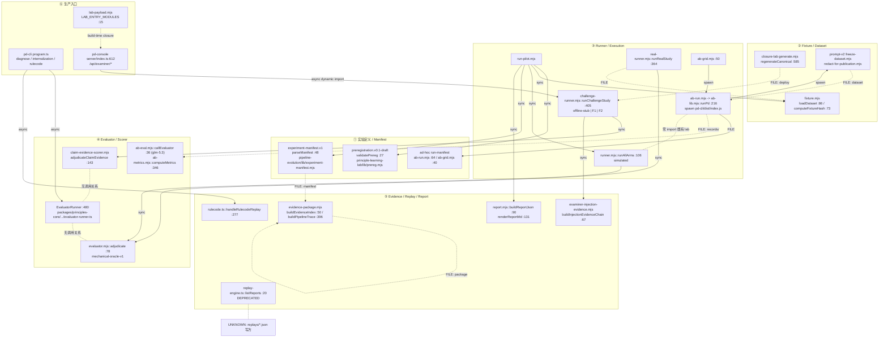

# PD Lab Capability Inventory — Read-only Architecture Audit

> PRI-1244 · 只读架构调查 · 调查日期 2026-11-16
>
> 本报告只描述**当前源码中实际存在并实际连通**的实验基础设施。所有结论均以本报告代码基线为准，
> 文档只作为线索。凡无法由源码证明的关系一律标 `UNKNOWN`，不以概念图或相似命名替代证据。

---

## 1. Executive Summary

**核心结论：PD 目前不存在一条统一、可复用的实验生命周期。** 仓库里存在四套彼此独立的实验工具族、
一套生产业务运行时中同名但业务专用的机制，以及一个只做声明的 `docs/experiments/` 资产目录。
它们之间**没有共享的实验身份、没有共享的 Evaluator、没有共享的 Evidence 协议**，
唯一的"生产 ↔ Lab"连接是 pd-console 的 Examiner 路由对 `principle-learning-lab` 中
Challenge/Examiner 子集的动态 `import` 桥接。

五项最重要的架构发现：

1. **没有统一实验定义协议。** `experiment-manifest.v1`、`preregistration.v0.1-draft`、
   PR #2653 的 ad-hoc `run-manifest` 三套并存，字段语义互不满足，实验 ID 无注册表。
2. **没有统一 Runner 与 Evaluator。** G1 模拟 runner、G2 真实 runner、Challenge 三模式 runner、
   `ab-run` 调度器并存；Evaluator 至少四套（机械 oracle、claim-evidence scorer、
   内部化 LLM judge、PR #2653 glm-5.3 盲评），彼此**零代码复用**。
3. **生产桥只覆盖一小部分 Lab 能力。** `scripts/build/lab-payload.mjs:15-24` 的
   `LAB_ENTRY_MODULES` 只有 7 个 Examiner/Challenge 模块；G1/G2 核心模块
   （`prereg/fixture/runner/evaluator/real-runner/report/evidence-verifier`）均不在生产载荷闭包内。
4. **"Replay" 是四种不同语义。** 确定性夹具重执行、Challenge 轨迹重放校验、
   RuleCode 沙箱确定性重执行、以及已退役的遗留报告只读查询——**没有真实宿主运行的 trace replay**。
5. **PR #2653 是一套自洽但高度一次性的 A/B 底盘。** 它把真实执行正确委托给生产 CLI 的 dist，
   但编排/评分/指标/盲化/报告全部自建且硬编码（4 个绝对 worktree 路径、v1 base commit、
   16 个 painId、18/19 个提示变体、rubric、模型、阶段集合），**零 import 既有 lab 库**。

**问题 A–E 的结论见 §12 之前的分节与本文末尾「最终结论」。**

---

## 2. Investigation Baseline（调查基线）

| 项目 | 值 |
|---|---|
| 调查日期 | 2026-11-16 (GMT+8) |
| 仓库 | `csuzngjh/principles`（`origin` = `https://github.com/csuzngjh/principles.git`） |
| 默认分支 / 基础分支 | `main` |
| **基础分支 HEAD SHA** | `45a7fd7062f9d9de65fa0460c05faab1e9def7ce`（`fix(runtime): persist pain reports before diagnosis readiness (#2671)`） |
| **PR #2653 合并 commit SHA** | `63e76a8bd6911db6d0a654897e0280e326a83e7e`（squash merge，单 parent `49d55e9374b0500be52ba087d89187b793e2b8e0`） |
| PR #2653 合并时间 | 2026-11-16T05:54:55Z |
| PR #2653 实际改动 | **141 个文件**：127 A + 14 M；其中 `experiment/prompt-v2/` 下 123 个，目录外 18 个 |
| 调查范围 | 以 `origin/main` 为准的整个 `packages/`、`scripts/`、`experiment/`、`docs/` 与 CI 配置 |
| 隔离方式 | 独立 worktree `D:/Code/_worktrees/principles/PRI-1244-lab-capability-inventory`，分支 `ai/PRI-1244-lab-capability-inventory` |

**基线核实细节（重要）：**

- 本地 `main` 在调查时 HEAD 为 `2927acefae`、落后 `origin/main` **31 个 commit**
  （`git rev-list --left-right --count main...origin/main` = `0 31`）。因此**未使用本地 main 作为基线**。
- 主工作树 `D:/Code/principles` 有 52 个未提交/未跟踪条目。按任务约束**未覆盖、未清理、未重置**；
  全部调查与报告写入均在独立 worktree 中完成。
- GitHub `gh pr view --json files` 只返回 **100** 个文件（API 上限）。以合并 commit 的
  `git diff-tree --no-commit-id --name-status -r 63e76a8bd...` 为准，实际为 **141** 个文件：
  123 个在 `experiment/prompt-v2/`（全部为新增），目录外 18 个
  （1 个 changeset + 6 个生产 prompt builder 修改 + 4 个测试/snapshot 修改 + 3 个新增测试 + 其余测试文件）。
  合并后 `git log --diff-filter=A 63e76a8bd..HEAD -- experiment/prompt-v2` 为空，
  即 `analysis/`、`snapshots/` 也属于 PR #2653 本身，而非后续提交。
- 文档只作为线索；`docs/experiments/README.md`、`docs/pipeline-evolution/README.md`、
  `scripts/dev/principle-learning-lab/README.md` 均已通读，其描述已逐项回到源码核对。
- 本报告中的所有行号均对应上述基线 SHA。

---

## 3. Existing Experiment Infrastructure（现有实验基础设施总览）

### 3.1 四套实验工具族 + 一个生产桥

| # | 工具族 | 根目录 | 入口 | 定位 |
|---|---|---|---|---|
| A | Principle Learning Lab — G1/G2 pilot 栈 | `scripts/dev/principle-learning-lab/` | `run-pilot.mjs`、`run-formal-study.mjs`（`package.json:60,61`） | 确定性、全合成研究原型；README 自述"未跑真实模型" |
| B | Principle Learning Lab — Challenge/Examiner 栈 | 同上 `lib/challenge-*.mjs`、`examiner-study.mjs` | `run-challenge-study.mjs`、pd-console `/api/examiner/*` | **唯一被生产 Console 动态加载的 lab 子集** |
| C | Pipeline Evolution + Closure Lab | `scripts/dev/pipeline-evolution/`、`scripts/dev/pipeline-closure-lab/` | `dev:evolution-init`、`dev:evolution-evidence`、`dev:closure-lab` | 只读取证 + 证据包派生 + 确定性夹具 |
| D | Adaptive Selector Lab | `scripts/dev/adaptive-selector-lab/` | `orchestrate.mjs`、`diagnostic.mjs`、`approved-run.mjs` | 审批门控的模型选择研究；协议已在生产 TS 中重写 |
| E | PR #2653 Prompt V2 A/B 底盘 | `experiment/prompt-v2/` | `ab-grid.mjs` → `ab-run.mjs` 等 CLI（无 npm script） | 真实 Pain A/B；自建全链；一次性代码为主 |

另有：

- `docs/experiments/`：`behavior-signature.json` 声明资产，`docs/experiments/README.md:3-4` 明写
  "本目录**不是**系统组件：没有数据库表、没有 runtime 对象、没有长期存储"。其形状校验只存在于
  `packages/principles-core/tests/behavior-signature-artifact.test.ts`，不是 `verify:merge` 门禁
  （`README.md:60-61` 自述）。**分类：PLANNED/声明资产。**
- `packages/*` 业务运行时：存在 Runner / Evaluator / Replay / Evidence / Report 同名实现，
  但全部绑定内部化、诊断、Examiner 业务流程（详见 §4、§6）。

### 3.2 关键边界：`LAB_ENTRY_MODULES`

`scripts/build/lab-payload.mjs:15-24` 定义生产安装载荷中 lab 的**唯一入口白名单**：

```
lib/examiner-study.mjs
lib/challenge-runner.mjs
lib/challenge-behavior-report.mjs
lib/challenge-actor.mjs
lib/examiner-injection-evidence.mjs
lib/examiner-v07-cases.mjs
lib/examiner-v2-cases.mjs
```

`collectLabModuleClosure(labRoot)`（`scripts/build/lab-payload.mjs:33-56`）以这些入口做相对 `import`
的传递闭包，越出 `lib/` 即 fail-loud。消费者：

- `packages/create-principles-disciple/scripts/bundle-plugin.mjs:11,548-562`（`prepack/prepublishOnly` 钩子）
- `scripts/dev/experiment-install-layout.mjs:35,135-158`（实验安装布局）
- 运行时 `packages/pd-console/src/server/routes/examiner.ts:77`（`LAB_ENTRY`）、
  `:92-100`（`PD_EXAMINER_LAB_ROOT` 覆盖）、`:143-160`（动态加载）、`:240`（缺载荷 503 `examiner_lab_unavailable`）

**这意味着：只有 B 族是 PRODUCTION-GATED；A 族 G1/G2 核心模块、C/D/E 族均不在生产载荷内。**

---

## 4. 七类核心能力盘点（Manifest / Fixture / Runner / Evaluator / Replay / Evidence / Report Inventory）

### 4.1 Manifest / 实验定义

| 契约 | 源码位置与符号 | 字段 / 校验 | 调用方 | 实际使用 |
|---|---|---|---|---|
| `experiment-manifest.v1` | `scripts/dev/pipeline-evolution/lib/experiment-manifest.mjs:17` `MANIFEST_SCHEMA`；`:48` `parseManifest`；`:137` `loadManifest`；`:153` `newManifestTemplate` | 必填 `experimentId/scenarioId/host/startedAt/pdCommit`（`:19,53-60`）；模板含 model/featureFlags/fixtureHash/sessionIds/painIds/correlations/behaviorObservation（`:155-177`）。**无 hypothesis / arm / sample / stopping / baseline-treatment 字段**。肯定性结论须 ≥1 条 evidence（`:95-122`） | `init-experiment.mjs:26,121`；`collect-evidence.mjs:39,594`；`principle-learning-lab/run-pilot.mjs:37,155-166`（host=`simulated`） | LAB-ONLY。`packages/*` 零 import |
| `preregistration.v0.1-draft` | `scripts/dev/principle-learning-lab/lib/prereg.mjs:27` `validatePrereg`（唯一导出） | `studyId`、claims（含 `contrastId`/`hypothesisDirection`/`primaryMetric`/`competingExplanations`/`analysisUnit`）、`contrastDesign`、`primaryMetricsByProbe`、`allocationAndAnalysis.executionOrder`（严格排列校验 `:55-77`）、`informationCutoff`、`budget`、`ownerDecisionsPending`。拒绝工具伪造审批（`:34-36`） | 仅 `run-pilot.mjs` + 测试 | LAB-ONLY。状态为 `DRAFT_NOT_OWNER_APPROVED`；无版本冻结逻辑，冻结在 `sidecar.mjs` |
| ad-hoc run manifest | `experiment/prompt-v2/scripts/ab/ab-run.mjs:64-76`；`ab-grid.mjs:40-47`；`ab-dreamer-paired.mjs:86-100` | `runId`/shard/heads/datasetFile/datasetSha256；arms.role=control/treatment。**无 schema、无注册表**，`runId` 是自由 CLI 参数 | 仅 #2653 自身脚本 | LAB-ONLY/一次性 |
| `behavior-signature.json` | `docs/experiments/<slug>/`；校验在 `packages/principles-core/tests/behavior-signature-artifact.test.ts` | intentContract 逐字复制 + eligibleOpportunity + previousBehavior + observationWindows | 测试 | PLANNED/声明资产 |

**实验 ID：** 三套机制互不共享——`experiment-manifest` 由操作者 CLI 传入（`init-experiment.mjs:94,122`，无生成器）；
`principle-learning-lab` 由调用方硬编码/传入（`run-pilot.mjs:89` `PLE-PILOT-01`；
`run-formal-study.mjs:211,247`）；#2653 `runId` 自由传参。**不存在全局实验 ID 注册表**
（`experiment-manifest.mjs:11-13` 注释亦承认 "no registry until SPEC Phase 2"）。

**版本冻结：** `init-experiment.mjs:99-105` 用 `git rev-parse HEAD` 抓 `pdCommit`，`:107-113` 读三个
`package.json` 版本；`sidecar.mjs:48-62` `freezeCandidate()` 以 `sha256(policyText)` + byteLength 冻结候选；
#2653 以 `prompt-hashes*.json` + `check-frozen-files.mjs:16-33` 钉死 16 个运行时文件的 blob SHA。
三者互不兼容。

### 4.2 Fixture / Dataset

| 能力 | 源码与符号 | 性质 | 实际使用 |
|---|---|---|---|
| G1 合成夹具 | `principle-learning-lab/lib/fixture.mjs`：`DATASET_SCHEMA='pd-principles-dataset.v0.1'`（`:15`）；`computeFixtureHash`（`:73`）；`loadDataset`（`:86`）；`healthCheck`（`:265`）；`assembleActorInput`（`:199`）；`scanGoldLeak`（`:238`） | **全合成**，强制 `synthetic===true`（`:272-283`）；14 文件固定顺序 + 排序拼接 sha256（`:47-79`）；canary 防泄漏；gold 不可见。`preregistration.json` 特意排除在 hash 外并单独算 hash（`:120-130`） | LAB-ONLY，`run-pilot.mjs`；无生产调用 |
| closure-lab 夹具 | `scripts/dev/pipeline-closure-lab/generate.mjs:585-654`（`regenerateCanonical`）、`:675-707`（`deployCopy`） | 公式种子、无随机；`DEPLOY_EXCLUDE` 剥离 ground truth（`:663-673`）；6 个场景 | LAB-ONLY，`dev:closure-lab`；不在 CI |
| #2653 真实 Pain 数据集 | `experiment/prompt-v2/dataset/pain-dataset.json`（4969 行）、`pain-inventory.json`（16822 行）；`freeze-dataset.mjs:25-42`（16 个 painId）、`:115-135`（每样本 inputDigest）；`redact-for-publication.mjs:112-152,224-249`（脱敏 + fail-closed 断言） | **真实生产 DB 快照**；提交副本字段级脱敏，全保真副本在 gitignored `.tmp`；`loadDataset`（`ab-lib.mjs:242-259`）与 `assertFullFidelityDataset`（`ab-blindpack.mjs:148-167`）遇脱敏值直接抛错 | 一次性；`redact-for-publication.mjs` 是**无依赖纯函数库，具通用性**（被 `scripts/__tests__/pdspec001-redaction.test.ts:16` import） |
| adaptive-selector 夹具 | `scripts/dev/adaptive-selector-lab/fixture-workspace.mjs:17` `seedFixtureWorkspace`（async，播种真实 SQLite） | 不是 stub reader，向真实 Reader 播种；无 digest，成本是 char 数 | LAB-ONLY，被 `scripts/dev/adaptive-activation/run-cases.mjs:28,318` 等复用 |
| 测试框架 fixture | `packages/*/tests/fixtures/**`、`docs/plans/**` | 测试专用 | 不构成实验数据管理 |

**没有**跨工具族的统一 Fixture 管理、统一样本 ID、跨实验样本复用协议。真实样本仅存在于 #2653；
G1/G2 全部为合成样本。

### 4.3 Runner / Execution

| Runner | 入口与符号 | 模式 | 配对/隔离/恢复 | 调用关系 |
|---|---|---|---|---|
| G1 模拟 | `principle-learning-lab/lib/runner.mjs:27` `runArm`、`:106` `runAllArms` | 仅 `simulated`，无开关 | history×strategy 配对；arm 局部内存；无进程隔离；无 retry（timeout 即结算） | 仅 `run-pilot.mjs:28` + 测试 |
| G2 真实 | `lib/real-runner.mjs:120` `runRealArm`、`:364` `runRealStudy` | transport 注入，真实/离线 Fake 由调用方决定 | `contentMode`（policy/summary/raw/none）四向对照；每 arm 新建 transport | 仅 `run-formal-study.mjs:38`（动态 import）+ 测试；README:98 "未跑真实模型" |
| Challenge（生产桥） | `lib/challenge-runner.mjs:263` `RUNNER_EXECUTION_MODES = ['offline-stub','F1-direct-model','F2-real-host']`、`:405` `runChallengeStudy` | 三模式 | 写锁 + append-only ledger（`:436,470`）；skip 已结算；`RESULT_UNKNOWN` 不自动重试（`:481-485`）；断路器；`runChallengeStudyResume`（`:875`） | CLI `run-challenge-study.mjs`；pd-console `examiner-executor.ts:600-605` 动态加载 |
| closure-lab | `scripts/dev/pipeline-closure-lab/generate.mjs:709-710` + 各场景 `verify.js` → `lib/report.cjs:26` `runConsumer`（async `execFile`） | 夹具部署 + 机械断言 | 公式种子；子进程隔离 | 手动 CLI + 场景本地 `npm test`，不入 CI |
| #2653 A/B | `ab-grid.mjs:50-65` spawn ×N → `ab-run.mjs` → `ab-lib.mjs:216-236` `runPd` | **真实模型**：`spawn(process.execPath, [<arm>/packages/pd-cli/dist/index.js, ...])`，调用 `pain record`/`diagnose run`/`runtime internalization run-once` | 4 个 arm worktree 硬编码（`ab-lib.mjs:27-37`）；CAS 租约回收（`ab-run.mjs:88-98`）；`runId` 自由传参 | 完全自建，**零 import 既有 lab runner**；执行委托给生产 CLI 的 dist（非源码） |

**关键判断：没有统一 Runner。** #2653 是唯一执行真实生产 CLI 的 A/B runner，但它执行的是**两个独立
worktree 中已编译的 dist**（v1 冻结在 base、v2 treatment），并通过各臂 dist 的 TypeBox schema 校验产物
（`ab-run.mjs:31-40`）。它没有重实现诊断/内部化业务逻辑，但重实现了编排、租约与完成判定。

### 4.4 Evaluator / Scorer / Metrics

| 评价器 | 源码与符号 | 性质 | 与谁连通 |
|---|---|---|---|
| G1 机械裁定 | `principle-learning-lab/lib/evaluator.mjs:31` `JUDGE_ID='mechanical-oracle-v1'`、`:78` `adjudicate`、`:143` `runCalibration` | 三层分离（objectiveTaskStatus / principleAlignment / ownerCost）；`blinded:true`；**无 LLM judge**（`report.mjs:124` `NOT_SUPPORTED`）；rubric `gold.v0.1` | `runner.mjs:13`、`real-runner.mjs:38`、`run-pilot.mjs:26` + 测试 |
| G1 门 + 报告 | `lib/report.mjs:27` `evaluateG1Gate`、`:90` `buildReportJson`、`:131` `renderReportMd` | baseline/treatment 比较在这里，**不在 evaluator**；MD 由 JSON 确定性派生 | 仅 `run-pilot.mjs:36` |
| Examiner scorer | `lib/claim-evidence-scorer.mjs:143` `adjudicateClaimEvidence`（`claim-evidence-adjudication.v3`） | production-bridged；`challenge-runner.mjs:39,425` 默认注入；与 `evaluator.mjs` **无代码复用**（仅注释声称 mirror discipline） | Challenge 栈 + pd-console Examiner |
| 内部化 LLM judge | `packages/principles-core/src/runtime/internalization/evaluator-runner.ts:480` `class EvaluatorRunner`（4104 行）；prompt builder `evaluator-prompt-builder.ts:681` `EVALUATOR_PROTOCOL_INSTRUCTION`/`:696` `buildPrompt`（合约 `evaluator-output-v1.prompt.v13`）；输出契约 `evaluator-output.ts:428` `isEvaluatorOutputV2`、`:445` `EvaluatorValidator` | **完全绑定内部化业务流**（Dreamer→…→Evaluator→Rule activation）；驱动 Artificer 修复（`:2383`）、治理效应（`:2314`）、rule artifact（`:3553`）；失败的 LLM `adversarialResult` 在落库前被剥离（`:951-953`） | `pd runtime internalization run-once --runner evaluator`；宿主 auto-consumer；非实验 evaluator |
| #2653 盲评 + 指标 | `ab-eval.mjs:27-34` rubric（6 阶段维度权重）、`:36` `callEvaluator`（`node:https` 直连 glm-5.3）、`:90` `buildEvalPrompt`；`ab-diversity-eval.mjs:25-48` 8 指标；`ab-metrics.mjs:207` `layer1`、`:258` `buildFullChainPairing`、`:297` `buildPerAgentPairing`、`:346` `computeMetrics` | rubric/模型/prompt **全部硬编码在源码**，无版本号；盲包由 `ab-blindpack.mjs:334` `buildBlindPack` + `:106` `scrubLeakyFields` + `:124` `findBlindViolations` 生成，blindmap 单独文件 | 仅 #2653 自身脚本 |
| Quality scorecard | `packages/principles-core/src/quality-scorecard/report-generator.ts:31/121/222` | 业务质量评分卡（14 维 + 强模型裁定），非实验报告 | `pd quality scorecard`（hidden CLI） |

**Examiner 边界：必须区分。** Examiner 是**生产 Console 可达的研究管线**（研究问题 + prereg + arm config +
盲评/证据链），其评分走 `claim-evidence-scorer.mjs`；内部化 `EvaluatorRunner` 是**业务流水线门**；
G1 `evaluator.mjs` 是**确定性机械 oracle**。三者只共享"evaluator"命名与部分纪律理念，**没有调用关系**。

### 4.5 Replay

| 形态 | 源码 | 语义 | 判定 |
|---|---|---|---|
| Deterministic re-execution | G1 `fixture.mjs:7-9` 注释、`report.mjs:140` "deterministic replay: yes"；`run-pilot.mjs:11-13` `startedAt` 不参与 replay-identity | 冻结夹具 + 无时钟无随机 → 重跑得到同一结果 | 可复现，但不是 trace replay |
| Fixture-based verification | `challenge-behavior-report.mjs` `replayChallengeExecution`（测试：`principle-learning-lab-productization-integration.test.ts:9,50-59`、`principle-learning-lab-frozen-package.test.ts:9,35`）；`run-exm-mvp-offline.mjs:13` `replayExmPackage` | 对照 `expected-replay.json` 校验 `reportHash`/`executionsHash`；可抛 `SCORE_REPLAY_MISMATCH`/`STATE_REPLAY_MISMATCH`/`IMPLEMENTATION_DRIFT`/`GOLD_OR_INPUT_DRIFT` | **重放校验**，不重放真实宿主 |
| RuleCode sandbox 重执行（生产） | `evaluator-runner.ts:2747` `executeDeterministicReplay`、`:3010` `evaluateRefinerRuleHostGate({code, goldenTrace})`；CLI `packages/pd-cli/src/commands/rulecode.ts:277` `handleRulecodeReplay`、`:363` 调用 gate | 冻结 golden trace 上重执行规则代码，决定是否可激活 | 生产确定性重执行，绑定内部化 |
| 遗留报告只读查询 | `packages/openclaw-plugin/src/core/replay-engine.ts:11` `ReplayEngine`、`:20` `listReports`、`:48` `hasPassingReport`；类型 `principles-core/src/runtime/types/replay-types.ts:7-42` | 只读 `<implAssetRoot>/replays/*.json`，**零重执行** | **DEPRECATED**：`openclaw-plugin/src/index.ts:1016` "replay 生成路径已在 PRI-230 退役"；写方 UNKNOWN |
| Re-execution（#2653） | `experiment/prompt-v2/reports/EXPERIMENT_REPRODUCIBILITY_REPORT.md:16-33` | 靠重跑脚本重建产物；grep `replay` 在脚本中仅命中 `dump-v1-prompts.mjs:10` 注释 | **不是 replay** |

**结论：不存在"恢复原始实验定义 + 输入 + Prompt + 模型 + 运行配置 + 执行轨迹"的统一 Replay 入口。**
真实宿主运行无法被 trace 回放；只能重新执行或离线仿真。

### 4.6 Evidence

| 机制 | 源码与符号 | 身份 / Digest | 性质 |
|---|---|---|---|
| Pipeline evidence package | `pipeline-evolution/lib/evidence-package.mjs:50` `buildEvidenceIndex`、`:331` `buildMetrics`、`:396` `buildPipelineTrace`、`:436` `renderOwnerReview`；写出在 `collect-evidence.mjs:469-484` `writePackage`、`:414-467` `exportArtifacts` | 每 artifact sha256（`:404-406,451`）；**无包级 digest**；trace 阶段表 `:388-394`，behavior 恒 UNKNOWN（`:422`） | 从只读 store 派生的证据索引；纯函数；LAB-ONLY |
| Lab 注入证据链 | `principle-learning-lab/lib/examiner-injection-evidence.mjs:31-33` 六级链、`:67` `buildInjectionEvidenceChain`、`:164` `verifyInjectionEvidenceChain`、`:251` `collectOfflineStubInjectionEvidence` | `studyId/unitId/caseId/armId/repetitionId/attemptId/principleHash/promptHash/receiptHash` + `chainHash`（`:153`） | **production-bridged**（在 `LAB_ENTRY_MODULES` 内）；真实 host 上限 `SUBMITTED`（`:41-46`） |
| 生产业务证据链 | `principles-core/src/runtime/types/evidence-chain-contract.ts:954` `assembleEvidenceChain`；`pd-console/src/server/models/EvidenceChainConsoleModel.ts:249-330`；`ExaminerEvidenceModel.ts:200-260` | pain/task/candidate/principle ID 链（`:65-131,1294-1313`）；**不产 digest**；内容 hash 仅内部去重 | 业务证据 read model，非实验证据包 |
| 内部化证据就绪门 | `evidence-readiness.ts:378` `computeBehaviorExamplePackDigest`（`sha256:`）、`:400` `assessEvidenceReadiness` | 行为样例 pack digest | 业务门，非实验 |
| #2653 散列钉子 | `dataset-manifest.json:41-58` sampleDigests、`ab-run.mjs` `artifactsSha256`、`ab-lib.mjs:55-56` `sha256/sha256File`、`blindpack/packages.json` + `blindmap.json` | 多处 sha256，但**无统一 Evidence Package / Index** | 一次性 |

**结论：不存在统一、可验证的实验证据协议。** Evidence 是不同模块分别生成的文件集合/业务链；
只有 `examiner-injection-evidence.mjs` 形成了带 chainHash 的六级可验证链，但它服务于 Examiner 研究，
不是通用实验证据包。

### 4.7 Report

| 报告生成器 | 源码 | 输入→输出 | 判定 |
|---|---|---|---|
| G1 comparison report | `principle-learning-lab/lib/report.mjs:90` `buildReportJson`、`:131` `renderReportMd` | `{dataset, study, adjudications, calibration, gate, studyHash, arms}` → `comparison-report.v0.1` JSON + MD（MD 确定性派生，禁止手工重抄） | LAB-ONLY；唯一"从结构化数据自动生成"的实验报告 |
| Evidence owner review | `evidence-package.mjs:436` `renderOwnerReview` | evidence package → `report.md` | LAB-ONLY |
| Examiner behavior report | `challenge-behavior-report.mjs` `buildBehaviorReportV2` | challenge 执行 → behavior-report-v2.json | production-bridged（载荷内） |
| Quality scorecard | `report-generator.ts:31/121/222` | `QualityScorecardReport` → MD/HTML/JSON 字符串，零 I/O | 业务报告，`pd quality scorecard` hidden CLI |
| #2653 报告 | `experiment/prompt-v2/reports/*.md` 共 **25 个** | 全部**手写 markdown**；唯一脚本生成的 md 是 `analysis/owner-spotcheck-list.mjs:71`（写入 gitignored `.tmp`） | 一次性人工报告 |

**区分：** 实验报告（G1）、Examiner 报告、业务诊断/质量报告、临时实验分析 Markdown 是**四种不同职责**，
不因都叫 Report 而具有同一协议。

---

## 5. Actual Call Graph（真实调用关系）

以下 Mermaid 图只画**源码可证**的调用/交接关系。实线箭头为进程内调用（标注 sync/async），
点线为**文件交接**，虚线为无法证明的关系（`UNKNOWN`）。节点标签使用真实源码符号与路径。



**对应关系核查（§5 的十个问题）：**

| 问题 | 答案 |
|---|---|
| 谁创建实验？ | 无统一创建者。`init-experiment.mjs`（manifest）、`run-pilot.mjs`（study）、#2653 各 CLI（runId）各自创建 |
| 谁准备输入？ | G1 `fixture.mjs::assembleActorInput`；closure-lab `generate.mjs`；#2653 `freeze-dataset.mjs` |
| 谁执行？ | 四个独立 Runner（见 §4.3） |
| 谁评价？ | 四套 Evaluator（见 §4.4） |
| 谁生成 Evidence？ | `collect-evidence.mjs`（LAB）、`examiner-injection-evidence.mjs`（production-bridged）、业务链（production） |
| 谁生成 Report？ | G1 `report.mjs`（自动生成）、25 份手写 MD（#2653）等 |
| ID 如何传递？ | **未打通**：experimentId / studyId / runId / unitId 分属不同协议，无共享关联键 |
| 直接耦合？ | `run-pilot → {fixture,runner,evaluator,report}`；`challenge-runner → {claim-evidence-scorer, injection-evidence}`；`console → lab payload` |
| 存在但未连接？ | G1/G2 核心模块不接生产；`evidence-package` 不接 #2653；`pipeline-evolution` 不接 `EvaluatorRunner`；`ReplayEngine` 不接任何生成方 |

---

## 6. Production vs Lab Maturity Matrix（成熟度矩阵）

分类标准：`PRODUCTION` / `PRODUCTION-GATED` / `LAB-ONLY` / `TEST/POC` / `PLANNED` / `DEPRECATED` / `UNKNOWN`。

| 模块 | 成熟度 | 生产入口 | Lab 入口 | 测试入口 | Flag / Gate | CI | 判定理由 |
|---|---|---|---|---|---|---|---|
| `experiment-manifest.mjs` | LAB-ONLY | 无 | `dev:evolution-init`、`dev:pl-pilot` | `pipeline-evolution-evidence.test.ts`、`principle-learning-lab.test.ts` | 无 | test:scripts | `packages/*` 零 import；manifest 只界定实验 |
| `evidence-package.mjs` + `collect-evidence.mjs` | LAB-ONLY | 无 | `dev:evolution-evidence` | `pipeline-evolution-evidence.test.ts` | 无 | test:scripts | 纯函数 + 只读 DB 派生；无生产写方/读方 |
| `pipeline-closure-lab` | LAB-ONLY | 无 | `dev:closure-lab` | 各场景本地 `npm test` | 无 | 未纳入 | 场景 `verify.js` + `report.cjs`；不入 CI |
| `adaptive-selector-lab` | LAB-ONLY | 无（生产 TS 仅注释引用协议） | `orchestrate.mjs`/`diagnostic.mjs` | 3 个 `node:test` .mjs | `--execute-approved-*` + 一次性 claim | 未纳入 | 真实请求有审批门控，但无生产 import |
| G1/G2 核心（`prereg/fixture/evaluator/runner/real-runner/report/evidence-verifier`） | LAB-ONLY | 无 | `run-pilot.mjs`、`run-formal-study.mjs` | `scripts/__tests__/principle-learning-lab*.test.ts` | `NOT_AUTHORIZED` 配置门 | test:scripts | 不在 `LAB_ENTRY_MODULES`；README:98 "未跑真实模型" |
| Challenge / Examiner 栈（`challenge-runner`、`claim-evidence-scorer`、`examiner-injection-evidence`、`examiner-study`、`challenge-behavior-report`） | **PRODUCTION-GATED** | `/api/examiner/*`（`server/index.ts:612-614` 无条件注册） | `run-challenge-study.mjs` | `scripts/__tests__/*` + console BDD/E2E | lab 载荷缺失→503；F2 需 APPROVED Stage R（`:956`）；`PD_EXAMINER_LAB_ROOT` | 部分 | 唯一生产 lab 桥；载荷由 `bundle-plugin.mjs` 打包 |
| `lab-payload.mjs` | PRODUCTION | 安装器 prepack + console 运行时 | `experiment-install-layout.mjs` | `lab-payload-closure.test.ts` | 无 | test:scripts | 单一"lab 子集"定义，fail-loud |
| `docs/experiments/behavior-signature.json` | PLANNED | 无 | 无 | `behavior-signature-artifact.test.ts` | 无 | 未证实 | README 明写"不是系统组件" |
| `EvaluatorRunner` / `evaluator-prompt-builder` / `evaluator-output` / `evidence-readiness` | PRODUCTION | `pd runtime internalization run-once`；宿主 auto-consumer | 无 | 大量 `__tests__` | `evaluator_artificer_repair_loop` flag（默认 ON）；`internalization_auto_consumer` | 是 | 生产业务门，非实验 evaluator |
| `runner-phase/runner-result/base-peer-runner` | PRODUCTION | 同上 | 无 | 架构回归测试 | 同上 | 是 | 业务 runner 基座 |
| `rulecode replay` / evaluator 内 replay | PRODUCTION | `pd rulecode replay`（hidden） | 无 | 测试 | 无 | 是 | 规则沙箱确定性重执行 |
| `evidence-chain-contract` / `EvidenceChainConsoleModel` / `ExaminerEvidenceModel` / `evidence-guards` / `evidence-sanitizer` / `evidence-ref-binding` / `evidence-outcomes` | PRODUCTION | `/api/evidence-chain`、`/api/evidence/outcomes`、诊断链 | 无 | 测试 | 无 | 是 | 业务证据子系统，非实验证据 |
| `report-generator.ts`（quality-scorecard） | PRODUCTION | `pd quality scorecard`（hidden CLI） | 无 | 测试 | 无 | 是 | 业务质量报告 |
| `experiment-workspace-guard.ts` | PRODUCTION-GATED | 宿主 hooks（当 `PD_EXPERIMENT_ROOT` 存在） | 实验 workspace | 测试 | `PD_EXPERIMENT_ROOT` | 是 | 隔离守卫，不是执行能力 |
| `replay-engine.ts` / `replay-types.ts` | DEPRECATED | 插件 `/pd-promote-impl` 只读查询 | 无 | 测试 | 无 | — | 生成路径 PRI-230 退役；写方 UNKNOWN |
| `experiment/prompt-v2/scripts/*` | LAB-ONLY / TEST-POC | 无（无 npm script、无 CI） | 手动 CLI | `pdspec001-*.test.ts` | 无 | 未证实执行 | 一次性 A/B 底盘；无生产路径 |

**注意：** 上表 `PRODUCTION` 指的是"被生产入口调用"，**不意味着该模块是通用实验基础设施**。
绝大多数 PRODUCTION 行都是业务实现。

---

## 7. PR #2653 Capability Mapping（实验能力映射）

### 7.1 #2653 实际包含什么

合并 commit `63e76a8bd...` 实际改动 141 个文件（见 §2）。其中：

- `experiment/prompt-v2/` 下 123 个新增文件：
  - `baseline/`（V1 prompt 快照 + model-config + prompt-hashes）
  - `prompts/`（V2 canonical 6 个 + runtime 变体 19 个 + hashes）
  - `dataset/`（真实 pain 数据集、inventory、dataset-manifest）
  - `scripts/ab/`（12 个 A/B 脚本）、`scripts/analysis/`（3 个）、顶层工具 12 个、3 个测试
  - `reports/` 25 份手写 Markdown、`isolation/` 报告、`snapshots/`
- 目录外 18 个：changeset、6 个生产 prompt builder 修改、其测试/snapshot 与 3 个新增测试。

### 7.2 逐项映射表

判定取值：`DIRECT REUSE` / `ADAPTER REQUIRED` / `CONTRACT GAP` / `MISSING` / `UNKNOWN`。
"现有能力"指 §3–§4 中已盘点的模块；"接入"指 #2653 资产复用现有能力。

| # | #2653 实验资产 | 判定 | 证据与理由 |
|---|---|---|---|
| 1 | Prompt Variant | **CONTRACT GAP** | #2653 `dump-v2-prompts.mjs:40-74` 生成 19 变体 + `prompt-hashes-v2.json`；没有通用 variant 管理模块。现有 `sidecar.mjs::freezeCandidate` 只冻结单个候选文本（`:48-62`），不含 arm/variant 矩阵语义 |
| 2 | Experiment Definition | **CONTRACT GAP** | `experiment-manifest.v1` 无 arm/hypothesis/stopping；`preregistration.v0.1` 无 prompt-variant/pain-sample 绑定；#2653 用 ad-hoc `run-manifest.*.json`（`ab-run.mjs:64-76`）。三者字段不重叠 |
| 3 | Fixture / Samples | **ADAPTER REQUIRED** | #2653 真实 Pain 样本 + 脱敏器；`redact-for-publication.mjs` 是无依赖纯函数（可 **DIRECT REUSE**），但 16 个 painId 硬编码（`freeze-dataset.mjs:25-42`），需适配到统一样本 ID / digest 契约 |
| 4 | Frozen Input | **CONTRACT GAP** | `dataset-manifest.json:41-58` sampleDigests + `check-frozen-files.mjs:16-33` blob SHA；现有 `fixture.mjs::computeFixtureHash`（`:73`）是 14 文件固定顺序的另一套 digest，不兼容 |
| 5 | Runner | **ADAPTER REQUIRED** | `ab-lib.mjs:216-236` `runPd` 已正确委托生产 CLI dist；但 4 个 worktree 绝对路径（`:27-37`）+ v1 base commit（`:40`）硬编码。可保留执行委托，把 worktree 解析抽成 adapter |
| 6 | Execution Records | **CONTRACT GAP** | `records/<sid>.<arm>.json` 内联拼装 `steps/status/verification/artifactsSha256`；无共享 schema，与 `experiment-manifest.v1` 或 `sidecar` 的 `adjudication.v0.1` 都不兼容 |
| 7 | Evaluator | **UNKNOWN → ADAPTER REQUIRED** | `ab-eval.mjs` glm-5.3 盲评；现有 4 套 evaluator 无一消费 prompt A/B 结果；`evaluator.mjs`（机械 oracle）只接受 G1 gold 结构。需要一个把 `evals/*.json` 映射到既有裁定契约的 adapter，但契约本身需先对齐 |
| 8 | Scorer | **ADAPTER REQUIRED** | `ab-metrics.mjs:207,258,297,346` 的 layer-1 + 配对指标逻辑是纯计算，可复用；但 arm 名（v1/v2/v2c/v21）与阶段集合写死 |
| 9 | Trace | **MISSING** | 仅 `record.steps[]`（时间戳 + stdout 尾部，`ab-run.mjs:171`）；无 `buildPipelineTrace` 式结构化 trace；真实宿主执行轨迹不可回放 |
| 10 | Evidence | **MISSING** | 无 evidence package/index；只有散列钉子。`examiner-injection-evidence.mjs` 的六级链是 Examiner 专用（绑定 `unitId/caseId`），不能承载 prompt A/B |
| 11 | Replay | **MISSING** | 只有"重跑重建产物"的可复现性；无 trace replay；与 `replayChallengeExecution`/`rulecode replay` 无关联 |
| 12 | Report | **CONTRACT GAP** | 25 份手写 MD；`report.mjs::buildReportJson`（`:90`）只接受 G1 adjudication；无 prompt A/B 对比报告生成器 |

**额外调查结论：#2653 是否已经实现自己的实验执行/评价/报告/数据管理？**

**是，且是完整自建的一套。** 证据：

- 执行：`ab-grid.mjs` → `ab-run.mjs` → `runPd` spawn 生产 CLI dist；自建编排、租约回收与完成判定。
- 评价/评分：`ab-eval.mjs`（盲评）、`ab-diversity-eval.mjs`、`ab-metrics.mjs`、`ab-blindpack*.mjs`、`ab-blind-summary.mjs`。
- 数据管理：`snapshot-and-discover.mjs` → `build-inventory.mjs` → `freeze-dataset.mjs` + `redact-for-publication.mjs`。
- 报告：25 份手写 Markdown + 脚本生成的 blind-summary/layer1-metrics JSON。
- **零复用**：全仓 grep 无任何 `import .../principle-learning-lab` 或 `.../pipeline-evolution`；
  唯一跨目录 import 是 `scripts/__tests__/pdspec001-redaction.test.ts:16` → `redact-for-publication.mjs`；
  `package.json` 无对应 npm script；`.github/` 与 `.cnb.yml` 无引用。

其中**真正具备通用能力潜质**的只有少数纯函数：`redact-for-publication.mjs`、
`ab-blindpack.mjs::{buildBlindPack, scrubLeakyFields, findBlindViolations}`、
`ab-metrics.mjs::{computeMetrics, layer1, build*Pairing}`、`ab-lib.mjs::{sha256, canonical, childEnv}`。
其余均为与 PD 六 Agent / 具体 arm / 具体 worktree 绑定的一次性代码。

---

## 8. Existing Architecture Boundaries（现有架构边界）

1. **产品边界（AGENTS.md §1）**：PD 拥有"与 Owner 相关的行为证据、重复行为模式诊断、可复审的
   原则提案、Owner 决策、可逆激活、行为变化观察"；不做通用任务执行、通用编排、通用记忆。
   实验基础设施应当服务于这条边界，而不是成为新的通用平台。
2. **单一真相源（AGENTS.md P4）**：`experiment-manifest.v1` 自我定位为 *metadata authority*，
   "what HAPPENED remains owned by the stores: state.db / trajectory.db / telemetry"（`:3-8`）。
   这是现有体系中最清晰的一条边界，应当保留。
3. **事实 vs 结论分层**：`evidence-package.mjs:8-15`、`docs/pipeline-evolution/README.md:68-71`
   明确 bucket（事实）与 status（结论）分离，未到达 = UNKNOWN，绝不判 FAIL。
4. **生产 ↔ Lab 边界**：`lab-payload.mjs:1-9` 只打包 console 实际可达的闭包，
   避免研究/transport 模块（读用户 home 的 API key）进入用户机器。这是**有意的安全边界**。
5. **安装器所有权（AGENTS.md §1.1）**：`~/.pd/runtime`、`<ws>/.pd/`、
   `~/.openclaw/extensions/principles-disciple` 归安装器，调查期间未触碰。
6. **业务门 vs 实验评价**：`EvaluatorRunner` 的产物直接驱动 Artificer 修复与 rule activation
   （`evaluator-runner.ts:2383,3553`），不能当作实验评分器复用。

---

## 9. Duplication and Architecture Risks（重复建设与架构风险）

> 本阶段只识别，不清理、不重构。

| # | 重复职责 | 涉及模块 / 源码位置 | 是否有真实调用 | 整合影响 | 建议复用的现有实现 |
|---|---|---|---|---|---|
| R1 | 多套实验定义协议 | `experiment-manifest.mjs:17`；`prereg.mjs:10,27`；`ab-run.mjs:64-76` | 各自在自己的 CLI 内被调用 | 实验身份无法互通，#2653 无法被 evidence/trace 链定位 | `experiment-manifest.v1`（唯一有正式 schema + 校验器）；研究设计字段下沉到 sidecar |
| R2 | 多套 Fixture / 数据集 | `fixture.mjs:15,73`；`closure-lab/generate.mjs:585`；`freeze-dataset.mjs:25-42` | 各自真实运行 | 冻结输入 digest 不兼容；真实 vs 合成样本无统一标记 | `fixture.mjs` 的 canonicalJson + sha256 纪律；#2653 的脱敏器 |
| R3 | 多套 Runner | `runner.mjs:106`；`real-runner.mjs:364`；`challenge-runner.mjs:405`；`ab-run.mjs`/`ab-lib.mjs:216` | 全部真实调用 | 执行模式/身份/恢复语义不同，无法统一调度 | 不强行合并；先统一"运行记录契约"与 ID 传递 |
| R4 | 多套 Evaluator / Scorer | `evaluator.mjs:78`；`claim-evidence-scorer.mjs:143`；`EvaluatorRunner:480`；`ab-eval.mjs:36`+`ab-metrics.mjs:346` | 全部真实调用 | 同名不同契约，最易被误判为"可复用" | 按职责分层：机械 oracle / 业务 judge / 实验盲评分别保留，禁止交叉误用 |
| R5 | 多种 Replay 语义 | `replayChallengeExecution`；`rulecode.ts:277`；`replay-engine.ts:20`；#2653 重跑 | 前三者有真实入口；`ReplayEngine` 半退役 | "已回放"表述极易误导 Owner | 明确术语：Deterministic Re-execution / Fixture-based Replay / Re-execution / Offline Simulation |
| R6 | 多套 Evidence 生成 | `evidence-package.mjs:50`；`examiner-injection-evidence.mjs:67`；`evidence-chain-contract.ts:954`；#2653 散列钉子 | 前三者有真实调用 | 无统一证据包，跨模块追溯断裂 | `examiner-injection-evidence.mjs` 的 chainHash + 六级链设计（但需去 Examiner 专用绑定） |
| R7 | 多种 Report 格式 | `report.mjs:90`；`evidence-package.mjs:436`；`challenge-behavior-report.mjs`；`report-generator.ts:31`；25 份手写 MD | 全部真实 | 结论分类/版本/追溯不一致 | `report.mjs` 的"JSON 为权威、MD 确定性派生"纪律 |
| R8 | 多套实验身份 | experimentId / studyId / runId / unitId / caseId / armId 分属 6 个命名空间 | 各自真实 | **无法把 #2653 的样本结果关联到 manifest/evidence/report** | 需要一个实验身份关联键（最小契约扩展） |
| R9 | Lab 与生产能力重复 | `evaluator.mjs`（LAB）vs `EvaluatorRunner`（PROD）；`challenge-runner`（LAB→PROD 桥）vs 业务 runner | 有真实调用 | 名实不符是最大评审风险 | 保留业务实现；Lab 只复用纯函数与纪律 |
| R10 | 无 CI 保护的实验路径 | #2653 脚本、closure-lab、adaptive-selector-lab | 手动执行 | 无人能保证冻结协议长期有效 | `lab-payload-closure.test.ts` 的 fail-loud 闭环模式 |

---

## 10. Reusable Components（可复用组件）

按"可复用程度"分级，均**不需要新子系统**：

**Tier 1 — 可直接复用（纯函数 / 已有正式契约）：**

- `scripts/dev/pipeline-evolution/lib/experiment-manifest.mjs:48,137,153`：`experiment-manifest.v1` 校验与模板。
- `scripts/dev/principle-learning-lab/lib/fixture.mjs:18,27,73`：`canonicalJson`、`sha256`、`computeFixtureHash`。
- `experiment/prompt-v2/scripts/redact-for-publication.mjs:112,224`：字段级脱敏 + fail-closed 断言（无依赖）。
- `scripts/build/lab-payload.mjs:33` `collectLabModuleClosure`：单一 lab 子集定义 + fail-loud 纪律。
- `scripts/dev/principle-learning-lab/lib/examiner-injection-evidence.mjs:67,164`：六级证据链 + chainHash 验证（需去业务绑定）。

**Tier 2 — 需要薄 Adapter：**

- `ab-lib.mjs:216` `runPd`：执行委托给生产 CLI dist 的思路正确；把 worktree 绝对路径解析抽成 adapter。
- `ab-metrics.mjs:207,258,297,346`：`layer1` + 配对指标；参数化 arm 名与阶段集合。
- `ab-blindpack.mjs:334,106,124`：盲包 + 去标识 + 泄漏自检；适配到统一样本 ID。
- `challenge-runner.mjs:405` 的三模式 runner：为 prompt A/B 增加一种 mode，而不是新建 runner。
- `report.mjs:90,131`：JSON 权威 + MD 确定性派生的报告模式。

**Tier 3 — 需要最小契约扩展（不是新协议）：**

- 在 `experiment-manifest.v1` 上增加**可选** `variant`/`sampleIds`/`evaluation` 绑定段（与现有
  `sidecar` 思路一致：研究指标放 sidecar，不污染原 manifest），或建立一个 manifest → run → evidence
  的身份关联键。
- 统一运行记录的最小字段：`experimentId / runId / armId / inputDigest / promptHash / modelId / status`。

**明确不应复用（职责不同）：**

- `EvaluatorRunner`（业务内部化门）、`evidence-chain-contract`（业务 Pain 证据链）、
  `report-generator.ts`（质量评分卡）、`ReplayEngine`（退役只读查询）。

---

## 11. Actual Gaps（真实能力缺口）

1. **统一实验身份与关联键**：没有把 experimentId → fixture digest → run → evaluation → evidence → report
   串起来的身份链（R8）。
2. **统一的实验评价契约**：能消费"Baseline vs Treatment + 多指标 + 盲评"的通用 evaluator 不存在；
   现有四套互不兼容（R4）。
3. **统一 Evidence Package**：无包级 digest、无统一 claim→evidence 索引覆盖 #2653 实验结果（R6）。
4. **真实 Replay**：无"恢复定义 + 输入 + Prompt + 模型 + 运行配置 + 轨迹"的重放；真实宿主只能重跑（§4.5）。
5. **统一对比报告生成器**：25 份手写 MD 说明缺从结构化结果自动生成对比报告的能力（§4.7）。
6. **CI 保护**：#2653 / closure-lab / adaptive-selector-lab 的冻结协议无 CI 守护（R10）。
7. **生产可复用的 prompt-variant 冻结机制**：`sidecar.freezeCandidate` 只冻结单候选，
   不含 arm/variant 矩阵语义（§7.2 #1）。

---

## 12. Recommended Minimal Integration Path（最小实施路径建议）

> 仅给顺序与理由，**不在本 PR 实施任何一项**。

1. **第一步：先定身份，不改协议主体。**
   在 `experiment-manifest.v1` 上增加可选绑定段（或 sidecar），定义
   `experimentId / runId / armId / inputDigest / promptHash / modelId` 最小关联键。
   理由：R8 是所有后续整合的前置条件；不改现有模块主体，符合 P3 最小变更面。
2. **第二步：把 #2653 执行入口接到现有 runner 的模式语义上。**
   保留 `ab-lib.mjs::runPd` 对生产 CLI dist 的委托，仅把 worktree 解析做成 adapter
   （`ADAPTER REQUIRED`），不要新建第五个 runner。
3. **第三步：把 #2653 的评价结果映射到既有裁定契约。**
   先明确 `ab-eval`/`ab-metrics` 的输出如何落入 `adjudication.v0.1` 风格的结构；
   若字段确实不足，才做**最小契约扩展**（`CONTRACT GAP`），不要复用 `EvaluatorRunner`。
4. **第四步：复用 `examiner-injection-evidence.mjs` 的 chainHash 设计做实验证据包。**
   去掉 `unitId/caseId` 业务绑定，保留六级链与验证器；不新建证据子系统。
5. **第五步：用 `report.mjs` 的 JSON 权威 + MD 确定性派生模式生成 #2653 对比报告。**
   替代 25 份手写 MD 中的核心结论部分；保留人工审计叙述为 sidecar。
6. **第六步：把上述冻结校验接进 `test:scripts` / CI。**
   复用 `lab-payload-closure.test.ts` 的 fail-loud 模式，防止冻结协议漂移。

**不推荐：** 新建统一 Lab 平台、统一 Runner 抽象、把 `EvaluatorRunner` 改造成通用 evaluator、
或把 `ReplayEngine` 复活为实验 replay。

---

## 13. Explicit Non-Goals（明确非目标）

- 本 PR **不包含任何业务代码、测试代码、实验数据改动**，只新增本报告。
- 本阶段**不实施**任何清理、重构、协议扩展、adapter 或 CI 变更（§12 仅为建议）。
- 本阶段**不新建** SPEC、Dev Experiment Kit、第二套 Manifest/Fixture/Runner/Evaluator/Replay/Evidence/Report。
- 不把测试通过等同于生产使用；不把文档规划等同于已实现；不把命名相似等同于可复用。
- 不修改 Owner 工作区、`.pd/`、安装目录或任何未提交改动。
- 不关闭 PRI-1244、不自动合并 PR、不部署。

---

## 14. Source Evidence Index（源码证据索引）

> 全部路径相对于报告所在基线 `45a7fd7062f9d9de65fa0460c05faab1e9def7ce`。

### 14.1 实验定义 / Manifest

| 符号 | 路径:行 |
|---|---|
| `MANIFEST_SCHEMA` / `parseManifest` / `loadManifest` / `newManifestTemplate` | `scripts/dev/pipeline-evolution/lib/experiment-manifest.mjs:17 / :48 / :137 / :153` |
| `REQUIRED` / behavior outcome gate | `scripts/dev/pipeline-evolution/lib/experiment-manifest.mjs:19 / :30 / :95-122` |
| `validatePrereg` | `scripts/dev/principle-learning-lab/lib/prereg.mjs:27` |
| prereg schema / executionOrder guard | `scripts/dev/principle-learning-lab/lib/prereg.mjs:10 / :55-77` |
| `freezeCandidate` | `scripts/dev/principle-learning-lab/lib/sidecar.mjs:48-62` |
| ad-hoc run manifest | `experiment/prompt-v2/scripts/ab/ab-run.mjs:64-76`、`ab-grid.mjs:40-47`、`ab-dreamer-paired.mjs:86-100` |

### 14.2 Fixture / Dataset

| 符号 | 路径:行 |
|---|---|
| `DATASET_SCHEMA` / `computeFixtureHash` / `loadDataset` / `healthCheck` / `assembleActorInput` / `scanGoldLeak` | `scripts/dev/principle-learning-lab/lib/fixture.mjs:15 / :73 / :86 / :265 / :199 / :238` |
| `regenerateCanonical` / `deployCopy` | `scripts/dev/pipeline-closure-lab/generate.mjs:585 / :675` |
| 真实 pain 样本固定 | `experiment/prompt-v2/scripts/freeze-dataset.mjs:25-42` |
| `redactForPublication` / `assertNoVerbatimLeak` | `experiment/prompt-v2/scripts/redact-for-publication.mjs:112 / :224` |
| `assertFullFidelityDataset` | `experiment/prompt-v2/scripts/ab/ab-blindpack.mjs:148-167` |

### 14.3 Runner

| 符号 | 路径:行 |
|---|---|
| `runArm` / `runAllArms` | `scripts/dev/principle-learning-lab/lib/runner.mjs:27 / :106` |
| `runRealArm` / `runRealStudy` | `scripts/dev/principle-learning-lab/lib/real-runner.mjs:120 / :364` |
| `RUNNER_EXECUTION_MODES` / `runChallengeStudy` / `runChallengeStudyResume` | `scripts/dev/principle-learning-lab/lib/challenge-runner.mjs:263 / :405 / :875` |
| `runConsumer` | `scripts/dev/pipeline-closure-lab/scenarios/f-cross-asset/lib/report.cjs:26` |
| `runPd` / `WORKTREES` / `V1_BASE_COMMIT` | `experiment/prompt-v2/scripts/ab/ab-lib.mjs:216 / :27-37 / :40` |

### 14.4 Evaluator / Report

| 符号 | 路径:行 |
|---|---|
| `JUDGE_ID` / `adjudicate` / `runCalibration` | `scripts/dev/principle-learning-lab/lib/evaluator.mjs:31 / :78 / :143` |
| `evaluateG1Gate` / `buildReportJson` / `renderReportMd` | `scripts/dev/principle-learning-lab/lib/report.mjs:27 / :90 / :131` |
| `adjudicateClaimEvidence` | `scripts/dev/principle-learning-lab/lib/claim-evidence-scorer.mjs:143` |
| `class EvaluatorRunner` / `evaluateRefinerRuleHostGate` | `packages/principles-core/src/runtime/internalization/evaluator-runner.ts:480 / :3010` |
| `buildPrompt` / prompt contract v13 | `packages/principles-core/src/runtime/internalization/evaluator-prompt-builder.ts:696 / :681` |
| `assessEvidenceReadiness` / `computeBehaviorExamplePackDigest` | `packages/principles-core/src/runtime/internalization/evidence-readiness.ts:400 / :378` |
| `callEvaluator` / `buildEvalPrompt` / `computeMetrics` | `experiment/prompt-v2/scripts/ab/ab-eval.mjs:36 / :90`、`ab-metrics.mjs:346` |
| `generateMarkdownReport` / `generateHtmlReport` / `generateJsonReport` | `packages/principles-core/src/quality-scorecard/report-generator.ts:31 / :121 / :222` |

### 14.5 Evidence / Replay

| 符号 | 路径:行 |
|---|---|
| `buildEvidenceIndex` / `buildPipelineTrace` / `renderOwnerReview` | `scripts/dev/pipeline-evolution/lib/evidence-package.mjs:50 / :396 / :436` |
| `buildInjectionEvidenceChain` / `verifyInjectionEvidenceChain` / `HOST_MAX_PROVABLE_LEVEL` | `scripts/dev/principle-learning-lab/lib/examiner-injection-evidence.mjs:67 / :164 / :41-46` |
| `assembleEvidenceChain` | `packages/principles-core/src/runtime/types/evidence-chain-contract.ts:954` |
| `ReplayEngine` / `listReports` / `hasPassingReport` | `packages/openclaw-plugin/src/core/replay-engine.ts:11 / :20 / :48` |
| 退役声明 | `packages/openclaw-plugin/src/index.ts:1016` |
| `handleRulecodeReplay` | `packages/pd-cli/src/commands/rulecode.ts:277 / :363` |

### 14.6 生产桥 / 门控

| 符号 | 路径:行 |
|---|---|
| `LAB_ENTRY_MODULES` / `collectLabModuleClosure` | `scripts/build/lab-payload.mjs:15-24 / :33` |
| 安装器打包 | `packages/create-principles-disciple/scripts/bundle-plugin.mjs:11 / :548-562` |
| `LAB_ENTRY` / `resolveLabRoot` / 503 | `packages/pd-console/src/server/routes/examiner.ts:77 / :92-100 / :240` |
| examiner 路由注册 | `packages/pd-console/src/server/index.ts:612-614` |
| 动态加载 lab | `packages/pd-console/src/server/routes/examiner-executor.ts:600-605` |
| `PD_EXPERIMENT_ROOT` 守卫 | `packages/openclaw-plugin/src/core/experiment-workspace-guard.ts:47 / :78 / :153 / :175` |

### 14.7 文档线索（仅线索，结论已回到源码）

- `docs/experiments/README.md:3-4,60-61`
- `docs/pipeline-evolution/README.md:34-71,152-159`
- `scripts/dev/principle-learning-lab/README.md:98,109,163-169`
- `docs/specs/SPEC-PD-PL-001-principle-learning-dataset-v0.3.md`（研究指标放 sidecar 的纪律）
- `experiment/prompt-v2/reports/EXPERIMENT_REPRODUCIBILITY_REPORT.md:16-33`

---

## 最终结论（问题 A–E）

### 问题 A — PD 是否已有统一实验生命周期？

**否。** 从真实调用关系看，存在的是"若干条局部闭环"：G1 pilot 闭环（def→fixture→runner→evaluator→report）、
Challenge/Examiner 生产桥闭环、pipeline-evolution 只读取证闭环、#2653 自建 A/B 闭环。
它们之间没有共享身份、没有共享 evaluator、没有共享 evidence 协议。**模块数量多 ≠ 生命周期统一。**

### 问题 B — 七类能力中哪些真正可复用，哪些只是概念上存在？

| 能力 | 判定 |
|---|---|
| Manifest | `experiment-manifest.v1` 真实可复用（有 schema/校验器/真实调用），但**不含**实验分组语义 |
| Fixture | `fixture.mjs` 的冻结 + digest 纪律可复用；跨工具族统一管理**不存在** |
| Runner | 四个 runner 都是业务/实验专用；**没有可复用的统一 runner**；#2653 `runPd` 的执行委托思路可借鉴 |
| Evaluator | 四套互不兼容；`evaluator.mjs`（机械 oracle）可复用于确定性场景；通用 prompt A/B evaluator **不存在** |
| Replay | 四种语义均非通用 trace replay；`ReplayEngine` 已半退役；**真实宿主 replay 缺失** |
| Evidence | `examiner-injection-evidence.mjs` 六级链设计可复用（需去业务绑定）；统一证据包**不存在** |
| Report | `report.mjs` 的 JSON→MD 确定性模式可复用；统一对比报告生成器**不存在** |

### 问题 C — #2653 应接入哪条链路？需要多少 Adapter？是否需扩展底层协议？

应接入 **pipeline-evolution manifest + principle-learning-lab Challenge 执行模式 + examiner-injection-evidence**
这条已有链路，而不是新建第五条。按 §7.2：约 **5 项 ADAPTER REQUIRED**（Fixture 脱敏/Runner worktree 解析/
Scorer 参数化/盲包样本 ID/Challenge mode）、**4 项 CONTRACT GAP**（Variant/Definition/Frozen Input/
Execution Records/Report）、**3 项 MISSING**（Trace/Evidence/Replay）、**1 项 UNKNOWN→ADAPTER**（Evaluator）。
底层协议**只需最小扩展**（manifest 增加可选绑定段 + 最小运行记录关联键），不需要新协议或新子系统。

### 问题 D — 最容易出现重复建设的地方？哪些明确不应重新开发？

最危险的是 **Evaluator / Scorer**（四套同名不同契约，最易被误判"直接复用"）与
**实验身份/Evidence**（6 个命名空间互不关联，最容易各自再建一套证据包）。
明确不应重新开发：`EvaluatorRunner`（业务内部化门）、业务 evidence chain、
quality-scorecard report、已退役的 `ReplayEngine`、以及任何第二套 Manifest/Fixture/Runner。

### 问题 E — 下一阶段最小实施路径？

按 §12 六步顺序：**先定身份关联键 → 接 #2653 执行入口（薄 adapter）→ 映射评价契约 →
复用证据链设计 → 复用 JSON→MD 报告模式 → 接 CI 冻结校验**。
理由：身份是所有关联的前置；所有步骤都复用现有模块，变更面局限在 adapter 与可选字段，
符合 P3 最小变更面与 P4 单一真相源，且每一步都可独立回退。

---

**未确认的问题（UNKNOWN）：**

1. 安装版是否确实随包携带 `console/lab` 载荷（`pd-console/examiner.ts:6-8` 注释声称携带，
   本基线未核验已发布 tarball）——影响 Examiner 生产桥在真实安装环境的可用率。
2. 遗留 `replays/*.json` 的当前写方——`packages/` 与 `scripts/` 均未发现写 `overallDecision` 的代码。
3. #2653 脚本在合并后是否由 CI/Owner 实际执行过——运行产物在 gitignored `.tmp`，不在提交中；
   `reports/*.md` 声称的 gate 结果无法对应到当前合并态产物。
4. pd-console `/api/examiner/*` 是否在路由层之外还有配置级 feature flag——本基线未证明。
5. `principle-learning-lab` 中部分 challenge transport 模块（`challenge-amd-transport.mjs`、
   `challenge-openclaw-host.mjs` 等）的逐个调用者未穷举，标记为 UNKNOWN，不作"已连通"断言。

---

*本报告为只读架构调查产物；任何结论如需升级为实施决策，应另行创建 SPEC 并通过 Owner 审批。*
