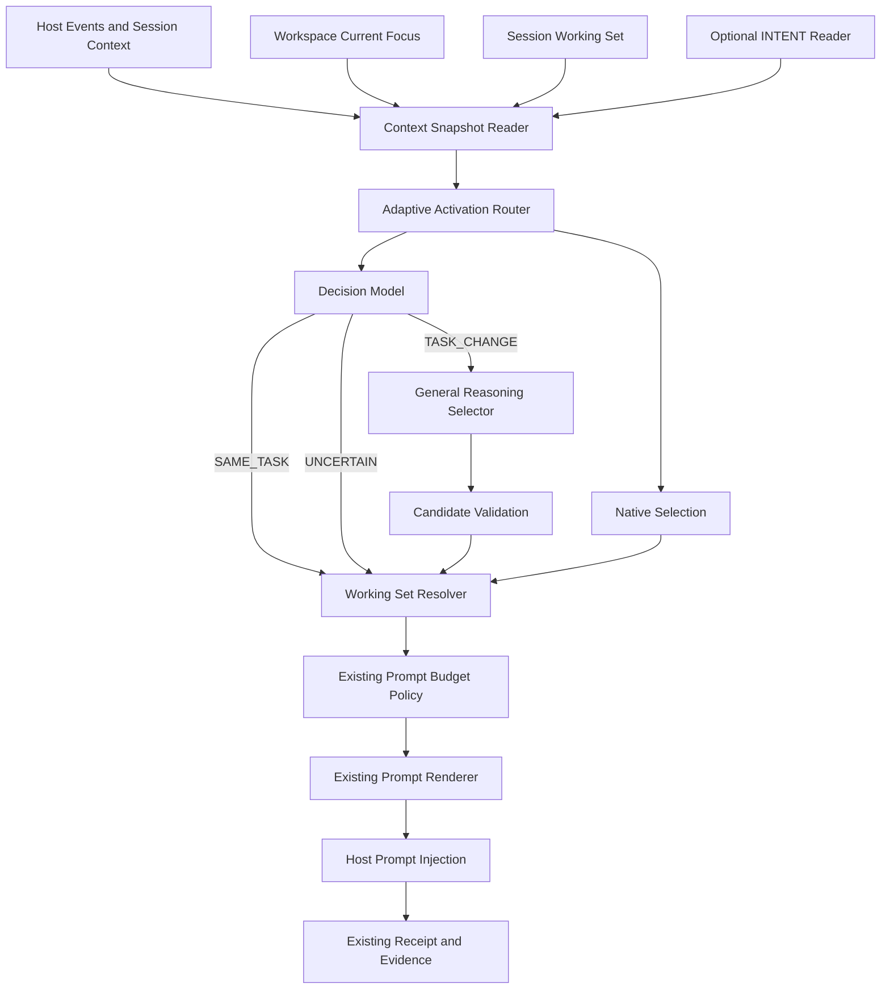

# PD Adaptive Activation SPEC v0.3

**Adaptive Principle Activation — Architecture & Engineering Specification**

| Metadata | Value |
|---|---|
| Version | v0.3 |
| Date | 2026-11-04 |
| Status | Proposed — Engineering Baseline |
| Owner | PD Owner |
| Repository | `csuzngjh/principles` |
| Audit baseline | `49a91651ab6c755f9074a653998951f4f88c0f43` |
| Supersedes | Working Set Selector SPEC v0.2 |
| Target hosts | OpenClaw / Codex / WorkBuddy |
| Primary architecture | Native + Model-assisted |
| Implementation principle | Reuse First, Minimal New Components |

---

# 0. Executive Summary

## 0.1 Problem

PD 已经具备原则治理、激活、Prompt 注入、预算控制和运行时证据记录等基础能力。

但目前系统存在一个重要缺口：

**PD 能够判断哪些原则已经获得激活资格，却不能可靠地判断当前宿主正在执行什么任务，以及哪些已激活原则最适合当前任务。**

现有原则激活与 Prompt Selection 主要解决：

1. 原则是否获得合法的运行时激活资格。
2. 已激活原则如何进入有限的 Prompt 预算。
3. 如何避免固定排序导致某些原则长期无法进入上下文。

Adaptive Activation 要解决的是另一个问题：

> 在当前任务、目标和执行阶段下，哪些已获得授权的原则真正值得进入宿主上下文？

这不是新的原则治理系统，也不是新的任务管理系统。

它是现有原则激活系统之上的一层任务感知与选择能力。

## 0.2 Design Decision

本 SPEC 确立以下架构：

**Decision 1：保留现有 Runtime V2 Activation。**

它仍然是原则激活资格和授权的唯一权威来源。

**Decision 2：保留 Native Selection。**

没有配置外置模型时，PD 仍然可以正常工作，继续使用现有原则读取、预算控制和公平轮转机制。

**Decision 3：增加可选的 Model-assisted Selection。**

通过两个外置模型协作：

- Decision Model：判断任务上下文是否发生了重要变化。
- General Reasoning Model：理解任务与抽象原则之间的关系，完成多标签原则选择。

**Decision 4：保留并升级 Current Focus。**

不重新开发 Task Manager，不删除早期设计，而是修复并升级已有工作区焦点机制。

**Decision 5：区分三个上下文层次。**

- INTENT：长期目标和不可妥协的约束。
- CURRENT_FOCUS：工作区当前重点。
- Session Working Set：当前会话的任务状态和原则选择结果。

**Decision 6：统一最终注入链路。**

两种选择模式最终都使用现有的原则激活读取、预算管理、Prompt Renderer 和证据系统。

任何模型失败、超时、输出不合法或状态不确定，都不得阻塞宿主正常执行。

## 0.3 Expected Benefits

1. 减少与当前任务无关的原则注入。
2. 在任务目标或执行阶段发生变化时，及时重新选择原则。
3. 降低长期运行时上下文中原则堆积和冲突的风险。
4. 不依赖外置模型也能维持 PD 的基本能力。
5. 避免重新建设一套复杂的任务管理和模型运行框架。
6. 为 Examiner 提供更可重复、可解释的原则选择证据。

---

# 1. Goals and Non-Goals

## 1.1 Goals

### G1 — Task-aware Principle Selection

能够根据宿主当前任务上下文，从已激活原则中选择适用原则。

### G2 — Adaptive Refresh

识别以下变化：

- 新任务开始。
- 当前任务目标改变。
- 当前任务进入新的重要阶段。
- 当前工作上下文发生实质性变化。
- 原有原则集合不再适用。

### G3 — Dual Selection Modes

支持两种独立工作模式：

- Native Mode
- Model-assisted Mode

Native Mode 不依赖外置模型。

### G4 — Multi-label Selection

允许一次选择多个原则。

不限制为单一最优原则。

### G5 — Context Continuity

跨宿主、跨会话尽可能维护合理的任务上下文，但必须隔离不同 Session 的运行状态。

### G6 — Reuse Existing Infrastructure

优先复用：

- Runtime V2 Activation。
- Prompt Activation Reader。
- Prompt Budget Policy。
- Existing Prompt Renderer。
- Pi AI Runtime。
- Runtime Profile。
- Existing Evidence / Receipt。
- Current Focus。
- Intent Reader。

### G7 — Safe Degradation

任何增强能力不可用时，都能够退回现有 Native 路径。

## 1.2 Non-Goals

本 SPEC 不负责：

1. 重新设计原则治理、Owner 审批和激活权限。
2. 重新建设 Principle Artifact 管理系统。
3. 重新开发通用任务管理平台。
4. 重新建设模型供应商和 API 管理系统。
5. 让 Selector 自主修改原则。
6. 让 Selector 执行原则中的业务动作。
7. 让模型直接修改宿主正在执行的任务。
8. 用关键词匹配替代抽象原则理解。
9. 在 v0.3 中训练专用决策模型。
10. 将原则注入成功等同于宿主行为已经改善。

---

# 2. Existing System Audit

## 2.1 Audit Baseline

本 SPEC 基于主干代码审计：

`49a91651ab6c755f9074a653998951f4f88c0f43`

以下区分三种状态：

- VERIFIED：审计时已在代码中确认。
- PROPOSED：本 SPEC 新增的设计。
- PENDING：需要实施前重新核实的内容。

## 2.2 Existing Capabilities

| Component | Existing Capability | Status |
|---|---|---|
| Runtime V2 Activation | 原则激活资格和授权管理 | VERIFIED |
| Activation State Store | SQLite 激活状态持久化 | VERIFIED |
| Prompt Activation Reader | 读取有效原则激活 | VERIFIED |
| Principle Artifact Validation | 验证原则 Artifact | VERIFIED |
| Prompt Budget Policy | 模型感知预算计算 | VERIFIED |
| Fair Rotation | OpenClaw 路径公平轮转 | VERIFIED |
| Shared Host Runtime | 跨宿主共享运行时 | VERIFIED |
| Pi AI Runtime | 内部模型调用基础设施 | VERIFIED |
| Runtime Profiles | 不同内部 Agent 的模型绑定 | VERIFIED |
| SignalCollector | 关键词与可选 LLM 两阶段识别 | VERIFIED |
| Current Focus | 工作区焦点和工作记忆维护 | VERIFIED, INCOMPLETE |
| Intent Reader | INTENT.md 读取接口及 Feature Flag | VERIFIED |
| Working Set Selector | 旧版设计提案 | PROPOSAL ONLY |
| principle_working_sets | 旧 SPEC 中的数据结构概念 | NOT VERIFIED IN PRODUCTION |
| Adaptive Task Change Detection | 任务变化识别 | NOT IMPLEMENTED |
| General Principle Selector | 语义化多标签原则选择 | NOT IMPLEMENTED |

## 2.3 Existing Governance Activation

现有授权链路必须保持：

```text
Principle Artifact
       |
       v
Artifact Validation
       |
       v
Owner Approval / Authorized Policy
       |
       v
ActivationDispatcher
       |
       v
SQLite Activation State
       |
       v
Runtime V2 Prompt Activation Reader
       |
       v
Eligible Activated Principles
```

Selector 只能读取已经获得授权且当前有效的原则。

Selector 不得：

- 创建 Activation。
- 修改 Activation。
- 批准 Principle。
- 停用 Principle。
- 绕过 Artifact Validation。
- 直接修改治理状态。

现有主要代码：

- `packages/principles-core/src/runtime-v2/activation/activation-dispatcher.ts`
- `packages/principles-core/src/runtime-v2/activation/sqlite-activation-state-store.ts`
- `packages/principles-core/src/runtime-v2/activation/prompt-activation-reader-contract.ts`
- `packages/openclaw-plugin/src/core/runtime-v2-prompt-activation-reader.ts`

## 2.4 Existing Native Prompt Selection

现有 Native Selection 已经具备：

- 有效原则读取。
- Prompt 预算计算。
- `fair_rotation_v1`。
- 超预算原则处理。
- 确定性选择。

需要特别注意宿主差异：

| Host Path | Existing Behavior |
|---|---|
| OpenClaw Plugin | 可使用 fair_rotation_v1 |
| Shared Host Runtime | 当前在缺少可靠轮次编号时使用 legacy FIFO 策略 |
| Codex | 不得伪造 user-turn ordinal |
| WorkBuddy | 需要完成宿主能力核实 |

现有 Native Selection 主要解决预算分配和公平性，并不保证原则与当前任务的语义相关性。

这正是 Adaptive Selection 需要补充的能力。

相关代码：

- `packages/principles-core/src/runtime-v2/activation/prompt-budget-policy.ts`
- `packages/principles-core/src/runtime-v2/activation/prompt-activation-reader-contract.ts`
- `packages/host-runtime/src/active-principle-prompt.ts`
- `packages/openclaw-plugin/src/hooks/prompt.ts`

## 2.5 Existing Model Infrastructure

当前 PD 已经具备 Pi AI Runtime 和 Runtime Profile 配置体系。

可以复用：

- Provider。
- Model。
- API Key Environment Variable。
- Base URL。
- Timeout。
- Retry。
- Max Tokens。
- Reasoning Configuration。
- Agent Runtime Binding。

本 SPEC 不新增第二套模型客户端。

拟增加两个可选内部 Agent 角色：

- `principle_decision`
- `principle_selector`

具体注册方式必须沿用当前 Agent Registry 和 Profile Binding 契约，不能另造一套模型管理配置。

相关代码：

- `packages/principles-core/src/runtime-v2/config/pd-config-types.ts`
- `packages/principles-core/src/runtime-v2/config/pd-config-agent-binding.ts`
- `packages/pd-cli/src/services/runtime-adapter-resolver.ts`
- `packages/principles-core/src/runtime-v2/adapter/pi-ai-runtime-adapter.ts`

## 2.6 Current Focus Reality

现有 Current Focus 位于：

`memory/okr/CURRENT_FOCUS.md`

已经具备：

- 工作区焦点模板。
- P0/P1/P2 任务记录。
- 下一步行动。
- 工作记忆提取。
- 历史备份。
- 压缩与恢复。
- OpenClaw 生命周期维护。

但存在以下问题：

1. `currentTask` 数据结构已有定义，实际提取和恢复链路不完整。
2. 工作记忆提取主要基于 Assistant 消息和正则。
3. 长对话读取存在从文件头部截取而遗漏最新内容的风险。
4. 维护时机主要依赖 OpenClaw Compaction。
5. Session 状态与 Workspace Focus 尚未形成可靠隔离。
6. Codex / WorkBuddy 尚未确认具有一致的 Focus 生命周期接入。
7. `safeReadCurrentFocus()` 可能包含恢复或初始化副作用，不能直接当作 Selector 的纯读取接口。

相关代码：

- `packages/openclaw-plugin/src/core/focus-history.ts`
- `packages/openclaw-plugin/src/hooks/lifecycle.ts`
- `packages/openclaw-plugin/src/commands/focus.ts`
- `packages/principles-core/src/prompt-builder/focus-compression.ts`

结论：保留，升级，不重建。

## 2.7 Existing Intent

现有 Intent Reader 已经提供独立接口和 Feature Flag。

`intent_engineering` 当前默认关闭。

必须保持：

- 未启用时不读取 INTENT.md。
- 不绕过 Owner 配置。
- 不将 INTENT 内容自动升级为激活原则。
- 不由 Selector 修改长期意图。

相关代码：

- `packages/openclaw-plugin/src/core/intent-doc-reader.ts`
- `packages/principles-core/src/runtime-v2/intent/intent-doc-reader-port.ts`
- `packages/principles-core/src/runtime-v2/config/pd-config-feature-flags.ts`

## 2.8 Components Not to Repurpose

以下模块不能直接承担 Adaptive Activation 的领域职责：

| Component | Existing Purpose | Restriction |
|---|---|---|
| Principle Reuse | 防止重复原则产生 | 不作为语义选择器 |
| Owner Decision Semantic Selector | Owner 决策卡文本选择 | 不复用其业务判断 |
| PrincipleClassifier | Console 原则分类 | 不作为任务选择器 |
| Runtime V2 TaskStore | 内部化任务队列 | 不作为用户 Task Manager |
| SignalCollector | 纠正和共情信号识别 | 只复用模型调用基础设施和工程模式 |
| Context Intelligence | 内部 Agent 诊断上下文 | 不整体复用为 Selector |

---

# 3. Core Architecture

## 3.1 Architecture Overview



## 3.2 Design Boundaries

架构只增加三个核心职责：

1. Adaptive Activation Router。
2. Decision Model Integration。
3. General Principle Selector Integration。

Current Focus 和 Session Working Set 通过现有组件修复和扩展。

不得新增一个独立的 Prompt Injection 系统。

不得新增一个独立的 Governance Activation 系统。

不得新增一个独立的 Model Runtime 系统。

## 3.3 Two Operating Modes

### Native Mode

流程：

```text
Eligible Activated Principles
          |
          v
Existing Native Selection
          |
          v
Existing Budget Policy
          |
          v
Existing Prompt Renderer
          |
          v
Host
```

特点：

- 不需要外置模型。
- 不需要 Decision Model。
- 不需要 Selector Model。
- 保留当前行为和兼容性。
- 继续使用现有预算和轮转策略。

限制：

Native Mode 不承诺理解任务的抽象语义，也不承诺选择出最相关的原则。

它是可靠的基础运行模式，而不是 Model-assisted 的等价替代品。

### Model-assisted Mode

流程：

```text
Current Session Context
          |
          v
Change Detection Gate
          |
          v
Decision Model
          |
          +---- SAME_TASK ----> Keep Existing Working Set
          |
          +---- TASK_CHANGED
          |          |
          |          v
          |    General Reasoning Model
          |          |
          |          v
          |    Multi-label Selection
          |          |
          |          v
          |    Validate Candidate IDs
          |          |
          |          v
          |    Update Working Set
          |
          +---- UNCERTAIN ----> Safe Fallback
```

特点：

- 外置模型可选。
- 只在需要时进行任务变化判断。
- 任务变化后才重新选择原则。
- 允许一次激活多个原则。
- 失败时回到 Native。

---

# 4. Context Model

## 4.1 Three Context Levels

必须明确区分三个不同生命周期。

### A. INTENT — Strategic Context

长期意图。

包含：

- Why。
- Desired Outcome。
- Non-negotiables。
- Strategic Constraints。
- Long-term Direction。

特征：

- 生命周期长。
- 由 Owner 定义。
- 不应该被普通任务自动覆盖。
- 继续受 `intent_engineering` 控制。

### B. CURRENT_FOCUS — Workspace Context

工作区当前重点。

包含：

- 当前阶段。
- 当前重点任务。
- P0/P1/P2。
- 重要阻塞。
- 下一步行动。
- 工作记忆摘要。

特征：

- Workspace 级别。
- 可能被多个 Session 共享。
- 代表项目当前关注点。
- 不是单个 Agent 的任务状态。

### C. Session Working Set — Runtime Context

当前 Session 的执行状态。

包含：

- 当前任务描述。
- 当前执行阶段。
- 当前原则集合。
- 最近一次选择原因。
- 上次任务变化判断。
- 最近一次有效上下文版本。

特征：

- Session 级别。
- 不与其他 Session 混用。
- 不应自动覆盖 Workspace Focus。
- 可随任务变化而更新。

## 4.2 Context Priority

建议读取优先级：

1. 当前 Session 对话。
2. 当前 Session Working Set。
3. Workspace Current Focus。
4. Optional INTENT。

这些上下文不能简单合并成一段字符串。

必须保留来源和生命周期信息。

## 4.3 Context Reader Contract

新增一个只读上下文接口。

示例：

```typescript
interface AdaptiveContextSnapshot {
  hostKind: "openclaw" | "codex" | "workbuddy";

  workspaceId: string;
  sessionId: string;

  recentConversation: ConversationMessage[];

  sessionWorkingSet?: SessionWorkingSet;

  workspaceFocus?: {
    revision: string;
    content: string;
    updatedAt?: string;
  };

  intent?: {
    enabled: boolean;
    revision?: string;
    content?: string;
  };

  hostEvent?: {
    type: string;
    source: string;
    reliable: boolean;
  };

  capturedAt: string;
}
```

约束：

- 不允许直接读取整个宿主历史数据库。
- 不允许默认读取整个项目目录。
- 不允许绕过 Intent Feature Flag。
- 不允许在读取过程中创建或修复文件。
- 不允许将其他 Session 的上下文混入当前 Session。

`workspaceFocus` 必须通过纯只读接口获取。

如果文件不存在、格式无效或路径不可信，返回 unavailable，而不是自动写入模板。

---

# 5. Task Change Detection

这是整个 Adaptive Activation 的关键。

## 5.1 Design Principle

**不是每次用户发送消息，都调用 Decision Model。**

也不是通过关键词匹配判断任务是否发生变化。

我们采用事件驱动 + 有界检查点的混合模式。

代码负责判断是否到了值得检查的时间。

模型负责判断语义上是否发生了变化。

两者职责必须分开。

## 5.2 Trigger Conditions

以下事件可以触发一次检查：

| Trigger | Description | Action |
|---|---|---|
| INITIAL_SESSION | 当前 Session 没有 Working Set | 直接初始化选择 |
| HOST_TASK_BOUNDARY | 宿主确认新的任务边界 | Decision Model |
| FOCUS_REVISION_CHANGED | Workspace Focus 发生变化 | Decision Model |
| COMPACTION_RESUME | 上下文压缩后恢复 | 重新验证状态 |
| PERIODIC_CHECKPOINT | 达到检查点 | Decision Model |
| WORKING_SET_EXPIRED | 状态过期 | 重新验证或 Native |

注意：

这些事件必须以宿主实际可提供的能力为准。

不能假设 OpenClaw、Codex、WorkBuddy 提供完全相同的生命周期事件。

## 5.3 Incremental Checkpoint

为了避免每条消息调用 LLM，定义：

```typescript
interface RefreshPolicy {
  maxUserTurnsWithoutReview: number;

  maxContextDeltaChars: number;

  minReviewIntervalMs: number;

  refreshOnFocusRevisionChange: boolean;

  refreshOnReliableHostBoundary: boolean;
}
```

建议初始实验值：

| Parameter | Initial Value |
|---|---:|
| maxUserTurnsWithoutReview | 4 |
| maxContextDeltaChars | 2500 |
| minReviewIntervalMs | 30000 |
| refreshOnFocusRevisionChange | true |
| refreshOnReliableHostBoundary | true |

这些是实验配置，不是已验证的最优参数。

其含义是：

- 每条用户消息只更新轻量级 Session 计数和上下文指纹。
- 没有发生检查点事件时，不调用模型。
- 达到检查点后，才调用 Decision Model。
- 如果宿主提供可靠任务边界事件，可以提前触发。
- 如果宿主没有可靠事件，则使用有界检查点作为补偿。

必须明确：不调用模型，就无法保证立即识别任意单条消息中的语义变化。

因此，v0.3 采用可控的检测延迟，而不是承诺零延迟。

## 5.4 Decision Model Input

不要求用户把任务改写成固定 YAML 或表单。

Decision Model 接收自然语言上下文：

```typescript
interface TaskChangeInput {
  recentConversation: ConversationMessage[];

  previousTask?: {
    description: string;
    phase?: string;
  };

  previousWorkingSet: {
    principleIds: string[];
  };

  workspaceFocus?: string;

  intent?: string;

  trigger: RefreshTrigger;
}
```

建议上下文窗口：

- 最近 6 条有效消息。
- 优先保留最新内容。
- 最大输入长度初始建议 12,000 字符。
- 过长时保留最新内容，不从文件头部截断。
- 不保存完整原始对话到 Working Set 数据库。

## 5.5 Decision Model Output

```typescript
type TaskChangeType =
  | "SAME_TASK"
  | "NEW_TASK"
  | "GOAL_SHIFT"
  | "PHASE_SHIFT"
  | "UNCERTAIN";

interface TaskChangeDecision {
  changeType: TaskChangeType;

  confidence: number;

  previousTaskSummary?: string;

  currentTaskSummary?: string;

  reason: string;
}
```

输出约束：

- 必须是结构化 JSON。
- `confidence` 范围为 0～1。
- `reason` 简短。
- 不允许输出任意原则 ID。
- 不允许直接输出 Prompt 指令。

## 5.6 Decision Rules

| Decision | Behavior |
|---|---|
| SAME_TASK | 保留当前 Working Set |
| NEW_TASK | 触发重新选择 |
| GOAL_SHIFT | 触发重新选择 |
| PHASE_SHIFT | 触发重新选择 |
| UNCERTAIN | 不贸然替换现有集合 |

如果当前 Working Set 已经失效，则不确定状态回退 Native。

不得因为模型输出 `UNCERTAIN` 而清空当前原则。

## 5.7 No Keyword-based Semantic Routing

禁止通过以下方式建立主选择机制：

- 关键词命中表。
- 固定任务分类规则。
- 手工枚举所有用户任务。
- 每种任务预定义一组原则。
- 通过正则表达式推断复杂意图。

这些方式可以用于技术层面的事件和状态检测，但不能承担抽象任务语义判断。

---

# 6. General Reasoning Principle Selector

## 6.1 Responsibility

General Reasoning Model 是真正负责原则理解和选择的模型。

它需要理解：

1. 用户当前的目标。
2. 当前任务的决策结构。
3. 任务的关键约束。
4. 当前执行阶段。
5. 每条候选原则的适用条件。
6. 原则之间可能存在的互补关系和冲突。

它不需要执行任务。

它只需要选择适用原则。

## 6.2 Candidate Card

Candidate Card 必须来源于已经验证的 Principle Artifact。

现有 `PrincipleSchema` 已经包含部分可复用字段：

- triggerPattern
- action
- scope
- domain
- priority
- tags

Candidate Card 不得依赖不存在或未经验证的字段。

建议契约：

```typescript
interface PrincipleCandidateCard {
  principleId: string;

  artifactId: string;

  activationId: string;

  text: string;

  metadata: {
    triggerPattern?: string[];
    action?: string;
    scope?: string;
    domain?: string;
    priority?: string;
    tags?: string[];
  };

  tokenEstimate: number;
}
```

所有字段均须来自当前有效 Artifact。

缺少可选字段时允许为空。

不得为了补齐 Card 而读取未经授权的历史草稿。

## 6.3 Multi-label Selection

本系统采用：

**Multi-label Selection + Relevance Ranking + Budget-constrained Packing。**

不是单选问题。

也不是单纯的 Top-K 排序问题。

例如：

当前任务是：

> 为一个尚未成熟的 AI Agent 产品设计原则注入系统，同时控制成本、降低运行时复杂度，并保证 Owner 对治理拥有最终控制权。

模型可能选择：

- 目标一致性原则。
- 最小复杂度原则。
- 资源约束原则。
- 安全边界原则。
- 人类治理原则。

这些原则可以同时成立。

模型需要判断哪些原则共同适用，而不是强行选择唯一冠军。

## 6.4 Selector Input

```typescript
interface PrincipleSelectionInput {
  taskContext: {
    description: string;
    goal?: string;
    constraints?: string[];
    currentPhase?: string;
  };

  workspaceFocus?: string;

  intent?: string;

  candidates: PrincipleCandidateCard[];

  previousWorkingSet?: string[];
}
```

注意：

`taskContext` 由模型根据自然语言上下文理解形成。

不要求宿主提前把所有任务字段结构化。

## 6.5 Selector Output

```typescript
interface PrincipleSelectionResult {
  status:
    | "SELECTED"
    | "NONE_APPLICABLE"
    | "UNCERTAIN";

  selectedPrinciples: Array<{
    principleId: string;

    relevance: number;

    rank: number;

    reason: string;
  }>;

  overallConfidence: number;

  taskSummary: string;

  selectionReason: string;
}
```

输出约束：

- `principleId` 必须来自输入候选集合。
- 不允许产生新的原则 ID。
- 不允许修改原则正文。
- 不允许改变激活状态。
- 不允许返回任意执行代码。
- 不允许将模型的理由直接注入宿主 Prompt。

`NONE_APPLICABLE` 是合法结果。

它表示当前没有已授权原则适用于该任务。

不得为了保持注入数量而强行选择原则。

## 6.6 Selection Validation

模型输出必须经过代码校验：

1. JSON Schema 校验。
2. Candidate ID 白名单校验。
3. 重复 ID 去重。
4. 激活状态复核。
5. Artifact 有效性复核。
6. 结果数量限制。
7. 置信度阈值校验。
8. 排序字段校验。

任何一项失败，不能直接采用模型结果。

## 6.7 Candidate Pool Limits

初始建议：

| Parameter | Value |
|---|---:|
| Maximum candidates | 48 |
| Maximum selected principles | 12 |
| Maximum reason length | 160 characters |
| Minimum confidence | 0.70 |
| Candidate content | Verified Artifact only |

以上为实验初始值。

当有效候选原则数量超过最大输入能力时，不允许静默截断后声称选择完成。

应记录 `candidate_pool_overflow` 并回退 Native。

后续可通过真实数据评估是否需要批次处理，但 v0.3 不预先引入多轮 Selector 协议。

---

# 7. Unified Selection and Budget Packing

## 7.1 Shared Final Pipeline

两种模式必须汇合到同一最终处理链路：

```text
Native / Model-assisted
          |
          v
Validated Principle IDs
          |
          v
Existing Activation Revalidation
          |
          v
Existing Budget Policy
          |
          v
Prompt Renderer
          |
          v
Host Injection
          |
          v
Existing Receipt / Evidence
```

## 7.2 Native Packing

Native Mode 继续使用现有预算和公平轮转能力。

如果宿主无法提供可靠的轮次编号，不得伪造 `roundKey`。

## 7.3 Model-assisted Packing

Model-assisted Mode：

1. 按 Selector 返回的相关性排序。
2. 对候选原则进行激活状态复核。
3. 进入现有预算计算。
4. 优先保留相关性更高的原则。
5. 超预算时继续尝试后续候选，而不是简单截断全部结果。
6. 不允许超出实际 Prompt 预算。

如果现有 Budget Packer 无法直接表达模型排序后的顺序保留和超长跳过行为，只允许对现有 Packer 增加一个最小策略分支，例如 `model_ranked_v1`。

禁止另建一套独立预算装箱算法。

## 7.4 No Double Injection

同一原则不得因 Native 和 Model-assisted 两条路径同时运行而重复注入。

最终只能由一个 Working Set Resolver 产生唯一注入集合。

---

# 8. Working Set Persistence

## 8.1 Purpose

Working Set 代表某个 Session 当前选中的原则集合。

它不是原则激活状态。

它不是治理记录。

它不是完整任务历史。

## 8.2 Proposed Storage

旧版 v0.2 已提出 `principle_working_sets` 的设计概念。

审计未确认该表已经进入生产数据库。

v0.3 可以复用该概念，但实施前必须确认现有数据库所有权、迁移策略和连接边界。

建议最小数据结构：

```sql
CREATE TABLE principle_working_sets (
  workspace_id TEXT NOT NULL,
  host_kind TEXT NOT NULL,
  session_id TEXT NOT NULL,

  revision INTEGER NOT NULL,

  status TEXT NOT NULL,

  task_summary TEXT,

  selected_principle_ids_json TEXT NOT NULL,

  selection_mode TEXT NOT NULL,

  selection_trigger TEXT,

  decision_model TEXT,
  selector_model TEXT,

  confidence REAL,

  context_fingerprint TEXT,

  focus_revision TEXT,

  last_checked_turn INTEGER,

  created_at TEXT NOT NULL,
  updated_at TEXT NOT NULL,
  expires_at TEXT,

  PRIMARY KEY (
    workspace_id,
    host_kind,
    session_id
  )
);
```

约束：

- 不保存原始用户对话。
- 不保存 API Key。
- 不保存完整模型推理过程。
- 不允许跨 Workspace 读取。
- 不允许跨 Session 覆盖。
- 所有更新必须带 revision。
- 过期状态不能作为当前有效选择。

## 8.3 Concurrency

同一 Session 的并发更新必须使用：

- SQLite Transaction。
- Revision Check。
- Optimistic Lock。
- Deterministic Upsert。

如果两个 Selector 同时执行：

只允许较新且上下文版本有效的结果提交。

旧结果不能覆盖新结果。

## 8.4 Expiration

Working Set 是可恢复的运行时缓存。

初始建议：

- Session 活跃时延长有效期。
- Session 长时间不活跃后标记过期。
- 初始空闲 TTL：24 小时。
- 过期后不得直接使用旧结果作为 Live 选择。
- 可以重新选择或退回 Native。

TTL 仅影响缓存有效性，不代表任务已经完成。

---

# 9. Current Focus Upgrade

## 9.1 Decision

**保留 CURRENT_FOCUS.md，不重新建设 Task Manager。**

现有文件结构和维护机制继续演进。

## 9.2 Responsibilities

CURRENT_FOCUS 负责 Workspace 级信息：

```markdown
# CURRENT_FOCUS

## Status Snapshot

Current Phase:
Overall Status:
Last Updated:

## Current Tasks

### P0

### P1

### P2

## Next Actions

## Active Blockers

## Working Memory

### Key Artifacts

### Active Problems

### Decisions

### Next Steps
```

不要求 Owner 维护复杂 JSON 或 YAML。

自然语言 Markdown 仍然是主要交互方式。

## 9.3 Required Fixes

### F1 — Complete currentTask Production

现有 `WorkingMemorySnapshot.currentTask` 已定义但生产和恢复链路不完整。

必须完成：

- 从真实上下文提取当前任务。
- 写入 Current Focus 的明确区域。
- 支持解析恢复。
- 保留人工编辑内容。
- 避免自动覆盖 Owner 的战略描述。

### F2 — Read the Latest Conversation

修复当前 Session 文件读取偏向头部的问题。

必须保证：

- 最新消息不会因为文件长度限制而被遗漏。
- 优先处理最近上下文。
- 保留消息边界。
- 截断策略有测试。

### F3 — Lifecycle Maintenance

Current Focus 不应只依赖 Compaction。

需要根据真实宿主能力评估：

- Prompt Build。
- Compaction。
- Session Resume。
- Session End。
- Workspace Focus Update。

不得假设每个宿主都具备同样的事件。

### F4 — Safe Read Separation

将读取与恢复职责分开：

```typescript
interface CurrentFocusReader {
  readSnapshot(
    workspaceId: string
  ): Promise<CurrentFocusSnapshot | null>;
}

interface CurrentFocusMaintainer {
  ensureTemplate(
    workspaceId: string
  ): Promise<void>;

  updateWorkingMemory(
    workspaceId: string,
    patch: WorkingMemoryPatch
  ): Promise<void>;
}
```

Selector 只能使用 Reader。

Selector 不得调用 Maintainer。

### F5 — Multi-session Isolation

多个 Session 不得互相覆盖各自的执行状态。

Workspace Focus 可以共享，但 Session Working Set 必须隔离。

### F6 — Cross-host Consistency

OpenClaw、Codex、WorkBuddy 必须使用统一的上下文接口。

但不能为了统一而虚构宿主能力。

如果某个宿主无法提供可靠 Session ID 或 Workspace Identity：

该宿主不启用 Model-assisted Live Mode。

先保持 Native。

## 9.4 Ownership

Owner 对 Workspace Focus 和长期 Intent 拥有最终控制权。

Selector 不得自动修改：

- INTENT。
- Owner 的战略目标。
- Owner 手工维护的 P0/P1/P2 任务描述。

自动维护只允许在明确授权的工作记忆区域内进行。

---

# 10. Model Runtime Configuration

## 10.1 Reuse Existing Runtime

使用现有 Pi AI Runtime 和 Runtime Profile。

不新增独立模型客户端。

建议新增两个内部 Agent 绑定：

```text
principle_decision
principle_selector
```

具体 Agent 注册与 Profile Binding 必须通过现有配置验证。

## 10.2 Proposed Configuration

以下是 v0.3 的目标配置示意，不代表现有配置文件已经支持这些字段。

```yaml
adaptiveActivation:
  mode: native

  refreshPolicy:
    maxUserTurnsWithoutReview: 4
    maxContextDeltaChars: 2500
    minReviewIntervalMs: 30000
    refreshOnFocusRevisionChange: true
    refreshOnReliableHostBoundary: true

  decision:
    enabled: false
    agent: principle_decision
    timeoutMs: 1500
    minimumConfidence: 0.70

  selector:
    enabled: false
    agent: principle_selector
    timeoutMs: 3000
    minimumConfidence: 0.70

  limits:
    maxCandidates: 48
    maxSelected: 12
    maxContextChars: 12000

  persistence:
    enabled: true
    idleTtlMs: 86400000
```

模型 Profile 继续使用现有 Runtime Profile 配置。

Owner 可以选择：

- 同一供应商的两个模型。
- 不同供应商的两个模型。
- 同一个通用模型承担两个角色。
- 不配置任何外置模型。

不允许硬编码某个供应商或某个模型名称。

## 10.3 Model Selection Policy

Decision Model 优先：

- 低延迟。
- 低成本。
- 稳定结构化输出。
- 对自然语言任务变化有足够理解能力。

General Selector 优先：

- 抽象原则理解能力。
- 长上下文理解。
- 多标签判断。
- 复杂约束推理。
- 稳定的结构化输出。

决策模型是否足以理解抽象原则，不是本 SPEC 的前提。

它只负责判断任务变化。

真正的抽象原则理解交给 General Reasoning Model。

---

# 11. Feature Flags and Rollout Modes

## 11.1 Mode Definitions

```typescript
type AdaptiveActivationMode =
  | "native"
  | "shadow"
  | "live";
```

### Native

默认模式。

- 不调用外置模型。
- 不改变现有原则选择结果。
- 保持原有行为。

### Shadow

- 正常执行 Native。
- 并行计算 Model-assisted 选择结果。
- 不将模型结果注入宿主。
- 记录两种选择结果的差异。
- 不影响实际宿主行为。

注意：Shadow 仍会将必要的上下文发送给配置的外部模型，因此必须明确 Owner 授权和数据出站策略。

### Live

- 使用 Model-assisted Working Set。
- 仍经过现有预算和 Prompt Renderer。
- 必须由 Owner 明确启用。
- 任何模型失败都回退 Native。

禁止 Shadow 自动升级 Live。

## 11.2 Default Flags

| Feature | Default |
|---|---|
| Adaptive Activation | OFF / Native |
| Decision Model | OFF |
| General Selector Model | OFF |
| Shadow Mode | OFF |
| Live Mode | OFF |
| Current Focus Repair | 按独立维护任务实施 |
| Intent Engineering | 保持现有默认 OFF |
| External Context Transmission | Explicit Opt-in |

---

# 12. Host Event Capability Gate

跨宿主能力是实施前置条件。

本 SPEC 不假设三个宿主具备相同事件。

必须建立并维护 Host Event Capability Matrix。

## 12.1 Required Capabilities

| Capability | OpenClaw | Codex | WorkBuddy |
|---|---|---|---|
| Before Prompt Build | 已有实现路径，需验证具体调用语义 | 待验证 | 待验证 |
| User Turn Identity | 需核实 | 不得假设已具备 | 待验证 |
| Session Identity | 需核实完整生命周期 | 需核实 | 需核实 |
| Workspace Identity | 已有工作区上下文路径，需核实边界 | 需核实 | 需核实 |
| Compaction Event | 已有相关生命周期实现 | 待验证 | 待验证 |
| Session Resume | 待核实 | 待验证 | 待验证 |
| Session End | 待核实 | 待验证 | 待验证 |
| Async Hook Support | 需核实超时和等待语义 | 待验证 | 待验证 |
| Background Execution | 需核实 | 待验证 | 待验证 |

以上不是三个宿主能力的最终裁定。

实际实现必须以 `PD Host Event Capability Matrix v0.1` 的代码与运行时证据为准。

## 12.2 Host Integration Rules

1. 使用宿主真实提供的事件。
2. 不允许模拟不存在的事件。
3. 不允许伪造 user-turn ordinal。
4. 不允许依赖某个宿主特有行为作为共享运行时前提。
5. 如果不能及时完成模型调用，必须使用当前有效 Working Set 或 Native。
6. 未通过 Host Capability Gate 的宿主不得进入 Live。

---

# 13. Execution and Failure Handling

## 13.1 Execution Policy

模型调用可以采用两种方式：

**Bounded Inline**

只有宿主 Hook 明确支持异步等待，并且通过延迟测试时才允许采用。

在硬超时内完成选择，否则 Native Fallback。

**Deferred Refresh**

如果宿主不能安全等待：

- 当前 Prompt 使用已有有效 Working Set 或 Native。
- 后台执行变化判断和原则选择。
- 结果只在下一次 Prompt Build 时生效。
- 不允许后台任务修改当前已经提交的 Prompt。

具体采用哪一种方式，由 Host Capability Gate 决定。

## 13.2 Failure Matrix

| Failure | Expected Behavior |
|---|---|
| Decision Model Not Configured | Native |
| Selector Model Not Configured | Native |
| Provider Unavailable | Native |
| Timeout | Native |
| Invalid JSON | Native |
| Unknown Principle ID | Reject Model Result |
| Inactive Principle | Reject Candidate |
| Invalid Artifact | Reject Candidate |
| Low Confidence | Keep Valid Existing Set or Native |
| NONE_APPLICABLE | Valid empty selection |
| Context Unavailable | Native |
| Focus Unavailable | Continue without Focus |
| INTENT Disabled | Do Not Read Intent |
| Storage Conflict | Do Not Commit Stale Result |
| Session Identity Unreliable | Native |
| Candidate Pool Overflow | Native |
| Budget Overflow | Existing Budget Policy |
| Host Hook Failure | Native / Existing Host Behavior |

## 13.3 Fail-open Boundary

Fail-open 只意味着：

Adaptive Activation 失败时，宿主仍然可以使用原有 Native Prompt Selection。

它不意味着：

- 忽略治理权限。
- 接受非法 Artifact。
- 绕过 Activation Validation。
- 注入未授权原则。
- 使用过期跨 Session 数据。

安全约束必须始终 fail-closed。

---

# 14. Security and Privacy

## 14.1 Principle Authority

所有候选原则必须来自当前有效 Activation。

Selector 不能成为治理权限来源。

## 14.2 Model Output

所有模型输出视为不可信数据。

必须：

- Schema Validation。
- Candidate Allowlist。
- Activation Revalidation。
- Artifact Revalidation。
- Output Size Limit。
- Duplicate Removal。

禁止模型输出直接进入宿主执行层。

## 14.3 Prompt Injection Protection

用户对话、Current Focus 和 INTENT 都是待分析的数据。

不得允许其中的指令覆盖 Selector 的系统约束。

Candidate Card 必须作为数据输入，而不是可执行指令。

## 14.4 Data Minimization

外置模型只接收完成任务所需的最小上下文。

默认不持久化：

- 原始用户对话。
- 完整模型推理过程。
- API Key。
- 不必要的个人信息。

Working Set 只保存选择结果和必要元数据。

## 14.5 Workspace Isolation

任何模型结果都必须绑定：

- Workspace ID。
- Host Kind。
- Session ID。
- Context Fingerprint。
- Working Set Revision。

不能跨 Workspace 或 Session 复用未经验证的选择结果。

---

# 15. Observability and Evidence

## 15.1 Required Events

建议增加以下事件：

```typescript
type AdaptiveActivationEvent =
  | "adaptive_check_triggered"
  | "decision_model_started"
  | "decision_model_completed"
  | "selector_started"
  | "selector_completed"
  | "selection_validated"
  | "working_set_updated"
  | "working_set_reused"
  | "native_fallback"
  | "prompt_injected";
```

每条事件至少包含：

- Timestamp。
- Workspace Hash。
- Session Hash。
- Host Kind。
- Trigger Type。
- Selection Mode。
- Model Profile。
- Model Version。
- Latency。
- Token Usage（可用时）。
- Working Set Revision。
- Selected Principle IDs。
- Fallback Reason。

## 15.2 Evidence Levels

必须严格区分：

| Evidence | What It Proves |
|---|---|
| Selection Decision | 模型选择了哪些原则 |
| Selection Validation | 选择结果通过了校验 |
| Prompt Rendered | 原则进入了渲染结果 |
| Host Submitted | 宿主接收或提交了 Prompt |
| Model Consumed | 需要宿主额外证据确认 |
| Behavioral Effect | 必须通过独立行为评估确认 |

不得将 Prompt 注入记录解释为模型已经理解或遵循原则。

不得将选择正确率直接解释为长期行为改善。

## 15.3 Examiner Integration

Examiner 可以复用以下证据：

- 当前任务上下文。
- 决策模型的变化判断。
- Selector 的原则选择结果。
- Working Set Revision。
- Prompt Injection Receipt。
- 后续行为表现。

Examiner 必须独立判断：

**原则选择是否正确，以及原则激活是否真正改变了宿主行为。**

Adaptive Activation 本身不能给自己出具效果证明。

---

# 16. Performance and Cost Budget

以下是初始工程目标，必须通过真实模型和宿主测试校准。

| Metric | Initial Target |
|---|---:|
| Per-message Decision Model Calls | 0 by default |
| Decision Model Timeout | 1.5 s |
| Selector Model Timeout | 3.0 s |
| Maximum Context Input | 12,000 chars |
| Maximum Candidate Cards | 48 |
| Maximum Selected Principles | 12 |
| Working Set Idle TTL | 24 h |
| Model Failure | No prompt blockage |
| Native Selection Overhead | No additional model calls |

## 16.1 Cost Control

成本主要来自两部分：

1. Decision Model 的周期性调用。
2. General Selector 的重新选择调用。

必须记录：

- 每 100 个用户轮次的 Decision 调用次数。
- 每 100 个用户轮次的 Selector 调用次数。
- 平均输入 Token。
- 平均输出 Token。
- 每次任务变化产生的成本。
- Shadow 与 Live 的成本差异。

优化顺序：

1. 减少不必要的 Decision 调用。
2. 限制上下文窗口。
3. 减少重复 Selector 调用。
4. 复用未过期 Working Set。
5. 评估更便宜的 Decision Model。

不能通过降低原则理解质量来单纯追求模型成本。

---

# 17. Evaluation and Experiments

## 17.1 Evaluation Objectives

必须验证四个独立问题：

**E1 — Task Change Detection**

能否识别真实任务变化？

**E2 — Principle Selection**

能否选择真正适用的抽象原则？

**E3 — Stability**

同一任务中是否避免不必要的原则集合变化？

**E4 — Runtime Efficiency**

能否在合理延迟和成本下完成选择？

## 17.2 Test Dataset

建议构建一组人工标注的任务场景：

| Scenario | Purpose |
|---|---|
| Same Task / Different Wording | 检验任务稳定性 |
| New Task | 检验任务切换 |
| Goal Shift | 检验目标变化 |
| Phase Shift | 检验执行阶段变化 |
| Multi-task | 检验多原则选择 |
| Abstract Principle | 检验抽象理解 |
| Similar Principles | 检验原则区分 |
| Conflicting Principles | 检验适用边界 |
| Long Context | 检验上下文压缩 |
| Missing Focus | 检验降级 |
| No Applicable Principle | 检验空集合 |
| Invalid Candidate | 检验权限校验 |

建议首轮至少包含：

- 30 个同任务场景。
- 30 个任务变化场景。
- 40 个原则选择场景。

由 Owner 或独立评审者提供 Ground Truth。

## 17.3 Decision Metrics

| Metric | Description |
|---|---|
| Change Precision | 判断发生变化的准确率 |
| Change Recall | 真实变化被发现的比例 |
| False Refresh Rate | 不必要重新选择比例 |
| Missed Goal Shift | 漏掉目标变化的比例 |
| Decision Latency | 决策耗时 |
| Decision Cost | 单次决策成本 |

建议 Shadow Gate：

- Change Precision >= 0.90。
- Change Recall >= 0.85。
- False Refresh Rate <= 0.10。

以上是初始实验门槛，必须结合标注样本规模和置信区间解释，不能仅凭小样本达标宣称可靠。

## 17.4 Selector Metrics

| Metric | Description |
|---|---|
| Precision@K | 选择原则中正确原则比例 |
| Recall@K | 相关原则覆盖比例 |
| NDCG@K | 相关性排序质量 |
| Critical Principle Recall | 关键原则覆盖率 |
| Invalid ID Rate | 非法原则 ID 比例 |
| Empty Selection Accuracy | 空集合判断质量 |

建议初始目标：

- Precision@K >= 0.80。
- Critical Principle Recall >= 0.90。
- Invalid ID Rate = 0。
- NDCG@K >= 0.75。

不能只评价原则数量和 Prompt 长度。

## 17.5 Native vs Model-assisted Comparison

必须比较：

1. Native Selection。
2. Model-assisted Selection。
3. Model-assisted + Existing Budget Packer。

主要观察：

- 相关原则覆盖率。
- 无关原则比例。
- 注入字符数量。
- 原则冲突情况。
- 任务切换响应速度。
- 模型调用成本。

---

# 18. Rollout Plan

## Phase 0 — Architecture and Host Verification

目标：

确认实现边界。

任务：

1. 复核现有 Working Set Selector v0.2。
2. 完成 Host Event Capability Matrix。
3. 确认三个宿主的 Session Identity。
4. 确认异步 Hook 和超时行为。
5. 确认 SQLite 状态存储归属。
6. 确认现有 Activation Reader 的扩展接口。
7. 确认两个内部 Agent 的注册方式。

Gate 0：

没有可靠宿主事件、Session Identity 和权限边界证据，不得进入 Live 开发。

## Phase 1 — Current Focus Repair

目标：

修复已有基础设施。

任务：

1. 完成 currentTask 提取。
2. 完成 currentTask 恢复。
3. 修复最新消息截取问题。
4. 分离 Focus Reader 和 Maintainer。
5. 实现 Session / Workspace 隔离。
6. 补齐测试。
7. 验证现有 OpenClaw 行为没有回归。

Gate 1：

Current Focus 可以可靠读取和恢复，且不破坏 Owner 手工内容。

## Phase 2 — Native Adaptive Foundation

目标：

在不引入外部模型的情况下建立统一工作流。

任务：

1. 建立 Adaptive Activation Router。
2. 接入现有 Activation Reader。
3. 接入现有 Native Selection。
4. 接入 Working Set 状态管理。
5. 统一 Prompt Renderer。
6. 接入现有 Receipt。

Gate 2：

Native 行为与现有生产路径兼容，所有治理约束保持不变。

## Phase 3 — Model-assisted Shadow

目标：

验证外置模型的真实价值。

任务：

1. 注册 `principle_decision`。
2. 注册 `principle_selector`。
3. 接入现有 Pi AI Runtime。
4. 实现 Decision Model。
5. 实现 Multi-label Selector。
6. 实现 Candidate Validation。
7. 实现 Shadow 结果记录。
8. 建立评估数据集。

Gate 3：

达到任务变化检测和原则选择质量门槛，且无权限越界。

Shadow 不影响实际 Prompt 注入。

## Phase 4 — Controlled Live

目标：

小范围启用模型辅助原则选择。

前提：

- Owner 明确授权。
- Gate 0–3 全部通过。
- Host Capability 已验证。
- 模型失败回退通过。
- Session 隔离通过。
- 数据出站授权通过。

Live 仅对 Owner 明确指定的宿主或工作区开启。

Gate 4：

没有跨 Session 污染、非法原则注入、Prompt 阻塞和治理绕过。

## Phase 5 — Examiner Evaluation

目标：

验证原则选择与行为变化之间的关系。

分别评估：

1. 原则选择是否正确。
2. 原则是否成功进入宿主上下文。
3. 宿主是否实际遵循原则。
4. 是否产生可观察的行为改善。
5. 改善是否具有持续性。

不得用前三项代替第四、第五项。

---

# 19. Acceptance Criteria

以下全部是交付验收条件。

## A. Governance

- [ ] Runtime V2 仍然是唯一激活授权来源。
- [ ] Selector 不能自行激活原则。
- [ ] Selector 不能绕过 Artifact Validation。
- [ ] 无效原则不能进入 Prompt。

## B. Native Mode

- [ ] 未配置任何外置模型时可以正常运行。
- [ ] 原有 Prompt Selection 没有回归。
- [ ] 现有预算策略正常工作。
- [ ] 不伪造 Host Turn Ordinal。
- [ ] 不增加每条用户消息的模型调用。

## C. Model-assisted Mode

- [ ] Decision Model 能区分任务变化类型。
- [ ] General Selector 支持多标签选择。
- [ ] 输出必须经过 Candidate Validation。
- [ ] 可以合法返回 NONE_APPLICABLE。
- [ ] 模型失败时回退 Native。
- [ ] Shadow 不影响实际注入。
- [ ] Live 必须 Owner 明确授权。

## D. Working Set

- [ ] 同一 Session 的选择状态可以恢复。
- [ ] 不同 Session 互相隔离。
- [ ] 并发更新不会覆盖新状态。
- [ ] 过期状态不能直接作为 Live 结果。
- [ ] 不保存完整原始用户对话。

## E. Current Focus

- [ ] currentTask 可以提取。
- [ ] currentTask 可以恢复。
- [ ] 最新对话不会因截断而遗漏。
- [ ] Owner 手工维护内容不会被覆盖。
- [ ] Selector 只能只读访问 Focus。
- [ ] Workspace 与 Session 状态隔离。

## F. Host Compatibility

- [ ] OpenClaw 完成真实运行时验证。
- [ ] Codex 完成真实运行时验证。
- [ ] WorkBuddy 完成真实运行时验证。
- [ ] 各宿主 Hook 超时行为明确。
- [ ] 各宿主 Session Identity 明确。
- [ ] 未验证宿主默认 Native。

## G. Evidence

- [ ] Selection Decision 可审计。
- [ ] Prompt Injection Receipt 可关联。
- [ ] Working Set Revision 可追踪。
- [ ] Fallback Reason 可追踪。
- [ ] Examiner 可以区分注入证据与行为效果证据。

---

# 20. Stop Conditions

发生以下任一情况，必须停止 Live 推进：

1. Selector 能够返回未授权 Principle ID。
2. 不同 Session 出现 Working Set 污染。
3. 模型输出绕过治理验证。
4. 外部模型调用阻塞宿主 Prompt。
5. Current Focus 被自动覆盖 Owner 内容。
6. 任务变化识别出现严重系统性误判。
7. Shadow 数据出站未获得 Owner 授权。
8. 无法可靠证明实际注入了哪个原则集合。
9. Native 路径发生回归。
10. 模型调用成本超过 Owner 设定预算。

停止后回退 Native，不影响已有治理状态。

---

# 21. Open Questions

以下问题不允许在没有证据的情况下提前假定。

| ID | Question | Required Evidence |
|---|---|---|
| OQ-01 | Codex 是否提供足够可靠的实时 Prompt Hook？ | 真实宿主探针 |
| OQ-02 | WorkBuddy 是否具备可用的 Session 生命周期事件？ | 真实宿主探针 |
| OQ-03 | 三个宿主如何共享 Workspace Focus？ | Identity 与路径审计 |
| OQ-04 | Decision Model 的最佳检查点间隔是多少？ | Shadow 评估 |
| OQ-05 | 轻量决策模型能否稳定识别目标变化？ | 标注实验 |
| OQ-06 | General Model 对抽象原则的理解质量是否足够？ | 多标签选择实验 |
| OQ-07 | Candidate Pool 是否需要超过 48 条？ | 真实数据统计 |
| OQ-08 | Working Set 应使用哪一个现有 SQLite 数据库？ | 数据库所有权审计 |
| OQ-09 | 模型结果能否在所有宿主上及时应用？ | Hook 延迟测试 |
| OQ-10 | Current Focus 的自动维护应该由哪个生命周期事件负责？ | Host Capability Matrix |

---

# 22. Architecture Decision Records

## ADR-001 — Runtime V2 Remains the Only Governance Authority

Decision: ACCEPTED.

理由：

避免出现两个互相独立的原则激活系统。

## ADR-002 — Native and Model-assisted Coexist

Decision: ACCEPTED.

理由：

PD 不应因为用户没有配置外置模型而失去基本运行能力。

## ADR-003 — Two-stage Model Architecture

Decision: ACCEPTED.

Decision Model 判断任务变化。

General Reasoning Model 负责抽象原则理解和选择。

理由：

降低昂贵模型的调用频率，同时避免要求轻量模型承担复杂原则理解任务。

## ADR-004 — Multi-label Selection

Decision: ACCEPTED.

理由：

真实任务可能同时需要多条互补原则。

## ADR-005 — No Per-message LLM Invocation by Default

Decision: ACCEPTED.

理由：

控制成本和延迟。

通过可靠宿主事件与有界检查点触发判断。

## ADR-006 — Current Focus Is Upgraded, Not Replaced

Decision: ACCEPTED.

理由：

已有工作区焦点能力值得保留，问题在于生命周期和状态完整性。

## ADR-007 — Three Context Levels

Decision: ACCEPTED.

INTENT、CURRENT_FOCUS 和 Session Working Set 必须独立。

理由：

长期战略、项目当前重点和会话执行状态不能混淆。

## ADR-008 — Existing Budget and Renderer Reused

Decision: ACCEPTED.

理由：

避免形成两套原则注入和预算管理系统。

## ADR-009 — Host Capability Is a Hard Gate

Decision: ACCEPTED.

理由：

跨宿主一致性必须建立在真实事件和身份能力之上，而不是抽象接口假设之上。

## ADR-010 — Shadow Before Live

Decision: ACCEPTED.

理由：

先证明选择质量，再改变真实宿主行为。

---

# 23. Final Architectural Statement

PD Adaptive Activation v0.3 的最终设计可以概括为：

**Governance decides which principles are allowed.**

**Decision Model decides when the task context has materially changed.**

**General Reasoning Model decides which authorized principles are relevant.**

**Native Selection keeps PD operational without external models.**

**Budget Policy decides what can fit.**

**Prompt Renderer decides how principles enter the host.**

**Examiner determines whether the intervention actually improves behavior.**

这几个职责必须保持独立。

Adaptive Activation 不是一个新的大型子系统。

它是对 PD 现有原则激活链路增加任务感知和选择能力的最小增强。

最终目标不是让 PD 每次都注入更多原则，而是：

**在正确的时间，让正确的原则进入正确的任务上下文，并且能够证明这次选择是否真正产生了价值。**

---

**END OF SPEC v0.3**