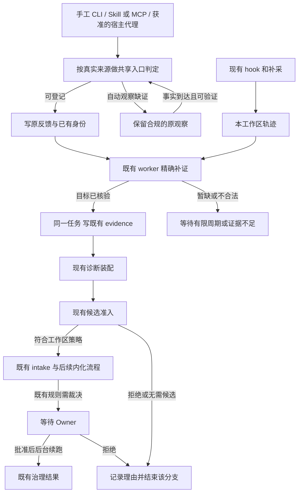

# PD 痛苦信号自动补证技术设计

- v0.5，补齐 Evidence/sourceRef 生命周期契约（§2.2）与治理状态对齐（§4.1），2026-11-20 · 配套 [产品 SPEC](./SPEC-PD-FEEDBACK-RESILIENCE-001.md)
- v0.4，入口、完整事件样本、相对评价、补证与无界面运行契约，2026-11-19
- 后台触发与生命周期的权威目标设计见 [PD Service Host Architecture SPEC](./SPEC-PD-SERVICE-HOST-001.md) 及其 [技术设计](./SPEC-PD-SERVICE-HOST-001-TECHNICAL-DESIGN.md)。本文件 §4.1 只保留业务恢复链路所需的进程事实与验收约束。
- 源码基线 `origin/main@eabd78abf6d655770c1a44b6e07eb0ea043086be`，包含 [#2699](https://github.com/csuzngjh/principles/pull/2699)、[#2700](https://github.com/csuzngjh/principles/pull/2700)、[#2701](https://github.com/csuzngjh/principles/pull/2701) 及 [#2702](https://github.com/csuzngjh/principles/pull/2702)。路径解析服从 #2699。
- **规范性数据语义**：[PD 行为偏差事件与相对评价规范](../concepts/PD_BEHAVIOR_DEVIATION_EVENT_AND_RELATIVE_EVALUATION.md)。本设计只定义如何复用现有入口、轨迹存储和任务管道，不声称相关完整事件数据集能力已在当前代码中实现。

## 1. 基线与设计决定

以下区分程序已经做的事和待实现的契约。源码基线用于核验当前实现；本文件定义待实现的产品和技术契约。文档设计、源码存在和真实安装产品验收是三个不同事实。

### 1.1 入口先收敛语义，再补缺的能力

| 已核对的入口 | 当前事实 | 实施约束 |
| --- | --- | --- |
| [Skill 源文件](../../packages/pd-skills/skills/pd-pain-signal/zh.md)、[CLI record](../../packages/pd-cli/src/commands/pain-record.ts) | Skill 的有锚点入口调用 MCP，要求本次 Owner 同意。Codex 旧显式 CLI 接受原话；通用 CLI 的 `handlePainRecord` 将 `painType` 设为 `user_frustration`，有绑定和无绑定两种来源，`--wait` 及工作区配置影响同步行为。 | 保留既有参数、原话类别、同步调用兼容。实现有锚点的 CLI 输入时复用 MCP 同一核心校验；Skill 调用一个可用入口，已被宿主消费的前缀不二次上报。正常异步提交先本地保存再回复。 |
| [MCP 装配](../../packages/pd-mcp-server/src/submit-assembly.ts) → [submitPainCapability](../../packages/principles-core/src/runtime/pain-submit-capability.ts) | `buildMcpIngressReport` 使用 `owner_manual/mcp_agent_assisted`；工作区由服务绑定。模型参数不能证明授权。能力层校验锚点、按既有规则生成身份并读回任务。Codex 取证是对当轮元数据及该工作区轨迹的精确查询。 | Owner 手工、代报和代理自主来源必须分别记录；调用了 MCP 只说明运输方式。旧信号按原字段解释，历史授权标签不追改。 |
| [Core 入口判定](../../packages/principles-core/src/runtime/pain-ingress.ts)、[宿主观察适配器](../../packages/openclaw-plugin/src/hooks/pain-ingress-adapter.ts) | `automatic_hook` 有归属且有证据时可 submit；无归属或证据仅 `observation_only`，不创建诊断任务。 | 优先让可信宿主侧承载获准的代理自主报告。仅当现有来源不能如实表达该路径时，扩展原来源联合与持久解析；校验当前工作区的自动执行授权、宿主身份和原事件。普通 MCP 参数不得设置 `approved` 或伪造观察身份。 |

**统一到哪一层。** CLI、MCP 和宿主事件保持各自输入协议，适配后使用已有 `PainIngressReport`、`evaluatePainIngress`、`PainToPrincipleService.recordPain` 及任务读回；不另建第二种入口事件或 Pain 管道。完整上下文行为偏差事件是数据集/分析语义单位，引用现有 Pain 身份、宿主权威轨迹和行动证据，不替代 `PainIngressReport` 或诊断任务。向实现人员交付以下字段映射和对照样本。

| 事实 | 权威来源与缺失处理 |
| --- | --- |
| 报告内容、行为与偏差、锚点 | 适配器保留原 `reason` 与可定位的 `anchorType/anchorRef`；已有原则按既有版本与状态核验。明确原话依现有 `correctionEvidence` 保存。普通陈述可登记；有锚点入口缺必需锚点要给具体原因。旧原话不因迁移被解释成有锚点报告。模型不得代写 Owner 原话。 |
| 工作区、宿主、发起者、入口、依据 | 工作区选取沿 #2699；发起者与通道从受信调用上下文派生 `origin` 与 provenance。自主代理沿获准宿主观察路径登记；没有相应授权时不得改走 Owner 代报。禁止调用方自由指定归属或可信等级。 |
| 身份与目标 | `painId/taskId` 或原 observation 身份沿用既有生成规则；恢复、重试引用同一记录。会话、提交轮、目标轮分开保存，可缺；目标定位线索和已核实证据分开。不同渠道没有共同稳定身份时不得仅凭文案相似合并。 |
| 证据和执行业务状态 | 从已授权的本工作区来源补 `evidence`，由真实数组推导 `evidenceClass`。诊断状态、准入结论和审批由下游产生。用户可区分已保存、仅有观察、结果不确定和写入失败；回执只声明实际可读回的事实。 |

已有自动观察缺证时，恢复从**持久化且可验证的原观察**开始，沿原身份重做入口判定；成功创建一次任务后沿该任务继续。若特定适配器只有瞬时事件，先补足其受策略允许的最小稳定引用，或记录该入口不支持事后恢复。已保存的反馈无需重新获得一次“提交”批准。完全没有可靠事实时停止该条的自动推断。

### 1.2 既有实现的取舍

| 自查发现 | v0.2 的决定 |
| --- | --- |
| v0.1 新设计 `proofRefs`、材料版本和专用装配接口。#2701 已可使用任务原有 `evidence`、`verifiedHostSession` 和 `evidenceClass`。 | 使用原有表示和诊断装配。只在任务上保留缺失时所需的可选线索和复查进度。没有新的证据数据源或消费者。 |
| v0.1 的测试只证明「能写证据」或直接用计数调准入。#2701 后续补丁明确修过 `evidenceClass` 与顶层数组不同步会被读回拒绝。 | 验收走真实任务写入、持久一致性解析、诊断装配及候选准入，不能用伪造 `entryCount` 或直接调评分门代替。 |
| 共享 `pickDiagnosticianCandidate` 先从库按 `limit` 取最旧的 pending / retry_wait。取出后跳过待补证项会产生队首阻塞。 | 在既有任务查询中先排除未就绪证据，再应用原排序、数量上限和轮转。执行端继续检查候选资格，避免 CLI 或并发更新绕开。 |
| v0.1 把自动重开、全缺 ID 推断、三宿主 MCP 等价身份和 Windows 新触发放在同一首版。现有重开函数只检查活动租约，没有比较父任务预期状态和 JSON。 | 首版只补尚未诊断的 Codex 已知目标。其他分支分开验收，有现成接口也不当作已证实能力。 |

**代码分工**：程序做定位、核验、补录与调度；PD Core 内置代理做诊断和候选建议。权限和候选准入由现有程序完成。缺可靠来源时分类为证据不足，用户无需另交一份材料才得到已登记回执。

## 2. 原始来源与权限

### 2.1 完整事件样本与时间视图

数据集样本单位是完整上下文行为偏差事件，而不是 Pain 行或 `diagnostic_json`。其逻辑组成与完整性判定以[规范性事件模型](../concepts/PD_BEHAVIOR_DEVIATION_EVENT_AND_RELATIVE_EVALUATION.md)为准。技术实现遵循以下约束：

- 原始对话轨迹、工具调用及返回、产物和状态变化留在各宿主已授权的权威来源；事件记录通过稳定 `sourceRef`、任务/会话/轮次身份和时间窗口关联，不把全文复制进 Pain 或任务 JSON，也不以摘要替代原始来源。
- Pain 记录入口可以先保存不完整候选。只有完整轨迹、行动证据、期望依据、偏差关系和运行条件均可追溯且授权允许时，才计为完整事件样本。无法访问、已撤回或已清退的来源不得用旧摘要冒充完整材料。
- 事件归档保留触发前完整相关轨迹，并把后续澄清、纠正和治理记录按真实时间追加关联；派生诊断、候选、评价和 Owner 决策与原始事实分开保存。
- 至少支持两种时间受限输入：历史诊断按该次诊断时点重建已存在且获准读取的上下文；宿主决策点评测仅暴露决策时点之前宿主有机会获知的信息。任何事后纠正、评价或候选结论不得泄漏到更早的输入。
- 原动作之后的真实历史结果只描述原动作路径，不得作为替代动作的反事实结果。反事实结论必须有独立的替代执行或明确的实验依据。
- 106 条 Pain 信号是 Owner 提供的候选入口数量，必须重新从实际数据源逐条关联、核验完整性和按事件去重；不能直接作为完整样本分母。

| 数据源 | 真实数据与复用点 | 技术边界 |
| --- | --- | --- |
| 各宿主 `<workspace>/.pd/state.db` | `tasks` 的 `task_id`、`input_ref`、状态和 `diagnostic_json`，以及 `pain_diagnoses`。`RuntimeStateManager` 是任务读写权威。 | 原反馈和已诊断结果在此。`sessionIdHint` 是查询线索。模型转述和候选结论不能成为真实对话。 |
| Codex、WorkBuddy `<workspace>/.state/trajectory.db` | `governance_observations` 有 `host_kind`、`rollout_identity`、`root_session_id`、`host_turn_id`、`logical_key`、物理键、`visible_text`、工具事实、来源及留存类型。`governance_rollouts` 提供来源关系，`governance_transcript_checkpoints` 提供补采进度。 | 采集器是唯一原始 JSONL 读入口。补录只读取同工作区中可用于该目的的留存用户/助手正文及合规工具事实。过期、回滚、隔离和撤回记录不补录，推理正文不进入反馈。 |
| OpenClaw `<workspace>/.state/trajectory.db` | `user_turns` 有用户轮行 ID、`session_id`、`turn_index`、正文或 blob 引用。`assistant_turns` 有 `run_id` 与可读正文。`tool_calls` 有已有运行关联。 | `acquireTrajectoryEvidence` 现有能力按 session 读取背景。精确补录需要一个独立核验的用户轮或关联运行。不可拿最近记录或 `turn_index` 充当 MCP 提交身份。 |

本机只读快照核对（前轮采样值）：留存正文方面，Codex 用户/助手观测为 108/20，WorkBuddy 为 7/46。OpenClaw 的治理观测表空，传统轨迹表共有 1,268 条用户轮、4,591 条助手轮、22,997 条工具记录。旧信号任务为 `succeeded`，会话提示 null、证据 0；按两个已知轮次查 Codex 治理观测均未命中。此项数值只说明采样时哪些表有数据，不能推广到每条反馈。

历史来源复核（2026-11-19）：既有 PRI-1260 记录给出了另一观察点。只读查询 Codex `thread_history_1.sqlite` 的 `thread_items` 后，确认该旧反馈有一条已完成的 `pd_submit_pain` 工具记录，位于已知提交轮；结构化结果的 `painId`、`capability` 和 `submitted` 回执相符。之前只查的 JSONL 不能证明同一关系。这个证据说明**可以定位该次提交**，不能证明用户所指早前轮的正文现在仍可访问，也不能证明已安装 PD 有受支持的读取契约。首版不接入宿主私有历史库。B1 若要支持回执恢复，先用受支持入口证明等价的结构化关联；只允许保存必要引用，不扫描私有全库。复查报告只记录类型、计数及核验结果。

**身份可用性**：Codex MCP SDK 的 `ctx.mcpReq._meta` 传入宿主 `threadId/sessionId` 与 `x-codex-turn-metadata.turn_id`；#2701 已接到精确读取。WorkBuddy hook 有 `generation_id`，转录的 `host_turn_id` 则由 `providerData.messageId` 或记录 ID 派生，二者与 MCP 提交的等价性未证实。OpenClaw 普通 MCP 同样未证明与某个用户轮等价。可确定的宿主能力按入口启用，不用默认映射补齐结果。

数据路径只取 #2699 验证好的宿主工作区，从对应数据库读；不根据项目 cwd、自由文本或 MCP 参数里的路径改变归属。就算其他宿主有相同内容、ID 或可读文件也不查。读取授权、摘录可持久化权限、复用和清退各按现行政策。正式入口的留存级别只说明记录可能能读，不能用来隐式扩大持久化范围。

### 2.2 Evidence / sourceRef 生命周期契约

材料在管道中的每个阶段有不同权限；不得把“读过一次”当成“可持久保留/可复用”。区分七种状态：

| 状态 | 含义 | 规则 |
| --- | --- | --- |
| 允许读取 | 采集/补证时从授权来源读 | 采集器是唯一原始 JSONL 读入口；读取前校验 workspace 归属、来源身份、consent 状态 |
| 临时使用 | 装配/诊断当次计算中使用 | 不落盘；进程结束后不保留 |
| 持久化摘录 | 按现有政策写入 `evidence` 的合规短摘录 | 有独立可持久化权限判定；不满足时保留未补录状态，不以无正文指针充数 |
| 重复使用 | 同一任务恢复/补证时读回已持久摘录 | 读回走同一 `sourceRef` 规则；不升级为新材料 |
| 授权撤回 | consent ledger `granted → revoked` | 撤回后的来源不再读取；装配前按 `sourceRef` 再校验（§3 第 5 步）；撤回点之后不得把该来源当有效输入 |
| 来源过期 | 轨迹/记录被保留策略清退 | 失效不视为有效新增输入；历史已持久摘录不当作新证据计数 |
| 数据清退 | 持久化摘录按政策删除 | 由现有 retention policy / trajectory-retention 驱动；**当前未观察到撤回时对已持久摘录的自动清退路径 → 记录为实施前置条件** |

六个问题的裁决：

1. **来源失效处理**：`sourceRef` 在装配前与准入前再校验；失效记录原因，保留原任务真实状态，不把历史摘录算成有效输入。
2. **持久化摘录**：允许的条件=来源授权 + 摘录政策；撤回后已持久摘录是否清退是实施前置条件（见上）。
3. **撤回后再诊断**：只用撤回时点仍合法的材料；不得引用撤回来源的轨迹或摘录。
4. **读取与写入之间撤回**：写入前最后一次 `sourceRef` 校验决定；撤回后不得写入。
5. **装配与模型调用之间撤回**：模型调用边界按同一 `sourceRef` 规则再检查；撤回的输入不得进入模型上下文。
6. **审计可留存的非敏感材料**：可保留 ID、计数、裁决结果、时间戳、宿主身份等元数据；不保留正文/摘录文本。

不建设第二套 Evidence 系统；以上全部沿用现有 `sourceRef`、consent ledger、retention policy 与轨迹读取边界。

## 3. 首版数据流

1. **保存**：提交入口先走既有持久化和读回。信号合法且目标早前一轮时，保留已验证的提交会话、提交轮和目标线索。正文不存在仍保存线索，不写 `verifiedHostSession` 冒充正文已核验。当前 `verifyCodexTarget` 在省略 `targetTurnId` 时默认提交轮。为兼容已有当轮调用，继续保留该语义；给明确指早前但目标未知的调用增加可表达的状态（内部判别及必要的可选入参），此状态不得进入当轮默认分支。验证器在持久化前调用，若可选轨迹读取抛错，在该窄边界转为可恢复原因并继续合法登记；工作区/来源授权、锚点或状态库故障仍按各自语义处理。未给早前目标又无法核验时，登记且明示目标未知。
2. **等待**：仅对可定位但暂未到的证据挂起自动诊断。可在现有 `diagnostic_json` 增加一个可选等待对象，包含宿主已提供的线索、原因、有限重查次数或到期时间。无等待对象的任务按原逻辑处理。该对象只驱动恢复和展示，不是证据来源或新任务状态。现有合法 Owner 陈述或独立证据已足以支持诊断时，不因少了一个 ID 强制等待。
3. **读取**：从现有 worker 的 `catchUpCodexIngestion` 之后和诊断领取之前，处理有界的到期任务。复用 #2701 的精确取证，校验宿主、确切 `rollout_identity`、目标 `host_turn_id`，再使用现有留存策略、消毒与短摘录上限。不回退到 `root_session_id`、最新轮或模糊匹配。读取故障、永久不可用和晚到给不同原因，处理失败只影响该反馈。
4. **条件写**：让原任务的 `evidence`、`sessionIdHint`、`painIngress.verifiedHostSession` 与 `painIngress.evidenceClass` 一次更新。`evidence` 复用现有 `sourceRef` 和合规短摘录；本次不另存 `proofRefs` 或全文。能读但不允许按现有政策持久化摘录时保留未补录状态，首版不通过无正文的指针增加计数。旧版 ingress 字段仍按现有解析器读取。
5. **释放等待**：使用现有 `updateTaskIfDiagnosticJsonUnchanged` 比较任务状态、待补材料及租约，实现同一事务只写一次，并清除等待标记。轨迹库和任务库分属两个连接；状态条件写不能保证原源保持可用。诊断装配开始前、准入前由现有轨迹读取边界按 `sourceRef` 规则再检查该任务新增材料的归属、授权和保留状态。失效时不能把历史摘录算成有效新增输入，只在原任务记录原因。无需新材料版本或第二套装配组件；条件比较现有任务 JSON。
6. **继续**：现有诊断和准入使用原任务中一致的证据。活跃诊断和已有成功结果不被首版补录覆盖。诊断已成功但后处理失败，走原有账本恢复，不再请求模型。超出复查上限投影为证据不足；首版允许现有周期有限探索，不加事件订阅。普通任务继续被选择。

候选查询必须在 SQL 排序/`LIMIT` 前应用等待过滤，影子检查使用同一语义。若旧任务缺该字段则可正常领取。执行时再次读任务状态和证据，已有合法显式恢复仍走原入口。不能先取一批最旧待处理任务再仅在 JS 里 `filter`；被挂起的队首会挡住后续。一次有界对照复现场景可以坚持使用已有 `listTasks` 和共享候选选择器，避免另起调度组件。

**领取边界**：仍在等待和已耗尽复查的缺证任务，都不计入可领取队列。前者可进入到期补证查询，后者在控制台显示证据不足。成功补录在同一次写入中恢复可领取状态。此处的期限是补证退避，不借用 `retry_wait` 的模型重试额度。首版早前目标路径依赖已有 `targetTurnId` 或同等已验证线索；没有目标时不能新增「把提交轮当作早前目标」的推断。

## 4. 直接复用和最小改动

| 位置 | 现有能力 | 首版最小改动 |
| --- | --- | --- |
| MCP `server.ts` / `submit-assembly.ts`、Core `submitPainCapability` | 读取 Codex 请求元数据、精确取证、持久化和回执。 | 提示与已验证证据分开；目标晚到时保留已有线索。把 #2701 精确查询提取到可以同时供提交和 worker 复用的位置，避免复制。 |
| `governance-observation-store.ts`、`catchUpCodexIngestion` | 物理记录、保留类型、现有精确过滤、字节补采与去重。 | 复用有键查询与授权检查。Core 通过现有轨迹读取注入边界调用，禁止反向依赖 Host Runtime。采集器不读新路径。 |
| `RuntimeStateManager.updateTaskIfDiagnosticJsonUnchanged`、`SqliteTaskStore.listTasks` | 现有原任务读取、带状态及租约前置条件的更新。 | 在已有筛选表达待补证与可执行两类，保留限制和公平性；应用原任务补证。无需新增表、索引前置要求或公共服务 API。 |
| `workspace-worker.ts` / `pickDiagnosticianCandidate` | 既有补采、reconcile、租约扫尾和公平选择。 | 补采后加一个有界恢复步骤，在领任务前排除等待。`reconcileGovernanceContinuation` 目前围绕既有治理流程，不把未准入 MCP 信号伪装成治理接纳记录。 |
| `SqliteContextAssembler`、`PainSignalBridge`、`evaluateAdmission`、`pd runtime trace show` / Console | 既有任务解析、证据装配、输入计数、诊断、准入、展示。 | 检查来源仍可用，复用已有装配与证据判定。现有读模型展示待补证原因；没有可用后台时继续如实显示。 |

`SourceTraceLocator` 缺 `sessionIdHint` 会返回 `missing_session_hint`，不用于首版猜测。`reopenDiagnosticianFamilyAtomic` 的活动租约门可复用，但历史任务重开前须在同一事务加入对预期 JSON 和状态的比较；不照搬 `--owner-statement` 写入语义，也不为首版改变终态任务。B1 覆盖可信回执与旧任务；B2 覆盖 WorkBuddy/OpenClaw 的确切身份；B3 覆盖独立执行者。

### 4.1 谁负责让管道继续运转

- **当前进程边界。** [Companion main](../../packages/pd-companion/src/main/main.ts) 的 `spawnWorkspaceWorkerFor` 启动系统 Node 下的 `pd codex/workbuddy worker`；`before-quit` 经 `stopWorkspaceWorkerSupervision` 停止它监督的子进程。[Core 诊断执行](../../packages/principles-core/src/runtime/internalization/split-diagnostician-runner.ts) 与 UI 分离。OpenClaw [插件注册入口](../../packages/openclaw-plugin/src/index.ts) 在 Gateway 内注册 `InternalizationAutoConsumerService`，其 timer chain 随 Gateway 生命周期启停。Console 的手动诊断路由另行启动一次 CLI 子进程；它不是自动消费者。
- **目标生命周期所有者。** [PD Service Host Architecture SPEC](./SPEC-PD-SERVICE-HOST-001.md) 将 PD 后台触发归给 PD-owned Service Host。V1 使用用户级 OS scheduler（Windows Task Scheduler、macOS LaunchAgent、Linux systemd --user）触发 `pd service run-once`；单次进程读取 canonical install manifest，为每个已授权 Workspace 调用一个有界 Worker Cycle，然后退出。它不依赖 Companion、Console Server 或 OpenClaw Gateway 存活，也不建设常驻通用 Daemon。
- **Worker 复用。** Codex / WorkBuddy 继续复用各自现有 Worker Cycle 的 `--once` 路径；OpenClaw 需要把 tool catalog、tool semantics 和 evidence provider 从 Gateway Plugin 生命周期拆出，提供可独立运行的 `pd openclaw worker --once`，并继续调用 `@principles/host-runtime` 的共享消费周期。Service Host 只负责发现、触发、隔离、收集状态和安排下次周期，不复制 Diagnostician 或 Internalization 业务逻辑。
- **唯一生命周期负责人。** 迁移后每个 Workspace 只有一个自动触发者。Service Host 接管前，Companion / OpenClaw Gateway 仍是现有路径的所有者；接管后才关闭对应旧监督者。Companion 只读状态，关闭或升级不能停止后台；Gateway 退出也不能停止已持久化且证据足够的任务。升级、回滚必须原子切换 owner marker，禁止双重消费者长期并行。
- **数据、锁与恢复。** 任务仍保存在每 Workspace 的 `.pd/state.db`；既有 RuntimeStateManager Durable Lease 是 task-level 并发权威，Service Host 的 per-install run lock 只防止重叠的调度进程，二者不能互相替代。进程中断后由 Lease TTL / Recovery Sweep 和下一周期接续；不新增全局任务队列、Pain 表或第二套 Lease。
- **平台与安全。** Scheduler 以当前用户身份运行，不安装系统级服务、不提升权限、不把密钥写入任务参数。每个子进程显式绑定 manifest 中的 Workspace，清理可能重定向 Workspace 的继承环境变量；一个 Workspace 故障不能阻断其他 Workspace。OpenClaw Gateway 不运行时不得扫描其私有内存或会话目录；证据不足就保留真实 waiting / degraded 状态。
- **治理状态。** ADR-0020 §11.6 dated amendment（2026-11-19）已批准 Service Host 窄范围架构：PD-owned 用户级 OS scheduler + 有界 `pd service run-once` + 复用现有 Worker Cycle。§11.6 是架构批准而非实现完成；§11.1 未被收窄的限制（系统级服务、通用常驻 Daemon、第二套任务系统）仍有效；生产交接仍需按 SPEC §8.4 逐 Workspace 原子完成并通过 Phase 5 验收。

## 5. 可执行验收

| 用例 | 首版通过条件 |
| --- | --- |
| T1 真实 MCP → 真实状态库 | 缺 ID、写失败、回执丢失分别显示真实状态；单次提交身份一致且没有第二条。 |
| T2 早前目标正文晚到 | 在同一安装构建用源夹具出真实提交、补采、任务读回、诊断装配、候选准入；精确原轮、原 ID、`evidenceClass` 与真实证据数一致。以本地确定性模型响应排除质量噪声。 |
| T3 归属、授权及队列反例 | 同文异会话、异宿主同键、过期、撤回均不得引用。让旧待补证任务数量超过领取上限，正常任务仍领取；自动诊断不会空转等待项。 |
| T4 故障与重复 | 超长完整行、未结束尾部、重放、两个 worker 并发和进程重启对照。未写全可补，越过坏行后有效记录可用，同一任务只成功补证一次，正常后处理沿用既有规则。 |
| T5 完整事件归档 | 从任务开始到 Pain 触发的对话、工具调用/返回、产物和状态变化均能通过授权 sourceRef 追溯；后续纠正按真实时间关联；缺失、撤回或过期来源不会被摘要伪装成完整样本。 |
| T6 相对期望评价 | 覆盖成功但偏离、失败但符合预期、同一行为因 Owner/任务上下文不同而方向相反；当时可获知期望、事后澄清、评价者推断分层保存，冲突和不确定性允许显式结论。 |
| T7 时间视图隔离 | 历史诊断只读该诊断时点已有上下文；决策点评测只暴露宿主当时可获知的信息；后续纠正/诊断不得泄漏；原动作后的历史结果不得充当替代动作的反事实结果。 |
| T8 事件计数与去重 | 多条 Pain 指向同一事件只计一次；相似文本但不同任务/发生时间不误合并；106 条候选信号逐条标注完整/不完整/不可分析并给出缺失原因。 |

以上 T1–T4 覆盖 A1–A4。队列压力用例也须经过 WorkBuddy 自有领取器及 OpenClaw 实际领取入口，只在适用路径启用待证过滤。对明确早前目标未知和验证器抛错各加一条从提交到任务读回的反例。

| 产品门槛 | 实际入口、动作与判据 |
| --- | --- |
| B4 来源与字段一致 | 用同一已知偏差走有锚点 CLI、Skill 正常通路、MCP 和可信宿主代理入口。核对回执、持久原任务、装配实收的行为/锚点/来源与证据，不比较渠道各自生成的 ID。另测旧 CLI 原话、自动观察缺证后晚到、代理伪称 Owner、无授权及重复事件。来源不能串，合法自动上报无需逐次批准，缺证不冒充形成候选。 |
| B3 无界面生命周期 | 在同一正式安装候选上，从用户登录、两个 UI 均未运行开始，提交后不手工启动 worker，读回周期及业务进展。中途杀掉后台进程，验证自行接续；重启 Companion、升级、禁用、卸载各自核对执行者和注册；测试一个工作区坏而另一个前进。凭据按用户级配置真实解析，模型可用隔离端点。 |
| B5 自动推进与治理停点 | 走真实任务写入→补证/已有材料→模型实收→诊断落库→准入→适用的 intake/下游工作→原 Owner 节点。批准与拒绝各走一个隔离样本；记录下一阶段持久结果，无需点“重试”。缺可选字段但材料足够、证据永久不足、模型短暂不可用、明确暂停分别给出真实结果。任一拒绝不得静默丢反馈或作成成功候选。 |

实施顺序：PRI-1273 负责首条可运行链并承载 B4 的共享输入和 B5 业务闭环；PRI-1277 并行交付 B3 的后台生命周期；PRI-1274 承担 B1，PRI-1275/1276 按各自路径完成 B2 和 B4 的宿主对照。总单 PRI-1272 汇总每个已声明支持的入口、宿主、安装版本和最后一个可证明的治理节点。未核对宿主、尚未发布的实现及没有可验证来源的历史记录分别记账。
