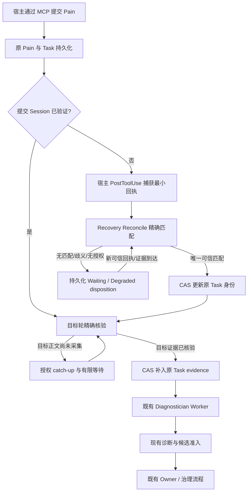

# PD 痛苦信号自愈恢复技术设计

- v0.6，新增 MCP 提交回执驱动的缺失身份恢复、最小化回执捕获、Recovery Reconcile 与非无限 Pending 契约，2026-11-21 · 配套 [产品 SPEC](./SPEC-PD-FEEDBACK-RESILIENCE-001.md)
- v0.5，补齐 Evidence/sourceRef 生命周期契约（§2.2）与治理状态对齐（§4.1），2026-11-20 · 配套 [产品 SPEC](./SPEC-PD-FEEDBACK-RESILIENCE-001.md)
- v0.4，入口、完整事件样本、相对评价、补证与无界面运行契约，2026-11-19
- 后台触发与生命周期的权威目标设计见 [PD Service Host Architecture SPEC](./SPEC-PD-SERVICE-HOST-001.md) 及其 [技术设计](./SPEC-PD-SERVICE-HOST-001-TECHNICAL-DESIGN.md)。本文件 §4.1 只保留业务恢复链路所需的进程事实与验收约束。
- 源码基线 `origin/main@2e91fdfa7916bf04943f16325da4beb0c95cd934`（2026-11-21），包含 [#2699](https://github.com/csuzngjh/principles/pull/2699)、[#2700](https://github.com/csuzngjh/principles/pull/2700)、[#2701](https://github.com/csuzngjh/principles/pull/2701) 及 [#2702](https://github.com/csuzngjh/principles/pull/2702)。路径解析服从 #2699。
- **规范性数据语义**：[PD 行为偏差事件与相对评价规范](../concepts/PD_BEHAVIOR_DEVIATION_EVENT_AND_RELATIVE_EVALUATION.md)。本设计只定义如何复用现有入口、轨迹存储和任务管道，不声称相关完整事件数据集能力已在当前代码中实现。

## 1. 基线与设计决定

以下区分程序已经做的事和待实现的契约。源码基线用于核验当前实现；本文件定义待实现的产品和技术契约。文档设计、源码存在和真实安装产品验收是三个不同事实。

### 1.1 入口先收敛语义，再补缺的能力

| 已核对的入口 | 当前事实 | 实施约束 |
| --- | --- | --- |
| [Skill 源文件](../../packages/pd-skills/skills/pd-pain-signal/zh.md)、[CLI record](../../packages/pd-cli/src/commands/pain-record.ts) | Skill 的有锚点入口调用 MCP，要求本次 Owner 同意。Codex 旧显式 CLI 接受原话；通用 CLI 的 `handlePainRecord` 将 `painType` 设为 `user_frustration`，有绑定和无绑定两种来源，`--wait` 及工作区配置影响同步行为。 | 保留既有参数、原话类别、同步调用兼容。实现有锚点的 CLI 输入时复用 MCP 同一核心校验；Skill 调用一个可用入口，已被宿主消费的前缀不二次上报。正常异步提交先本地保存再回复。 |
| [MCP 装配](../../packages/pd-mcp-server/src/submit-assembly.ts) → [submitPainCapability](../../packages/principles-core/src/runtime/pain-submit-capability.ts) | `buildMcpIngressReport` 使用 `owner_manual/mcp_agent_assisted`；工作区由服务绑定。模型参数不能证明授权。能力层校验锚点、按既有规则生成身份并读回任务。Codex 取证是对当轮元数据及该工作区轨迹的精确查询。 | Owner 手工、代报和代理自主来源必须分别记录；调用了 MCP 只说明运输方式。旧信号按原字段解释，历史授权标签不追改。 |
| [Core 入口判定](../../packages/principles-core/src/runtime/pain-ingress.ts)、[宿主观察适配器](../../packages/openclaw-plugin/src/hooks/pain-ingress-adapter.ts) | `automatic_hook` 有归属且有证据时可 submit；无归属或证据仅 `observation_only`，不创建诊断任务。 | 优先让可信宿主侧承载获准的代理自主报告。仅当现有来源不能如实表达该路径时，扩展原来源联合与持久解析；校验当前工作区的自动执行授权、宿主身份和原事件。普通 MCP 参数不得设置 `approved` 或伪造观察身份。 |

**统一到哪一层。** CLI、MCP 和宿主事件保持各自输入协议，适配后使用已有 `PainIngressReport`、`evaluatePainIngress`、`PainToPrincipleService.recordPain` 及任务读回；不另建第二种入口事件或 Pain 管道。完整上下文行为偏差事件是数据集/分析语义单位，引用现有 Pain 身份、宿主权威轨迹和行动证据，不替代 `PainIngressReport` 或诊断任务。向实现人员交付以下字段映射和对照样本。

| 事实 | 权威来源与缺失处理 |
| --- | --- |
| 报告内容、行为与偏差、锚点 | 适配器保留原 `reason` 与可定位的 `anchorType/anchorRef`；已有原则按既有版本与状态核验。明确原话依现有 `correctionEvidence` 保存。普通陈述可登记；有锚点入口缺必需锚点要给具体原因。旧原话不因迁移被解释成有锚点报告。模型不得代写 Owner 原话。 |
| 工作区、宿主、发起者、入口、依据 | 工作区选取沿 #2699；发起者与通道从受信调用上下文派生 `origin` 与 provenance。自主代理沿获准宿主观察路径登记；没有相应授权时不得改走 Owner 代报。禁止调用方自由指定归属或可信等级。 |
| 身份与目标 | `painId/taskId` 或原 observation 身份沿用既有生成规则；恢复、重试引用同一记录。会话、提交轮、目标轮分开保存，可缺；目标定位线索和已核实证据分开。不同渠道没有共同稳定身份时不得仅凭文案相似合并。 |
| 证据和执行业务状态 | 从已授权的本工作区来源补 `evidence`，由真实数组推导 `evidenceClass`。诊断状态、准入结论和审批由下游产生。用户可区分已保存、仅有观察、结果不确定和写入失败；回执只声明实际可读回的事实。 |

已有自动观察缺证时，恢复从**持久化且可验证的原观察**开始，沿原身份重做入口判定；成功创建一次任务后沿该任务继续。若特定适配器只有瞬时事件，先补足其受策略允许的最小稳定引用，或记录该入口不支持事后恢复。已保存的反馈无需重新获得一次“提交”批准。完全没有可靠事实时停止该条的自动推断。

### 1.2 既有实现的取舍

| 自查发现 | v0.2 的决定 |
| --- | --- |
| v0.1 新设计 `proofRefs`、材料版本和专用装配接口。#2701 已可使用任务原有 `evidence`、`verifiedHostSession` 和 `evidenceClass`。 | 使用原有表示和诊断装配。只在任务上保留缺失时所需的可选线索和复查进度。没有新的证据数据源或消费者。 |
| v0.1 的测试只证明「能写证据」或直接用计数调准入。#2701 后续补丁明确修过 `evidenceClass` 与顶层数组不同步会被读回拒绝。 | 验收走真实任务写入、持久一致性解析、诊断装配及候选准入，不能用伪造 `entryCount` 或直接调评分门代替。 |
| 共享 `pickDiagnosticianCandidate` 先从库按 `limit` 取最旧的 pending / retry_wait。取出后跳过待补证项会产生队首阻塞。 | 在既有任务查询中先排除未就绪证据，再应用原排序、数量上限和轮转。执行端继续检查候选资格，避免 CLI 或并发更新绕开。 |
| 旧版把自动重开、全缺 ID 推断、三宿主 MCP 等价身份和 Windows 新触发放在同一首版；首版又被缩窄成仅处理已知目标正文晚到，遗漏了「Pain 已创建但 Session 丢失」的原始故障。 | 首版必须同时交付 B1 可信提交回执身份恢复、A2 已知目标正文晚到补证及 B3 无界面业务闭环。历史终态任务重开明确排除；各宿主适配分开验收，Service Host 基础设施只归 PRI-1278。 |

**代码分工**：程序做定位、核验、补录与调度；PD Core 内置代理做诊断和候选建议。权限和候选准入由现有程序完成。缺可靠来源时分类为证据不足，用户无需另交一份材料才得到已登记回执。

### 1.3 B1：可信提交回执驱动的身份恢复

#### 现状核验（不得把现有能力夸大为已交付）

- MCP `pd_submit_pain` 在处理时可从宿主请求元数据读取身份声明；`submitPainCapability` 只在 `verifyHostSession` 验证通过后才写入 `sessionIdHint` / `painIngress.verifiedHostSession`。声明缺失或未验证时，任务合法落库但保持 unbound。
- Codex `PostToolUse` 的 `.*` matcher 已覆盖 `pd_submit_pain`；该事件在工具返回后由宿主 hook 触发，不依赖模型是否继续完成下一轮推理/跟进。`packages/codex-adapter/src/codec/input-decoder.ts` 将宿主 `session_id/turn_id/tool_use_id/tool_response` 解码为可信上下文 `sessionId/turnId/toolCallId/toolOutput`。`ingestCodexConversation` 可把 `toolName/params/result` 写入 `governance_observations`。但该路径受 `codex_conversation_ingestion` feature flag 和 consent ledger 双重门控，不能保证所有 MCP 提交都有回执观察。
- 当前 Codex EventLog 的 `tool_call` 不包含结构化 `toolResponse` / `painId`（即使记录工具名、toolCallId、错误/退出码等），不能作为身份恢复凭据。
- `listGovernanceObservations` 是通用有界列表（默认 500、最大 2000），没有按 `toolName + result.painId` 的专用精确查询契约。不得用通用列表截断扫描宣称能找回任意历史提交。
- 因此，已有获授权 `governance_observations` 中的完整结构化回执可作为兼容回退来源；但它不是可靠的默认捕获机制。B1 必须增加宿主完成事件上的最小回执捕获，并证明其真实安装行为。

#### 最小回执捕获契约

1. 在宿主 `after_tool_call` / PostToolUse 完成事件中，只处理工具名精确等于 `pd_submit_pain` 的事件。身份必须来自宿主适配器的可信事件上下文，不来自模型参数、用户文本或 MCP 输入中的 `hostSession` 声明。
2. 严格解析 Codex PostToolUse 的 toolOutput（原始 `tool_response`）：当前 MCP envelope 是单个 text content block，JSON 位于 `content[0].text`，不使用 `structuredContent`。只接受完整解析出的 `pd.pain-submit-receipt.v1`，要求 `capability=pd_submit_pain`、`status=submitted`（或 `submit_unconfirmed` 经原任务精确读回后确认）、`painId` 与 `taskId` 非空且匹配原任务。拒绝多块/非 JSON/自由文本中的相似字符串、普通消息、摘要、错误回执和未确认写入。
3. 同时绑定当前安装解析出的 Workspace、hostKind、宿主 Session、提交 Turn、toolUseId/toolCallId、receipt schema/capability/status、painId/taskId 与 observedAt。`taskId` 必须与 `painId` 的确定性映射一致，且原任务 `input_ref` 精确指向该 `painId`。
4. 仅持久化恢复所需的最小化元数据；Session/Turn/toolUseId 等标识仍按敏感运行元数据保护；不存储 `reason`、`anchorRef`、prompt、完整工具输入/输出、transcript 正文或摘要。首选在原任务 `diagnostic_json` 上用 CAS 原子附加已验证的 `verifiedHostSession` / `sessionIdHint` 和 recovery receipt reference；不新建 Pain、Task、全局队列或第二证据库。
5. 该最小捕获必须有明确的一次性 Workspace 级披露/授权；不得借 MCP 单次提交同意推导对完整会话采集的同意，也不得绕过 `codex_conversation_ingestion` 或现有 consent ledger。若现有 consent 明确覆盖该最小元数据，可复用；否则实现独立的 receipt-only 授权。它不要求每条 Pain 再次审批。
6. 当 hook 捕获失败时，只有在已有正式 consent 的情况下才可通过已授权 transcript catch-up 回放结构化回执。不得读取 Codex/WorkBuddy/OpenClaw 私有历史数据库或扫描未登记的会话目录。两条路径都不可用时，状态必须是可解释的 `receipt_unavailable` / `blocked_by_consent`，不能猜测。

#### 身份和目标分层

- `submissionSessionId/submissionTurnId`：证明哪一次 MCP 工具调用创建了这条 Pain，由唯一可信提交回执恢复。
- `targetTurnId`：证明痛苦信号指向哪一轮行为。可来自 MCP 已明确给出的目标轮或其他同等可信线索，随后必须在相同 host/workspace/session 下独立核验。
- 提交轮默认作为目标轮只适用于现有明确的当轮语义；不能用提交轮、最新轮、`turn_index`、最近消息、文本相似度或模型推断填补一个明确指向早前行为但目标未知的任务。
- `SourceTraceLocator` 继续负责在 `sessionIdHint` 已验证后精确定位目标证据；缺少 `sessionIdHint` 时返回 `missing_session_hint` 是正确的 fail-closed 行为，不应改成模糊搜索。

#### Recovery disposition

在原任务 `diagnostic_json` 中增加版本化的可选恢复对象，不新增 TaskStatus：`schemaVersion`、`state`、`reasonCode`、`attemptCount`、`lastCheckedAt`、`nextCheckAt`、`receiptRef`、`resolvedAt`。`state` 至少区分 `waiting_for_receipt`、`waiting_for_target_evidence`、`ready_for_diagnosis`、`blocked_by_consent`、`ambiguous_receipt`、`recovery_exhausted` 与 `unrecoverable`。任务执行状态仍由既有 Task lifecycle 管理；Read Model 必须把这些状态投影为可解释的 Waiting/Degraded，而不是无原因 Pending。

按有界退避执行恢复检查；达到策略上限后置为 `recovery_exhausted`，停止每周期无意义轮询但保留原记录。后续新到达的可信回执或证据可通过同一 CAS 重新评估。身份/证据恢复不调用模型、不绕过 Owner 治理，也不把 `recovery_exhausted` 伪装成 Pain 提交失败。

## 2. 原始来源与权限

### 2.1 完整事件样本与时间视图

数据集样本单位是完整上下文行为偏差事件，而不是 Pain 行或 `diagnostic_json`。其逻辑组成与完整性判定以[规范性事件模型](../concepts/PD_BEHAVIOR_DEVIATION_EVENT_AND_RELATIVE_EVALUATION.md)为准。技术实现遵循以下约束：

- 原始对话轨迹、工具调用及返回、产物和状态变化留在各宿主已授权的权威来源；事件记录通过稳定 `sourceRef`、任务/会话/轮次身份和时间窗口关联，不把全文复制进 Pain 或任务 JSON，也不以摘要替代原始来源。
- Pain 记录入口可以先保存不完整候选。只有完整轨迹、行动证据、期望依据、偏差关系和运行条件均可追溯且授权允许时，才计为完整事件样本。无法访问、已撤回或已清退的来源不得用旧摘要冒充完整材料。
- 事件归档保留触发前完整相关轨迹，并把后续澄清、纠正和治理记录按真实时间追加关联；派生诊断、候选、评价和 Owner 决策与原始事实分开保存。
- 至少支持两种时间受限输入：历史诊断按该次诊断时点重建已存在且获准读取的上下文；宿主决策点评测仅暴露决策时点之前宿主有机会获知的信息。任何事后纠正、评价或候选结论不得泄漏到更早的输入。
- 原动作之后的真实历史结果只描述原动作路径，不得作为替代动作的反事实结果。反事实结论必须有独立的替代执行或明确的实验依据。
- 106 条 Pain 信号是 Owner 提供的候选入口数量，必须重新从实际数据源逐条关联、核验完整性和按事件去重；不能直接作为完整样本分母。

| 数据源 | 真实数据与复用点 | 技术边界 |
| --- | --- | --- |
| 各宿主 `<workspace>/.pd/state.db` | `tasks` 的 `task_id`、`input_ref`、状态和 `diagnostic_json`，以及 `pain_diagnoses`。`RuntimeStateManager` 是任务读写权威。 | 原反馈和已诊断结果在此。`sessionIdHint` 是查询线索。模型转述和候选结论不能成为真实对话。 |
| Codex、WorkBuddy `<workspace>/.state/trajectory.db` | `governance_observations` 有 `host_kind`、`rollout_identity`、`root_session_id`、`host_turn_id`、`logical_key`、物理键、`visible_text`、工具事实、来源及留存类型。`governance_rollouts` 提供来源关系，`governance_transcript_checkpoints` 提供补采进度。 | 采集器是唯一原始 JSONL 读入口。补录只读取同工作区中可用于该目的的留存用户/助手正文及合规工具事实。过期、回滚、隔离和撤回记录不补录，推理正文不进入反馈。 |
| OpenClaw `<workspace>/.state/trajectory.db` | `user_turns` 有用户轮行 ID、`session_id`、`turn_index`、正文或 blob 引用。`assistant_turns` 有 `run_id` 与可读正文。`tool_calls` 有已有运行关联。 | `acquireTrajectoryEvidence` 现有能力按 session 读取背景。精确补录需要一个独立核验的用户轮或关联运行。不可拿最近记录或 `turn_index` 充当 MCP 提交身份。 |

本机只读快照核对（前轮采样值）：留存正文方面，Codex 用户/助手观测为 108/20，WorkBuddy 为 7/46。OpenClaw 的治理观测表空，传统轨迹表共有 1,268 条用户轮、4,591 条助手轮、22,997 条工具记录。旧信号任务为 `succeeded`，会话提示 null、证据 0；按两个已知轮次查 Codex 治理观测均未命中。此项数值只说明采样时哪些表有数据，不能推广到每条反馈。

历史来源复核（2026-11-19）：既有 PRI-1260 记录给出了另一观察点。只读查询 Codex `thread_history_1.sqlite` 的 `thread_items` 后，确认该旧反馈有一条已完成的 `pd_submit_pain` 工具记录，位于已知提交轮；结构化结果的 `painId`、`capability` 和 `submitted` 回执相符。之前只查的 JSONL 不能证明同一关系。这个证据说明**可以定位该次提交**，不能证明用户所指早前轮的正文现在仍可访问，也不能证明已安装 PD 有受支持的读取契约。首版不接入宿主私有历史库。B1 若要支持回执恢复，先用受支持入口证明等价的结构化关联；只允许保存必要引用，不扫描私有全库。复查报告只记录类型、计数及核验结果。

**身份可用性**：Codex MCP SDK 的 `ctx.mcpReq._meta` 传入宿主 `threadId/sessionId` 与 `x-codex-turn-metadata.turn_id`；#2701 已接到精确读取。WorkBuddy hook 有 `generation_id`，转录的 `host_turn_id` 则由 `providerData.messageId` 或记录 ID 派生，二者与 MCP 提交的等价性未证实。OpenClaw 普通 MCP 同样未证明与某个用户轮等价。可确定的宿主能力按入口启用，不用默认映射补齐结果。

数据路径只取 #2699 验证好的宿主工作区，从对应数据库读；不根据项目 cwd、自由文本或 MCP 参数里的路径改变归属。就算其他宿主有相同内容、ID 或可读文件也不查。读取授权、摘录可持久化权限、复用和清退各按现行政策。正式入口的留存级别只说明记录可能能读，不能用来隐式扩大持久化范围。

### 2.2 Evidence / sourceRef 生命周期契约

材料在管道中的每个阶段有不同权限；不得把“读过一次”当成“可持久保留/可复用”。区分七种状态：

| 状态 | 含义 | 规则 |
| --- | --- | --- |
| 允许读取 | 采集/补证时从授权来源读 | 采集器是唯一原始 JSONL 读入口；读取前校验 workspace 归属、来源身份、consent 状态 |
| 临时使用 | 装配/诊断当次计算中使用 | 不落盘；进程结束后不保留 |
| 持久化摘录 | 按现有政策写入 `evidence` 的合规短摘录 | 有独立可持久化权限判定；不满足时保留未补录状态，不以无正文指针充数 |
| 重复使用 | 同一任务恢复/补证时读回已持久摘录 | 读回走同一 `sourceRef` 规则；不升级为新材料 |
| 授权撤回 | consent ledger `granted → revoked` | 撤回后的来源不再读取；装配前按 `sourceRef` 再校验（§3 第 5 步）；撤回点之后不得把该来源当有效输入 |
| 来源过期 | 轨迹/记录被保留策略清退 | 失效不视为有效新增输入；历史已持久摘录不当作新证据计数 |
| 数据清退 | 持久化摘录按政策删除 | 由现有 retention policy / trajectory-retention 驱动；**BLOCKED（本轮审计结论，2026-11-20 三轮复核）**：见 §2.2.1 撤回三能力分解。不得将撤回语义宜称为已完整实现 |

六个问题的裁决：

#### 2.2.1 撤回不是单动词：三个必须分开审计的能力

| 能力 | 定义 | 当前状态 |
|---|---|---|
| R1 撤回授权 | consent ledger `granted → revoked` 状态迁移 | **已实现**（ledger v3） |
| R2 停止后续使用 | 撤回点之后，该 sourceRef 不再被读取、不再进入装配与模型上下文 | **部分实现**：装配前/写入前/模型调用前均有 `sourceRef` 再校验点（下述清单 3–5），但校验点依赖任务经过这些路径——不经过装配的任务不受约束 |
| R3 删除历史副本 | 对已持久化摘录的物理删除或不可恢复化处理 | **BLOCKED：代码库中不存在撤回清退路径** |

**R3 涉及的全部持久化/投影位置**（审计结果，清退实现必须逐一覆盖）：

1. Task `diagnostic_json` 中的 `evidence` 摘录（state.db `tasks` 行）；
2. `painIngress` 嵌套块内的 evidenceClass/verifiedHostSession 记录；
3. 装配证据与原则草案（evidence-chain / candidate intake 产物）；
4. 诊断材料（diagnostician 输出、Ledger 条目）；
5. Recall 读模型投影；
6. Console 投影与展示缓存。

**R2 Gate 明确未通过**：代码库中**不存在**"新诊断任务 / Recall 投影 / Console 投影在读取 sourceRef 前先查 consent ledger 最新状态"的统一前置校验；撤回 sourceRef 仍可能被已有投影当成有效授权证据展示。物理删除（R3）、逻辑屏蔽（投影层过滤）、停止新消费（R2）是三种不同实现，不得互相冒充。最小清退实现需同时满足：阻断新装配、定位全部副本、清除或不可恢复化处理敏感摘录、审计只留非敏感元数据、清退可见可重试幂等、所有读路径遵守撤回、重授权不复活旧摘录、不建第二证据库——超出"必要修复"边界，标记 BLOCKED，作为 SPEC 落地前置条件；由 PRI-1283 负责关闭，未通过前不得完成 sourceRef 证据恢复的生产发布验收。

1. **来源失效处理**：`sourceRef` 在装配前与准入前再校验；失效记录原因，保留原任务真实状态，不把历史摘录算成有效输入。
2. **持久化摘录**：允许的条件=来源授权 + 摘录政策；撤回后已持久摘录的清退为 BLOCKED 前置条件（见上），未关闭前不得宣称撤回语义完整。
3. **撤回后再诊断**：只用撤回时点仍合法的材料；不得引用撤回来源的轨迹或摘录。
4. **读取与写入之间撤回**：写入前最后一次 `sourceRef` 校验决定；撤回后不得写入。
5. **装配与模型调用之间撤回**：模型调用边界按同一 `sourceRef` 规则再检查；撤回的输入不得进入模型上下文。
6. **审计可留存的非敏感材料**：可保留 ID、计数、裁决结果、时间戳、宿主身份等元数据；不保留正文/摘录文本。

不建设第二套 Evidence 系统；以上全部沿用现有 `sourceRef`、consent ledger、retention policy 与轨迹读取边界。

## 3. 自愈恢复数据流

1. **Durable Ingress**：`pd_submit_pain` 继续使用既有 `submitPainCapability` 和原任务持久化/读回。缺失或未验证 Session 时，允许合法 Pain 先保存为 unbound，并保留具体原因；不因可选轨迹读取失败而丢弃合法提交。原 `painId` 与确定性 `taskId` 是后续恢复的唯一业务锚点。`submit_unconfirmed` 仍表示结果未知，不能直接视为成功。
2. **最小回执捕获**：Codex `after_tool_call` / PostToolUse 在工具返回后触发，独立于模型后续是否继续推理或执行；事件已向适配器提供宿主上下文 `sessionId/turnId/toolCallId/toolOutput`。在独立的 receipt-only 分支中，仅解析 `pd_submit_pain` 的结构化返回，严格核验 `schemaVersion/capability/status/painId/taskId` 与当前 Workspace 和原任务。只保留 Session、提交 Turn、toolUseId、回执标识及时间等最小化元数据，并按敏感运行元数据保护，不读取/保存 prompt、reason、anchor 原文或 transcript。该分支需一次性显式授权，不能绕过完整会话采集的 feature flag/consent。
3. **身份恢复**：每个 Worker Cycle 在已有 catch-up / governance reconcile 后、诊断候选领取前，运行有界 `PainRecoveryReconcile`。对 `sessionIdHint` 缺失的原 Task，优先读已附着的 receipt-only 元数据；需要回放时，只从当前 Workspace 已授权且保留有效的结构化 `pd_submit_pain` observation 精确查询。查询键至少包括 `hostKind + toolName + receipt.painId + receipt.taskId`，并校验 toolUseId、schema、status、Workspace 和任务 `input_ref`。相同物理/逻辑调用的幂等重放折叠为一条；不同 toolUseId 的多条匹配视为 ambiguous。禁止用通用 500 行列表截断扫描、文本搜索、跨宿主/跨 Workspace 搜索或宿主私有历史库。
4. **提交身份与目标证据分层**：唯一匹配后，恢复的是 `submissionSessionId/submissionTurnId`，通过 `updateTaskIfDiagnosticJsonUnchanged` 对原 Task 做 CAS，写入 `sessionIdHint`、`painIngress.verifiedHostSession` 与 receipt reference。之后才调用 `SourceTraceLocator`。目标轮继续依赖明确 `targetTurnId` 或等价可信线索；当轮默认语义沿用现有规则，但早前目标未知时不推断。`SourceTraceLocator` 缺 `sessionIdHint` 返回 `missing_session_hint` 仍是正确边界。
5. **目标证据补齐**：身份验证后，复用 #2701 精确取证和现有宿主 catch-up。校验同一 host/workspace/session、确切 `rollout_identity` 与目标 `host_turn_id`，再按现有 consent、retention、消毒和摘录政策读取/持久化。目标正文晚到时进入 `waiting_for_target_evidence`；正文到达后只更新原 Task 的 `evidence` 与 `evidenceClass`，真实数组和计数必须一致。不得用提交轮、最近轮、root session 回退或模糊匹配替代目标。
6. **条件写与任务保护**：身份与证据分别用原任务 JSON 的 expected-value CAS 更新；每次只补当前缺失字段，不覆盖已验证且冲突的身份、不覆盖活动租约、不改写已成功/终态任务。身份恢复不伪造 `evidenceClass=available`；只有真实合规 evidence entries 写入后才能更新 evidenceClass。CAS 冲突时重新读取并重新评估，不盲目重试。
7. **继续与公平领取**：只有身份/目标材料达到既有诊断要求的任务才进入 `pickDiagnosticianCandidate`。等待项必须在 SQL 排序和 `LIMIT` 前排除，正常任务继续领取。已有合法 Owner 陈述或独立证据已足以支持诊断时，不因缺少可选轨迹强制等待；治理批准/拒绝仍走既有流程。
8. **有界恢复 disposition**：在原 Task `diagnostic_json` 保存版本化 `recovery` 对象：`schemaVersion/state/reasonCode/attemptCount/lastCheckedAt/nextCheckAt/receiptRef/resolvedAt`。至少区分 `waiting_for_receipt`、`waiting_for_target_evidence`、`ready_for_diagnosis`、`blocked_by_consent`、`ambiguous_receipt`、`recovery_exhausted`、`unrecoverable`。不增加新的通用 TaskStatus；Read Model 将其投影为清楚的 Waiting/Degraded，不能只显示无原因 `pending`。按有界退避检查；达到上限后停止空转并保留原 Pain/Task。新可信回执或证据到达时可通过同一 CAS 重新评估。
9. **失败隔离**：无回执、回执歧义、授权撤回、来源过期、目标未知、采集器故障、Worker 暂停必须使用不同 reasonCode。无法证明来源时 fail closed；不删除反馈、不创建第二条、不自动请求用户去 Console 补 ID，也不声称恢复成功。

候选查询必须在 SQL 排序/`LIMIT` 前应用 recovery disposition 过滤，影子检查使用同一语义。等待身份/目标证据的任务进入有界 recovery 查询，不进入模型领取队列；`recovery_exhausted` 不得每个周期持续轮询。候选执行端再次读任务状态、证据和租约，避免 CLI 或并发更新绕开。

**职责边界**：Service Host 只负责周期唤醒、Workspace 隔离和单次 Worker Cycle 生命周期；`PainRecoveryReconcile` 负责业务身份/证据恢复；既有 Diagnostician 负责诊断；既有 admission/Owner 流程负责治理。不得为恢复另建 Scheduler、Daemon、Task Store、Queue、Lease 或第二 Evidence 系统。

## 4. 直接复用和最小改动

| 位置 | 现有能力 | 首版最小改动 |
| --- | --- | --- |
| MCP `server.ts` / `submit-assembly.ts`、Core `submitPainCapability` | 读取 Codex 请求元数据、验证 `hostSessionClaim`、持久化原 Pain/Task，并返回版本化 `pd.pain-submit-receipt.v1`。 | 缺失元数据时继续合法登记并留下 unbound 原任务；回执只证明提交身份，不证明目标轮正文已到。`submit_unconfirmed` 必须精确读回后才能恢复。 |
| `packages/codex-adapter/src/pd-hook.ts` / `packages/codex-adapter/src/codec/input-decoder.ts` `PostToolUse` | `hooks.json` 的 PostToolUse matcher 为 `.*`；事件上下文已有 `sessionId/turnId/toolCallId/toolOutput`。当前完整 observation 写入受 `codex_conversation_ingestion` 与 consent 双门控。 | 新增 receipt-only 最小捕获，只解析 `pd_submit_pain` 单 text-block JSON 回执，保存最小化身份元数据，并按敏感运行元数据保护并 CAS 更新原 Task；不得读写完整 prompt/transcript。 |
| `governance-observation-store.ts`、`catchUpCodexIngestion` | 已授权的 `tool_call` observation 可保存 `toolName/params/result`，有 retention 与 checkpoint；catch-up 只处理已认证 rollout。 | 作为已授权的兼容回退来源；提供按 host/tool/painId/taskId 的有界精确查询，不能用默认 500/最大 2000 的通用列表做全库扫描。不得扫描私有历史数据库或新路径。 |
| `RuntimeStateManager.updateTaskIfDiagnosticJsonUnchanged`、`SqliteTaskStore.listTasks` | 现有原任务读取、带 JSON/status/lease 前置条件的条件更新与任务筛选。 | 在原 Task `diagnostic_json` 存 recovery disposition；身份与证据分别 CAS，保留活动租约和终态保护；待恢复项在 SQL 排序及 `LIMIT` 前排除。无需新表/新 TaskStatus。 |
| `workspace-worker.ts` / `pickDiagnosticianCandidate` | 既有 catch-up、governance reconcile、Recovery Sweep、候选公平选择。 | 在候选领取前增加有界 `PainRecoveryReconcile`；它先恢复身份，再补目标证据，不调用模型、不替代现有诊断和准入。 |
| `SourceTraceLocator`、`SqliteContextAssembler`、`PainSignalBridge`、`evaluateAdmission`、Read Model | 精确目标轨迹读取、任务证据装配、诊断、候选准入和状态投影。 | `SourceTraceLocator` 只处理已验证 Session；缺 Session 的恢复由前置 receipt resolver 完成。Read Model 展示 Waiting/Degraded reason 与 nextCheckAt，不把无原因 pending 当作正常状态。 |

`SourceTraceLocator` 缺 `sessionIdHint` 返回 `missing_session_hint` 是正确的 fail-closed 行为；它不负责猜测身份。B1 只恢复新建且仍可继续的 unbound Pain，不重开历史终态任务，不复用 `reopenDiagnosticianFamilyAtomic` 改变终态。B2 分别证明 WorkBuddy/OpenClaw 的宿主回执映射；B3 复用 Service Host 唤醒既有 Worker Cycle。

### 4.1 谁负责让管道继续运转

- **当前进程边界。** [Companion main](../../packages/pd-companion/src/main/main.ts) 的 `spawnWorkspaceWorkerFor` 启动系统 Node 下的 `pd codex/workbuddy worker`；`before-quit` 经 `stopWorkspaceWorkerSupervision` 停止它监督的子进程。[Core 诊断执行](../../packages/principles-core/src/runtime/internalization/split-diagnostician-runner.ts) 与 UI 分离。OpenClaw [插件注册入口](../../packages/openclaw-plugin/src/index.ts) 在 Gateway 内注册 `InternalizationAutoConsumerService`，其 timer chain 随 Gateway 生命周期启停。Console 的手动诊断路由另行启动一次 CLI 子进程；它不是自动消费者。
- **目标生命周期所有者。** [PD Service Host Architecture SPEC](./SPEC-PD-SERVICE-HOST-001.md) 将 PD 后台触发归给 PD-owned Service Host。V1 使用用户级 OS scheduler（Windows Task Scheduler、macOS LaunchAgent、Linux systemd --user）触发 `pd service run-once`；单次进程读取 canonical install manifest，为每个已授权 Workspace 调用一个有界 Worker Cycle，然后退出。它不依赖 Companion、Console Server 或 OpenClaw Gateway 存活，也不建设常驻通用 Daemon。
- **Worker 复用。** Codex / WorkBuddy 继续复用各自现有 Worker Cycle 的 `--once` 路径；OpenClaw 需要把 tool catalog、tool semantics 和 evidence provider 从 Gateway Plugin 生命周期拆出，提供可独立运行的 `pd openclaw worker --once`，并继续调用 `@principles/host-runtime` 的共享消费周期。`PainRecoveryReconcile` 嵌入这些既有周期，在 Diagnostician candidate picking 前运行；Service Host 只负责发现、触发、隔离、收集状态和安排下次周期，不复制 Diagnostician 或 Internalization 业务逻辑。
- **唯一生命周期负责人。** 迁移后每个 Workspace 只有一个自动触发者。Service Host 接管前，Companion / OpenClaw Gateway 仍是现有路径的所有者；接管后才关闭对应旧监督者。Companion 只读状态，关闭或升级不能停止后台；Gateway 退出也不能停止已持久化、仍在等待可信身份/目标证据或已具备诊断条件的 Pain。升级、回滚必须原子切换 owner marker，禁止双重消费者长期并行。
- **数据、锁与恢复。** 任务仍保存在每 Workspace 的 `.pd/state.db`；既有 RuntimeStateManager Durable Lease 是 task-level 并发权威，Service Host 的 per-install run lock 只防止重叠的调度进程，二者不能互相替代。recovery disposition 与已验证 receipt metadata 写入原 Task `diagnostic_json`，以现有 CAS 和 Lease fence 防止并发覆盖。进程中断后由 Lease TTL / Recovery Sweep 和下一周期接续；不新增全局任务队列、Pain 表或第二套 Lease。
- **平台与安全。** Scheduler 以当前用户身份运行，不安装系统级服务、不提升权限、不把密钥写入任务参数。每个子进程显式绑定 manifest 中的 Workspace，清理可能重定向 Workspace 的继承环境变量；一个 Workspace 故障不能阻断其他 Workspace。宿主适配器只消费宿主正式完成事件或既有授权轨迹，不扫描 Codex/WorkBuddy/OpenClaw 私有历史数据库、私有内存或未登记会话目录；证据不足就保留真实 waiting / degraded 状态。
- **治理状态。** ADR-0020 §11.6 dated amendment（2026-11-19）已批准 Service Host 窄范围架构：PD-owned 用户级 OS scheduler + 有界 `pd service run-once` + 复用现有 Worker Cycle。§11.6 是架构批准而非实现完成；§11.1 未被收窄的限制（系统级服务、通用常驻 Daemon、第二套任务系统）仍有效；生产交接仍需按 SPEC §8.4 逐 Workspace 原子完成并通过 Phase 5 验收。

## 5. 可执行验收

| 用例 | 首版通过条件 |
| --- | --- |
| T1 缺失 Session 的真实 MCP 提交 | 在真实 Codex 宿主中故意移除 MCP 请求携带的 Session 元数据；pd_submit_pain 仍成功创建原 Pain/Task。工具返回后立即终止/中断宿主代理的下一轮执行，验证宿主 PostToolUse 仍独立捕获精确结构化回执，恢复器只更新原 Task 的 Session/提交轮；不调用 Console、不人工填 ID、不重新提交。 |
| T2 回执捕获与授权边界 | 分别测试 PostToolUse 正常、hook 写入失败、回执延迟、submit_unconfirmed、完整 conversation ingestion 关闭、receipt-only 授权撤回。仅授权的最小回执路径可自动恢复；授权关闭时不读 transcript、不绕过 consent，必须落明确 blocked_by_consent/receipt_unavailable。 |
| T3 目标轮正文晚到 | Session 和目标轮已验证，但目标正文未采集；在同一安装构建完成 catch-up、原任务读回、诊断装配、候选准入。精确原轮、原 ID、evidenceClass 与真实 evidence 数一致；不得用提交轮代替早前目标。 |
| T4 回执唯一性与隔离反例 | 普通消息、其他工具、同文异会话、异宿主同 ID、异 Workspace、不同 toolUseId 的多条回执、损坏 schema、失败状态、撤回/过期来源均不得关联；相同 toolUseId 的幂等重放只产生一次身份更新。 |
| T5 队列公平性 | 让缺身份/缺证等待项超过候选领取上限；等待项在 SQL 排序和 LIMIT 前排除，正常任务仍领取。recovery_exhausted 不再每周期空转。 |
| T6 并发、重启与重复 | 两个 Worker 并发、进程在 receipt capture / CAS / evidence write 中途退出、Lease 过期、hook 重放及 catch-up 重放；原 Pain/Task ID 不变，无重复 Pain、重复诊断或覆盖活动/终态任务。 |
| T7 无界面业务恢复 | 正式安装、用户登录后关闭 Web、Console、Companion，并在完成迁移后关闭 OpenClaw Gateway；提交一条故意缺 Session 且目标正文晚到的真实 Pain。Service Host 自动触发 Worker Cycle，完成身份恢复、证据补齐、诊断与准入；杀掉一次后台进程后自行接续。 |
| T8 宿主适配矩阵 | Codex、WorkBuddy、OpenClaw 各自通过真实入口证明工具完成事件、结构化回执、Session/Turn 和 Workspace 的唯一映射。未通过的宿主不得宣称支持完整自动恢复；不得把 generation_id、providerData.messageId、turn_index 或 OpenClaw 最近轮直接等同。 |
| T9 完整事件归档 | 从任务开始到 Pain 触发的对话、工具调用/返回、产物和状态变化均能通过授权 sourceRef 追溯；后续纠正按真实时间关联；缺失、撤回或过期来源不会被摘要伪装成完整样本。 |
| T10 相对期望评价 | 覆盖成功但偏离、失败但符合预期、同一行为因 Owner/任务上下文不同而方向相反；当时可获知期望、事后澄清、评价者推断分层保存，冲突和不确定性允许显式结论。 |
| T11 时间视图隔离 | 历史诊断只读该诊断时点已有上下文；决策点评测只暴露宿主当时可获知的信息；后续纠正/诊断不得泄漏；原动作后的历史结果不得充当替代动作的反事实结果。 |
| T12 事件计数与去重 | 多条 Pain 指向同一事件只计一次；相似文本但不同任务/发生时间不误合并；106 条候选信号逐条标注完整/不完整/不可分析并给出缺失原因。 |
| T13 sourceRef 撤回安全 | 撤回 sourceRef 后，新诊断、retry、准入、Recall、Console 和模型输入均拒绝该来源；所有已持久化摘录清退或不可恢复化；重授权不复活旧摘录；覆盖读取/写入和装配/模型调用之间的撤回竞态。 |

所有用例必须经过正常宿主入口、真实安装构建、真实状态库、真实 Worker Cycle 和持久化读回；诊断模型可用隔离确定性替身。只写数据库、直接调用准入函数或模拟 Worker 已启动不能算通过。

| 产品门槛 | 实际入口、动作与判据 |
| --- | --- |
| B1 缺失身份自动恢复（首版发布必过） | T1/T2 全部通过；提交身份来自宿主可信完成事件和唯一结构化回执；身份恢复与目标证据补齐分开证明；原 Pain/Task ID 不变。 |
| B2 宿主适配矩阵 | 每个声明支持的宿主通过 T8；未通过的宿主必须显式降级或关闭对应 MCP 自动恢复能力，不能把 Codex 的证据外推到其他宿主。 |
| B3 无界面生命周期（首版发布必过） | T7 通过，且 Service Host Phase 5 / AC-01～AC-13 的基础设施验收证据可引用；本工单只验真实 Pain 业务结果，不复制 PRI-1278 的 Scheduler/Worker/Lease/迁移验收。 |
| R2 sourceRef 撤回安全（生产发布前置） | T13 通过并关闭 PRI-1283；未通过前不得宣称 sourceRef 目标证据自动恢复达到生产发布条件。 |
| B4 来源与字段一致 | 同一偏差从有锚点 CLI、Skill、MCP 和获准的宿主自动来源进入；比较原任务读回与诊断实收的行为/锚点/来源/证据；另测代理伪称 Owner、无授权和重复事件。 |
| B5 自动推进与治理停点 | 走真实任务写入→身份/证据恢复→模型实收→诊断落库→准入→适用 intake→原 Owner 节点。批准与拒绝各走独立样本；缺证、授权撤回、模型暂时不可用和明确暂停均有不同持久结果。 |

实施顺序：PRI-1274（B1 缺失身份恢复）与 PRI-1273（A2 已知目标正文晚到）并行实施，二者是首版闭环的两个独立恢复阶段；PRI-1275/1276 复用 PRI-1274 的共享 receipt contract，分别完成 WorkBuddy/OpenClaw 适配，不再被 PRI-1273 的 Codex 晚到证据切片串行阻塞；PRI-1277 仅负责真实 Pain 的无界面业务集成与验收，必须等待 PRI-1278 Phase 5 生产交接、PRI-1273/1274 的恢复链通过及 PRI-1283 R2 安全门关闭；PRI-1278 是 Service Host 基础设施唯一负责人，PRI-1283 是 sourceRef 撤回安全唯一负责人。PRI-1272 汇总所有已声明支持的宿主、入口、安装版本和最后一个可证明的治理节点。历史终态任务重开不属于本首版，未核验的宿主/来源不得记为通过。
